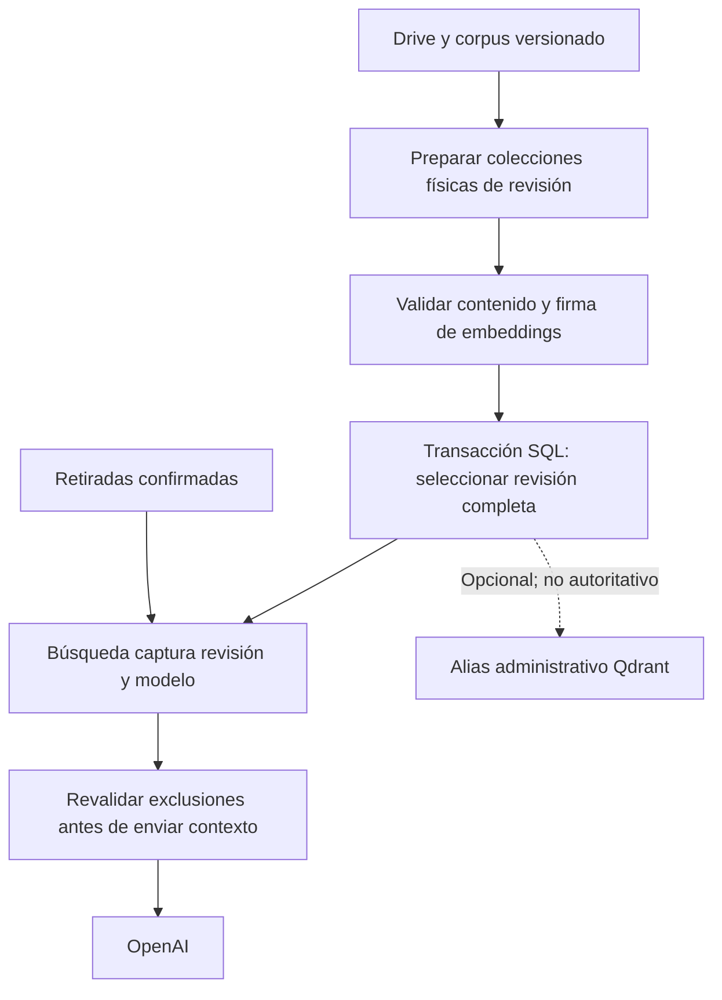
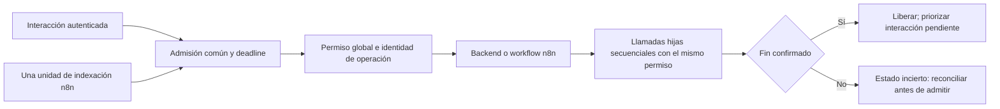

# Auditoría final de las decisiones de desarrollo con Docker

Esta referencia conserva las alternativas, riesgos, fuentes y justificaciones que sustentan el sistema. Sus conclusiones se concretan en el [contrato vigente](contrato-desarrollo-docker.md) y los [ADRs](../project/adrs/README.md).

Para consultar lo incorporado al código, las verificaciones y los límites actuales, usar el [estado del entorno](../project/estado-desarrollo-docker.md). Los pendientes que aparecen en el informe original corresponden a su fecha de investigación; las decisiones vigentes están en [D01–D26](../project/decisiones-desarrollo-docker.md).

## Investigación y evidencia conservadas

El contenido original permanece completo, incluidas las opciones retiradas y el motivo de su sustitución.

Leer el informe original y todas sus referencias

Los textos siguientes conservan el contexto de su elaboración. Sus pendientes y expresiones de futuro describen esa revisión histórica; el estado vigente es el indicado arriba. No son instrucciones actuales de ejecución.

# Auditoría final de las decisiones de desarrollo con Docker

> Cierre posterior, 18 de octubre: el usuario encargó terminar la definición. H01–H12 quedan concretados en el [contrato v1](contrato-desarrollo-docker.md); configuración manual y pruebas se difieren. El dictamen siguiente conserva el estado de la auditoría antes de ese cierre y no sustituye el contrato.

- Fecha: **18 de octubre de 2026**.
- Base de código: `8de71f5`; se conservan los cambios documentales locales.
- Estado: **auditoría de planificación; sin implementación ni pruebas del stack**.
- Alcance: D01–D26, acuerdos adicionales, recomendaciones I01–I10, ADR 0007/0008 y parámetros pequeños registrados. No se audita un despliegue de producción inexistente.
- Registro canónico: [planificación](../project/decisiones-desarrollo-docker.md). Ante una recomendación previa incompatible con este informe, prevalece la corrección aquí identificada como propuesta; ninguna se convierte en decisión del usuario por publicarla.

## Dictamen

La orientación principal es razonable para CyberSim: Docker de desarrollo, PostgreSQL existente, n8n, Piper y Qdrant locales, OpenAI/Drive/SMTP externos y datos funcionales con Prisma. **La planificación todavía no debe presentarse como contrato completo listo para ejecutar sin interpretación.** Hay inconsistencias de integración y garantías que necesitan una definición concreta.

La investigación no justifica volver a IA local, sustituir Drive/SMTP, añadir otra base de desarrollo o implantar una plataforma distribuida. Sí justifica precisar autoridad de revisiones, concurrencia/cancelación, bootstrap, identidad de sesiones y comportamiento tras reset. La revisión de fuentes no demuestra memoria, latencia, calidad o compatibilidad real.

Se usan estos veredictos:

- **M — Mantener:** razón válida en este contexto, con aceptación futura cuando corresponda.
- **C — Corregir o precisar:** la intención se conserva, pero la formulación/mecanismo admite un fallo.
- **V — Validar:** candidato o cifra sin prueba; su justificación no es un benchmark.
- **R — Retirado:** propuesta anterior sustituida, no recuperarla al implementar.

Las referencias [S01](#s01)–[S64](#s64) están al final. Son fuentes primarias de mantenedores y publicaciones de autores con experiencia documentada, no una votación de «seniors». Cuando una elección es preferencia del usuario —por ejemplo Drive o voz local— no se transforma en error porque otro equipo use otra tecnología. Lo que se audita es si puede cumplirse y qué coste tiene.

P1 identifica mecanismos que deben resolverse en el contrato para evitar pérdida de coherencia, acceso indebido o trabajo externo fuera de control. P2 identifica integración, configuración y aceptación que también deben definirse. Son prioridades de esta planificación, no puntuaciones de vulnerabilidad ni afirmaciones de explotación observada.

## Evidencia revisada y límites

Se releyeron [Compose](../../compose.yaml), [Prisma config](../../apps/backend/prisma.config.ts), [schema](../../apps/backend/prisma/schema.prisma), [seed](../../apps/backend/prisma/seed.ts), [Vite](../../apps/frontend/vite.config.ts), [arranque Express](../../apps/backend/src/server.ts), [chat controller](../../apps/backend/src/chat/infrastructure/controllers/ChatController.ts), [cliente chat](../../apps/frontend/src/chat/infrastructure/repositories/HttpChatRepository.ts), [repositorio tutor](../../apps/backend/src/chat/infrastructure/repositories/NativeChatRepository.ts), [Qdrant](../../apps/backend/src/chat/infrastructure/services/QdrantService.ts), [GPT](../../apps/backend/src/chat/infrastructure/services/GPTService.ts), [Piper](../../apps/backend/src/chat/infrastructure/services/PiperTTSService.ts), [generador](../../apps/backend/src/agent-malvado/infrastructure/controllers/ScenarioBuilderController.ts), [correo](../../apps/backend/src/auth/infrastructure/service/EmailService.ts), [registro](../../apps/backend/src/auth/application/useCases/RegisterEstudianteUseCase.ts) y [recuperación](../../apps/backend/src/auth/application/useCases/SolicitudCambioContraseniaUseCase.ts).

Se volvió a inventariar estructura de los cinco exports ignorados de `workspace/n8n`, sin imprimir credenciales ni IDs privados. Los dos nodos PostgreSQL activos del análisis emplean parámetros separados: **no se atribuye inyección SQL a esos nodos sin evidencia**. Persisten Gemini/Ollama/Redis y extracción PDF en la muestra; importar los JSON no implementa lo acordado.

No se inspeccionó de nuevo el motor Docker ni el volumen, no se inició PostgreSQL, no se accedió al corpus privado, no se envió correo ni se llamó a modelos. Se buscó documentación actual y se abrieron las páginas utilizadas; docs actuales pueden describir capacidades posteriores a una versión candidata. Una release publicada no acredita la disponibilidad de su imagen/digest ni la interoperabilidad de paquetes.

## Hallazgos que cambian o completan la planificación

### H01 — P1: dos autoridades para la revisión de conocimiento

**Debilidad:** el diseño anterior cambiaba aliases Qdrant y después confirmaba un manifiesto SQL. Son dos almacenes: si el proceso cae entre las escrituras, cada uno puede señalar una revisión diferente. También una consulta puede generar embeddings antes de un cambio de modelo y buscar después sobre otro índice. La atomicidad del alias se limita a las acciones Qdrant [[S31](#s31), [S32](#s32), [S11](#s11)].

**Corrección recomendada:** conservar colecciones físicas inmutables por revisión, verificarlas antes de publicar y usar **el manifiesto PostgreSQL como única autoridad funcional**: su transacción selecciona de una vez el conjunto de colecciones y firma de embeddings. Cada búsqueda captura esa revisión y consulta sus nombres físicos con el modelo/dimensión correspondientes. Los aliases son opcionales para administración, no un segundo criterio de disponibilidad. Esto es una inferencia de diseño para CyberSim, no una capacidad distribuida automática de Qdrant.

Las retiradas confirmadas se aplican independientemente de la revisión, antes de recuperar y antes de enviar contexto al modelo. No se puede retirar información ya enviada a un proveedor ni borrar una respuesta ya vista. La limpieza no elimina revisiones que todavía usan consultas activas. La reversión también respeta retiradas y firma compatible.

**Antes de implementar:** fijar este protocolo y propietario único de publicación. **Prueba después:** crash en cada frontera, cambio de modelo durante búsqueda, retirada durante staging y consulta concurrente.

### H02 — P1: el turno global no se obtiene con una variable n8n ni abortando fetch

El límite nativo n8n no abarca IA directa del backend, manuales y subworkflows. Un flujo de fondo bloqueado esperando permiso puede además ocupar el único slot que necesita la interacción. Un timeout HTTP no acredita finalización de la ejecución n8n/Piper/proveedor [[S18](#s18), [S24](#s24), [S48](#s48), [S49](#s49)].

**Recomendación:** mantener D23, definir una identidad y admisión comunes, registrar estado funcional y verificar cada llamada hija. La interacción no vuelve a adquirir el permiso que ya tiene su operación; sus llamadas son secuenciales. La indexación pide permiso por unidad, no por inventario completo. Desactivar retries de nodos/SDK/cliente para interacción, no solo los del frontend.

La garantía controlable es la **admisión y ejecución coordinada de trabajo por CyberSim**, con estado incierto que impide admitir más inferencias cuando no se conoce la finalización. No prometer exactamente una ejecución remota ni cancelación de OpenAI por cerrar la conexión. D23 no requiere implantar una cola genérica/replay. Las ejecuciones manuales incluidas deben seguir el contrato; un workflow arbitrario creado fuera de él no queda mágicamente controlado.

**Antes de implementar:** fijar quién concede el permiso, cómo lo propagan nodos/herramientas y cómo se resuelve `incierta`; si se necesita un adaptador de transporte común, delimitarlo sin trasladar la lógica de n8n. **Prueba después:** hot reload, timeout con ejecución viva, tercera petición, trabajo hijo y fallo de conexión.

### H03 — P1: falta una barrera explícita para resultados posteriores a un reset

Tras D26, el reset elimina también metadatos funcionales, pero Qdrant/n8n sobreviven. UUID nuevos por operación, identidad de instalación/revisión y rechazo de callbacks desconocidos son necesarios; la ausencia de tablas/filas no significa «todo vacío y seguro» [[S10](#s10), [S11](#s11), [S49](#s49)].

**Recomendación:** detener admisión y sincronización antes del reset manual previsto, confirmar lo activo y reanudar solo tras reconciliar. Un reset ejecutado directamente sin preparación produce estado no validado: no usar los aliases conservados ni aceptar una respuesta antigua como operación nueva. El comando Prisma no coordina n8n por sí solo. No restaurar datos educativos ni repetir IA automáticamente para “recuperar”.

Especificar este contrato es un cierre de planificación; demostrarlo sobre una base de prueba es una aceptación de implementación. D15 conserva el SQLite n8n, no la validez de trabajos educativos anteriores.

### H04 — P1: el generador puede salir a un servidor no elegido por el usuario

**Hecho del código:** `ScenarioBuilderController` utiliza un webhook externo de respaldo si falta `N8N_SCENARIO_WEBHOOK_URL`. Eso puede hacer que una preparación incompleta parezca funcional y envíe el prompt fuera del n8n local. No se contactó ese servidor.

**Corrección recomendada:** configuración requerida, URL interna explícita y error de preparación al faltar. No fallback silencioso a proveedores/instancias distintos. Revisar también que los JSON adaptados no conserven URLs, proveedores o IDs del equipo anterior. La dependencia de OpenAI/Drive/SMTP está aceptada; ese webhook adicional no [[S12](#s12), [S20](#s20), [S36](#s36)].

Cerrar configuración antes de implementar y probar con la variable ausente, dirección inválida y respuestas no conformes.

### H05 — P1: aislamiento de sesiones y control de gasto sin identidad suficiente

El chat acepta un `sessionId` del cliente, permite borrar sesiones y consultar estadísticas sin middleware de identidad en ese router. El generador tampoco aplica ese middleware en su controlador. El cliente chat solo envía Content-Type. No hay que presentar «sesiones separadas» como garantía ya lograda [[S35](#s35), [S36](#s36)].

**Recomendación:** vincular la sesión a identidad autorizada por el servidor y validar propiedad en envío/borrado; controlar acceso a generación y limitar administración. Un ID aleatorio y publicar solo en loopback no sustituyen esa autorización. Cambiar DTO/cliente y probar dos usuarios; evitar una reescritura completa de autenticación.

**Cierre de alcance necesario:** esta corrección concreta no estaba enumerada en D12. Incluirla expresamente en el contrato o registrar una excepción consciente; no implementarla silenciosamente ni afirmar que la planificación garantiza aislamiento sin ella.

### H06 — P1: la entrega de texto depende de reservar tiempo y controlar el trabajo de voz

La implementación espera a Piper después de guardar historial. Si el modelo consume casi 120 s, no quedan 15 s completos; si se devuelve texto tras abortar HTTP, la síntesis CPU puede seguir activa. El servidor Piper 1.8.0 tiene además rutas de descarga/selección de voces, no solo una API mínima de síntesis [[S44](#s44), [S45](#s45)].

**Corrección:** usar el tiempo restante con margen de respuesta y cero audio cuando no alcance; conservar el texto exactamente una vez. Fijar una voz permitida y no exponer/proxificar rutas de descarga o permitir cualquier voz del cliente. El modelo/voz se preparan antes y el servicio local no descarga durante una respuesta. Controlar terminación de síntesis con un proceso/worker supervisado si el HTTP oficial no ofrece el contrato necesario.

Ese mecanismo debe seleccionarse antes de codificar el adaptador; el plazo 15 s en CPU y la voz elegida se validan después. No atribuir cancelación efectiva al servidor Flask por haber abortado fetch.

### H07 — P2: la preparación completa y “un comando” tienen fronteras distintas

Compose no concede OAuth, no conoce secretos ni demuestra entrega SMTP. Su `--wait` espera estado de servicios e implica modo detached; no es la prueba funcional del producto [[S05](#s05), [S06](#s06), [S30](#s30), [S47](#s47), [S58](#s58), [S60](#s60)].

**Recomendación:** un comando cotidiano después de preparar credenciales y consentimientos. En el primer uso, n8n y la pantalla/diagnóstico de preparación deben estar accesibles mientras se completa el alta. Evitar dependencias circulares backend→preparador→backend o impedir abrir n8n hasta que OAuth ya exista. Proponer diagrama de arranque antes de implementar: DB/migración → backend de preparación + n8n → tareas funcionales → listo. Los procesos vivos no equivalen a disponibilidad completa.

La aceptación real se ejecuta explícitamente; no enviar correo ni ejecutar 30 casos pagados en cada healthcheck. Las evidencias se invalidan por cambios relevantes de configuración/contrato, sin exigir la batería entera en cada guardado de CSS. Conservar D08 y estados degradados D20/D24.

### H08 — P2: reutilizar PostgreSQL exige verificar autenticación, no solo el puerto

La imagen oficial aplica variables de inicialización y scripts solo al directorio vacío. Cambiar `POSTGRES_PASSWORD` no cambia la contraseña ya existente. `pg_isready` puede indicar servidor disponible sin usuario/clave/base correctos [[S09](#s09), [S58](#s58)].

**Recomendación:** comprobar nombre/major del volumen y conexión autenticada al destino real antes de migrar. No ejecutar scripts initdb como mecanismo para actualizar el volumen reutilizado; usar migraciones. Si la conexión falla, diagnosticar; no resetear por defecto ni contactar una BD externa alternativa.

El nombre de volumen explícito sin external permite crear/reutilizar pero no lo protege de `down -v`; documentar esa propiedad y probar labels/proyecto. No prometer simultáneamente creación automática y protección absoluta frente al borrado de Docker [[S07](#s07), [S08](#s08)].

### H09 — P2: cambios de schema/lockfile no equivalen a hot reload

Watch sincroniza fuentes o reconstruye servicios; no se debe asumir que cada rebuild vuelve a ejecutar un servicio one-shot de migración ya completado. Código nuevo con cliente o esquema viejo puede fallar mientras el puerto sigue sano [[S03](#s03), [S04](#s04), [S06](#s06), [S10](#s10)].

**Recomendación:** código normal usa Watch; dependencias y cambios de schema/migraciones tienen una operación explícita de mantenimiento que pausa admisión, genera cliente/aplica SQL revisado y verifica compatibilidad antes de reanudar. No aplicar migraciones destructivas al guardar. Las herramientas que generan SQL/lockfile montan las rutas de salida al host; Watch no sincroniza en sentido inverso.

La incidencia Compose 13717 se usa como caso original a contrastar, no como prueba de que falle nuestra versión. Probar altas, renombres, borrados, cambios con Watch parado y reanudación sin fuentes obsoletas [[S61](#s61)].

### H10 — P2: Drive común no implica consistencia inmediata ni autorización permanente

Las respuestas de listado pueden requerir más páginas, advertir búsqueda incompleta y cambiar mientras se pagina. Un 404 puede indicar inexistencia o acceso insuficiente; errores 403 también requieren interpretar su causa. OAuth External/Testing puede caducar en siete días [[S25](#s25)–[S29](#s29)].

**Recomendación:** no inferir bajas de una ronda fallida; confirmar sobre documento previamente conocido y origen accesible, distinguir error global de cambio individual y revalidar revisión al descargar. Registrar última ronda completa, pendientes y fallos. El scope readonly no se limita a la carpeta seleccionada; aplicar filtro y permisos reales. La carpeta común evita IDs por desarrollador, no la autorización individual.

Testing es una opción inicial, no solución para “no configurar a cada rato”. Antes de cerrar preparación debe constar el estado del cliente del equipo y sus restricciones; publicar una app o cambiar scopes no se hace automáticamente. Sin acceso al corpus real, recursión, shortcuts y tamaños siguen siendo propuestas de alcance, no garantías.

### H11 — P2: corpus autorizado, citas y datos enviados al proveedor no están suficientemente definidos

TXT/Markdown sigue siendo contenido no confiable: puede incluir instrucciones que intenten alterar un agente. El corpus común no vuelve seguros sus textos ni convierte un score alto en contexto suficiente. Además, “historial temporal” local no equivale a ausencia de retención en OpenAI; Responses tiene opciones de almacenamiento propias [[S34](#s34), [S39](#s39)–[S42](#s42)].

**Recomendación:** contexto delimitado como datos, herramientas permitidas y validación determinista; referencias de documento/revisión en respuestas para poder comprobarlas. No dar SQL/HTTP arbitrario al modelo ni usar n8n como vía de búsqueda que omita retiradas. Minimizar datos educativos enviados —agregados o IDs seudónimos cuando basten— y usar `store:false` y ninguna conversación remota persistente cuando el endpoint lo admita. Esto no promete Zero Data Retention ni cambia las políticas del proveedor.

La suficiencia RAG se calibra con preguntas positivas/negativas y corpus inicial: mantener D19, sin bloquear por un umbral universal inventado ni contestar de conocimiento general si falla recuperación.

### H12 — P2: errores y limpieza pueden ocultar fallos aunque la infraestructura funcione

Se confirmó un desajuste concreto: el correo de recuperación dice **24 horas**, pero el caso de uso emite el token por **1 hora**. El registro de estudiante captura fallos SMTP y devuelve el estudiante creado; recuperar contraseña sí informa el fallo. Una prueba que solo comprueba HTTP 2xx no prueba entrega.

**Recomendación:** respetar registro ya creado y permitir reenvío con estado explícito, sin duplicar cuentas; alinear plantilla con expiración y verificar el enlace real. Mantener TLS y SMTP externo. `verify()` acredita conexión/autenticación, no aceptación del remitente ni recepción final [[S47](#s47)].

La retención n8n de 72 h/1.000 ejecuciones es un punto inicial: anotadas y ejecuciones activas no siguen el mismo pruning; SQLite puede reutilizar espacio sin reducir archivo. “Solo errores” tampoco garantiza que sus payloads no contengan datos sensibles. Logs y conservación de ejecuciones se revisan por separado [[S22](#s22), [S55](#s55)].

## Auditoría de cada decisión aceptada

En esta tabla, M/C/V califica la planificación y no cambia por sí sola una elección del usuario. Las cifras son objetivos, no resultados. Las referencias enlazan al catálogo de fuentes.

| ID | Elección y razón de origen | Contraste y debilidad | Dictamen / cierre necesario |
|---|---|---|---|
| D01 | Windows 11, 16 GB, sin GPU; objetivo Docker 8 GB para accesibilidad | [S01](#s01)/[S02](#s02): límites y WSL ayudan, no sustituyen medición; CPU/disco no definidos y navegador 3D también consume host | V: medir frío/caliente/build/indexación/verificación; no certificar todos los equipos con 16 GB |
| D02 | OpenAI para conservar IA sin instalar modelo de chat local | [S37](#s37)–[S43](#s43): modelos/API son configurables; acceso, retención y coste no se heredan de tener ChatGPT | M/C: proveedor mantenido; contrato de datos/API y presupuesto pendientes |
| D03 | n8n para conservar edición visual y workflows | [S15](#s15)/[S17](#s17)/[S18](#s18): viable, añade persistencia/administración; exports no son integración completa | M: conservar lógica; no duplicar el motor en backend |
| D04 | Reutilizar volumen y permitir reset manual para preservar trabajo actual sin bloquear desarrollo | [S07](#s07)–[S10](#s10)/[S58](#s58): credenciales existentes, labels, versión y migraciones importan | M/C: H03/H08; nunca reset automático |
| D05 | Editor Windows y fuentes reflejadas en Docker por comodidad ya conocida | [S01](#s01)/[S03](#s03)/[S50](#s50): Watch es candidato; bind mount/polling tiene costes | M/V: matriz exacta de rutas, salidas al host y pruebas de eventos |
| D06 | JSON en Git y actualización explícita para revisar sin sobrescribir ediciones | [S19](#s19)–[S21](#s21): compatible; ownership, IDs, credenciales y publicación requieren tratamiento | M/C: manifiesto completo, backup privado y actualización sin ejecuciones activas |
| D07 | Descargas iniciales admitidas; offline sustituido por proveedores externos | [S05](#s05)/[S12](#s12)/[S25](#s25)/[S45](#s45): descarga y dependencia runtime son distintas | M: documentar tres salidas externas aceptadas y voz preparada; H04 evita cuarta salida oculta |
| D08 | Preparación completa antes de anunciar listo | [S06](#s06)/[S47](#s47)/[S58](#s58)/[S60](#s60): proceso sano no prueba función | M/C: H07; definir estados y evitar bucle de bootstrap |
| D09 | Chat 120 s, audio 15 dentro, análisis/generación 300; 1 activa/1 esperando | [S18](#s18)/[S24](#s24)/[S48](#s48): objetivos válidos, timeout no implica cancelación | C/V: H02/H06; cola consume presupuesto propuesto, no duración garantizada |
| D10 | TXT/Markdown para evitar PDF/OCR | [S34](#s34)/[S59](#s59): formato simple reduce dependencias, no elimina datos malformados/instrucciones | M: validar UTF-8, tamaño, contenido y ruta estructurada JSON separada |
| D11 | Drive y sincronización n8n independiente de reinicios | [S27](#s27)–[S30](#s30): inventario/reconciliación necesarios; notificación no equivale a estado completo | M/C: H10; no depender exclusivamente de evento nuevo |
| D12 | Incluir bloqueos concretos de URLs, análisis, audio y validación | Evidencia de código y [S36](#s36)/[S40](#s40)/[S47](#s47)/[S50](#s50): contenedores solos no corrigen contratos | M/C: lista cerrada de correcciones; H04/H05/H12 deben figurar expresamente |
| D13 | Un .env privado raíz para facilitar configuración | [S51](#s51) y controles por servicio: VITE expone variables, .env no cifra Docker ni el disco | M/C: proyección selectiva, exclusiones de build y respaldo/rotación fuera de Git |
| D14 | Piper local para conservar voz sin API externa | [S44](#s44)–[S46](#s46): contrato oficial distinto, timeout y licencia/voz a validar | M/C/V: H06; no asumir que ya hay servidor compatible |
| D15 | SQLite persistido propio n8n y clave estable para no perder credenciales en reset | [S15](#s15)–[S17](#s17)/[S22](#s22): soporte oficial, backup incluye DB y clave | M: mantener; un runner no es otro escritor de SQLite ni un cluster |
| D16 | Carpeta común para evitar configuración y conocimiento distinto por dev | [S26](#s26)–[S29](#s29)/[S34](#s34): permisos y rondas locales pueden divergir | M/C: mostrar revisión/origen, fuente común no garantiza respuestas idénticas |
| D17 | OAuth de equipo con autorización individual para Mi unidad personal | [S25](#s25)/[S26](#s26)/[S30](#s30): flujo documentado, Testing tiene caducidad y scopes amplios | M/C: mantener mecanismo, cerrar estado cliente/reautorización sin compartir tokens |
| D18 | Retirada automática confirmada para no responder con material retirado | [S28](#s28)/[S34](#s34): distinguir falta de acceso, errores y permisos | M/C: H01/H10; retirar de todas las vías, no solo tutor |
| D19 | Recuperación sana y suficiente para tutor, sin fallback general | [S34](#s34)/[S39](#s39)/[S41](#s41): grounding requiere corpus/evaluación, similitud no es certeza | M/V: H11; mensajes técnicos e insuficiencia distintos |
| D20 | Texto conservado si voz falla tras preparación | [S44](#s44)/[S45](#s45)/[S48](#s48): degradación razonable, requiere tiempo restante y estado UI | M/C: H06; texto único y no reintentar IA |
| D21 | Escenarios independientes para eliminar memoria Redis compartida | [S24](#s24)/[S40](#s40)/[S42](#s42) y export con clave =1: identifica una mezcla evitable | M: quitar memoria; no conversation_id/previous_response_id entre solicitudes |
| D22 | Historial temporal y aviso al perderlo para acotar alcance | [S35](#s35)/[S42](#s42): temporalidad no significa anonimato ni aislamiento por sí sola | M/C: H05/H11; señal de reinicio y propiedad de sesión; no nueva persistencia de chat |
| D23 | Un turno global y prioridad al usuario para controlar recursos | [S18](#s18)/[S24](#s24)/[S48](#s48)/[S49](#s49): n8n limit=1 no basta y puede bloquearse | C: H02; describir admisión, hijos, manuales, estados inciertos y starvation |
| D24 | Último índice validado con aviso si Drive falla después de listo | [S28](#s28)/[S32](#s32)/[S34](#s34): tolerancia útil, no permite revocaciones conocidas ni modelo incompatible | M/C: H01/H10; aviso y revisión/fecha, sin caducidad automática no elegida |
| D25 | SMTP externo existente para conservar envío real | [S47](#s47): compatible; configuración, remitente y entrega son comprobaciones distintas | M/C: H12; credenciales y destinatario explícito en verificación |
| D26 | Estado funcional estable entre entornos, sin base especial de desarrollo | [S10](#s10)–[S14](#s14): migraciones compartidas coherentes; no elimina tareas locales ni obliga a compartir datos | M: retirar cybersim_dev_control, mantener ADR 0008 como propuesta concreta |

## Inventario de recomendaciones pequeñas

Cada fila separa elección, motivo, riesgo y recomendación. Se incluyen cifras de la investigación anterior aunque no estén aceptadas. **V significa propuesta que debe medirse, no parámetro impuesto por una fuente.** Las recomendaciones nuevas de esta auditoría se identifican por H01–H12 y no añaden decisiones D sin respuesta humana.

### Alcance, arranque y recuperación

| ID | Elección o propuesta | Razón | Dictamen | Debilidad o acción necesaria | Fuentes |
|---|---|---|---|---|---|
| A001 | Solo desarrollo Docker | Concentrar trabajo en incorporación y edición | M | Conservar contrato funcional portable D26; no diseñar despliegue productivo. | [S12](#s12)/[S13](#s13) |
| A002 | Un comando cotidiano | Reducir pasos manuales repetidos | C | No incluye inventar secretos/consentimiento; detallar primera preparación H07. | [S05](#s05)/[S30](#s30) |
| A003 | docker compose up --build --watch | Construir y vigilar desde la raíz | M/V | Modo adjunto; comprobar comportamiento al detener y reanudar. | [S03](#s03)/[S05](#s05) |
| A004 | No combinar --wait como aceptación funcional | Evitar falso listo por puertos | M | --wait implica detached; readiness propia y verificación separadas. | [S05](#s05)/[S60](#s60) |
| A005 | Etapas en vez de sleep fijo | Esperar condiciones reales | M | Evitar ciclos; fallos con etapa, causa y operación siguiente. | [S06](#s06)/[S48](#s48) |
| A006 | Backend de preparación antes de listo | Terminar OAuth/corpus sin bloqueo circular | C | Distinguir proceso vivo de admisión de funciones; H07. | [S06](#s06)/[S60](#s60) |
| A007 | Aviso de descarga/build tras 20 min | Visibilidad durante descarga inicial | V | No es timeout de red universal ni promesa temporal. | [S02](#s02)/[S53](#s53) |
| A008 | 120 s por servicio local | Acotar espera tras tener imágenes | V | Conservar diagnóstico de OOM/IO; no reinicio infinito. | [S02](#s02)/[S06](#s06) |
| A009 | 180 s por migración/seed | Detectar preparación atascada | V | No matar SQL arbitrariamente y asumir rollback completo; comprobar estado. | [S10](#s10)/[S11](#s11) |
| A010 | 300 s de descarga de voz | Acotar intento y comprobar integridad | V | Reanudar fuera de chat; no duplicar archivos de descarga parcial. | [S44](#s44)/[S45](#s45) |
| A011 | Espera humana fuera de deadline IA | OAuth puede requerir intervención | M | Estado requiere_configuracion y URL concreta, sin falso listo. | [S25](#s25)/[S30](#s30) |
| A012 | 60 s por unidad de indexación | Ceder turno tras trabajo pequeño | V | Timeout no prueba que proveedor terminó; estado incierto H02. | [S24](#s24)/[S48](#s48) |
| A013 | 15 min por intento inicial de indexación | No ocultar preparación eterna | V | Conservar avance confirmado; no repetir embeddings sin revisar estado. | [S48](#s48)/[S49](#s49) |
| A014 | 120 s objetivo de arranque caliente | Expectativa de uso cotidiano | V | Medir sin descargas/cambios de corpus; no garantía general. | [S01](#s01)/[S06](#s06) |
| A015 | Preparación repetible | Recuperar interrupciones | M | Comprobar estado real; artefactos locales no son autoridad funcional. | [S10](#s10)/[S13](#s13) |
| A016 | Verificación explícita mediante perfil verify | Separar efectos reales del healthcheck | M/V | Servicio/comando todavía no existen; limpiar fixtures sin borrar trabajo. | [S05](#s05)/[S60](#s60) |
| A017 | Acta con huellas sin secretos | Saber qué se validó | C | Definir invalidación relevante; no repetir todos los envíos/IA tras CSS. | [S41](#s41)/[S60](#s60) |

### PostgreSQL, Prisma y datos iniciales

| ID | Elección o propuesta | Razón | Dictamen | Debilidad o acción necesaria | Fuentes |
|---|---|---|---|---|---|
| A018 | Reutilizar cybersim_postgres_data | Conservar volumen elegido | M/C | Revalidar existencia, PG_VERSION y credenciales sin imprimirlas. | [S07](#s07)/[S09](#s09) |
| A019 | Nombre explícito de volumen sin external | Crear o reutilizar mediante un comando | C | No protege de down -v; comprobar labels y nombre real H08. | [S07](#s07)/[S08](#s08) |
| A020 | No reset automático | Preservar datos y decisión humana | M | Fallar con diagnóstico; reset solo manual en desarrollo. | [S10](#s10) |
| A021 | Mantener major PostgreSQL 15 | No montar datos existentes con major incompatible | M/V | Pin de parche e imagen requiere comprobar volumen y release. | [S09](#s09) |
| A022 | DIRECT_URL y DATABASE_URL mismo destino | CLI y runtime no deben operar bases distintas | M | Comparar host/base/schema efectivos sin claves; shadow DB independiente. | [S10](#s10) |
| A023 | Aplicar migrate deploy al preparar | Usar SQL versionado sin prompt destructivo | M/C | No detecta todo drift ni genera cliente; comprobar estructura requerida. | [S10](#s10) |
| A024 | migrate dev solo explícito | Generar migraciones durante edición | M | Salida SQL al host; no ejecutarlo al guardar schema. | [S10](#s10) |
| A025 | Cliente Prisma como etapa separada | Código generado coherente con schema | M | No confundir generate con migrar ni con conexión validada. | [S10](#s10) |
| A026 | No DDL ad hoc al iniciar API | Una fuente de estructura | M | Versionar índices/constraints/grants que formen parte del contrato. | [S10](#s10)/[S14](#s14) |
| A027 | Seed transaccional y repetible | Completar faltantes sin duplicados | M/C | Hash fuera de transacción; no mantener SQL abierto esperando SMTP/IA. | [S11](#s11) |
| A028 | Un preparador de seed | Evitar carreras | M | Constraints y exclusión efectiva; no solo archivo marcador. | [S11](#s11)/[S49](#s49) |
| A029 | Conservar contraseñas y nombres existentes | No deshacer trabajo al reiniciar | M | No upsert update indiscriminado; colisión de rol produce diagnóstico. | [S11](#s11) |
| A030 | Conservar expiración de curso editada | No reactivar accesos sin querer | M | Crear valores iniciales solo al crear fixture; no renovar en cada arranque. | [S11](#s11) |
| A031 | No añadir otro progreso en cada seed | No fabricar intentos educativos | C | Detectar fixture existente sin imponer unicidad alumno/slug que impediría intentos reales. | [S11](#s11) |
| A032 | Estado funcional en base CyberSim | Un ciclo Prisma y D26 | M/C | Modelos mínimos propuestos; sin tabla genérica de todo Docker. | [S10](#s10)/[S12](#s12)/[S14](#s14) |
| A033 | documento_conocimiento | Identidad, hashes y retiradas | M/V | Definir claves/encoding y propietario, no guardar secretos OAuth. | [S11](#s11)/[S34](#s34) |
| A034 | revision_indice_conocimiento | Firma de embeddings y publicación | C | Única autoridad SQL; nombres físicos por revisión H01. | [S11](#s11)/[S31](#s31)/[S32](#s32) |
| A035 | operacion_integracion | Correlación y efectos idempotentes | M/C | No otra cola completa; UUID/estado incierto y límites de retención. | [S18](#s18)/[S49](#s49) |
| A036 | Reset también borra metadatos funcionales | Ciclo de vida coherente con la aplicación | M/C | Reconciliación y barrera para resultados antiguos H03; no prueba runtime actual. | [S10](#s10)/[S49](#s49) |
| A037 | No restaurar usuarios desde n8n | Mantener autoridad de datos educativos | M | Reset no autoriza replay de operaciones antiguas ni seed automático de Prisma v7. | [S10](#s10) |

### n8n, workflows y secretos

| ID | Elección o propuesta | Razón | Dictamen | Debilidad o acción necesaria | Fuentes |
|---|---|---|---|---|---|
| A038 | n8n una instancia regular | Menos servicios y complejidad | M | No crear workers/Redis sin necesidad; control global aparte. | [S15](#s15)/[S18](#s18) |
| A039 | SQLite n8n en volumen privado | Persistencia independiente de Prisma | M | Backup consistente y clave de cifrado por instancia. | [S15](#s15)/[S16](#s16) |
| A040 | Clave cifrado n8n estable | Conservar credenciales tras reinicio | M | No regenerarla por fallo OAuth; DB sin clave no es recuperación completa. | [S16](#s16) |
| A041 | Runner externo misma versión | Separar ejecución Code de n8n con secretos | M/V | No montar DB/clave ni todo .env; medir costo y paquetes permitidos. | [S17](#s17) |
| A042 | Runner JS únicamente necesario | Exports usan Code JS | M/V | No exigir Python por omisión; no worker Redis ni segundo n8n. | [S17](#s17) |
| A043 | Primera importación por manifiesto | Clon nuevo recibe piezas obligatorias | C | Verificar cada ID/versión; no saltar todo porque ya existe un workflow. | [S19](#s19)/[S20](#s20) |
| A044 | Publicación tras importación | Webhooks disponibles | M/C | Importar no equivale a publicar; CLI puede exigir reinicio H07. | [S19](#s19) |
| A045 | JSON en Git sin secretos | Revisión de cambios compartidos | M/C | Sanear headers, nombres privados, datos fijados, conexiones y destinos. | [S20](#s20) |
| A046 | Actualizar workflows explícitamente | Conservar edición visual local | M | Con copia previa, diff y ausencia de trabajo activo; D06. | [S19](#s19)/[S21](#s21) |
| A047 | Export explícito al host | Commit revisable sin automatizar Git | M | No exportar credenciales descifradas ni dejar secretos temporales en repo. | [S19](#s19)/[S20](#s20) |
| A048 | IDs y rutas estables | Enlazar backend/workflow/credenciales | M/C | Detectar colisiones, ownership/proyecto y referencias faltantes. | [S19](#s19)/[S20](#s20) |
| A049 | Owner n8n inicial | Acceso administrativo soportado | C | Configurar una vez; no depender de endpoint privado o owner preexistente. | [S19](#s19)/[S30](#s30) |
| A050 | .env único privado | Configuración sencilla | M/C | Proyección por servicio; no copia al frontend/imagen ni impresión con compose config. | [S51](#s51)/[S54](#s54) |
| A051 | Credenciales bootstrap temporales | Crear referencias locales n8n | C | Importar con servidor/DB coordinados, archivos privados y limpieza; no overwrite en reinicio. | [S16](#s16)/[S19](#s19) |
| A052 | Secretos por entorno y desarrollador | Revocación y separación de datos | M | No compartir tokens personales; elegir canal privado existente, no inventar Vault obligatorio. | [S12](#s12)/[S16](#s16) |
| A053 | No fallback a webhook externo | Respetar entorno local elegido | C | Eliminar respaldo observado y validar variable obligatoria H04. | [S20](#s20)/[S36](#s36) |
| A054 | No Gemini ni Ollama de exports | Unificar proveedor OpenAI acordado | M/C | Adaptar modelos y embeddings, no solo sustituir una URL. | [S24](#s24)/[S39](#s39) |
| A055 | No memoria Redis global =1 | Generación independiente | M | Retirar nodo/conexión; no instalar Redis por una memoria descartada. | [S18](#s18)/[S24](#s24) |

### Google Drive, corpus y publicación

| ID | Elección o propuesta | Razón | Dictamen | Debilidad o acción necesaria | Fuentes |
|---|---|---|---|---|---|
| A056 | Carpeta común de desarrollo | Evitar orígenes distintos por dev | M/C | Configurar ID no secreto y ACL; no cambios de Drive desde indexación. | [S26](#s26)/[S27](#s27) |
| A057 | OAuth equipo, consentimiento individual | No crear cliente por desarrollador | M | Conservar tokens locales cifrados y acceso individual al origen. | [S25](#s25)/[S30](#s30) |
| A058 | External/Testing inicial | Preparación simple para equipo conocido | C | Expira hasta 7 días en caso documentado; cerrar estado real del cliente H10. | [S25](#s25) |
| A059 | Callback localhost:5678 exacto | Retorno al navegador del desarrollador | M/V | Protocolo/host/puerto iguales al cliente; no usar hostname Docker. | [S30](#s30) |
| A060 | drive.readonly si compatible | No escribir en Drive | M/C | Alcanza archivos accesibles por cuenta, no solo carpeta; no confundir drive.file. | [S26](#s26) |
| A061 | Inventario periódico 60 s | Recuperar apagados y documentos previos | M/V | Paginación/errores, cuotas por dev y ronda sin solaparse; no descargar sin cambios. | [S27](#s27)/[S29](#s29) |
| A062 | Carpeta sin recursión ni shortcuts | Acotar rutas inicialmente | V | No elegido expresamente; validar organización real sin excluir material silenciosamente. | [S27](#s27)/[S34](#s34) |
| A063 | TXT/Markdown UTF-8 | Evitar extractores PDF/OCR | M | Rechazar vacío, binario, encoding inválido y tamaño excesivo; extensión no basta. | [S34](#s34) |
| A064 | 1 MiB por archivo | Acotar trabajo y memoria | V | No fuente universal; corpus real puede exigir ajuste o aviso. | [S59](#s59) |
| A065 | 50 MiB de corpus activo | Acotar escala inicial | V | Presupuestar vectores, payloads y revisiones además del texto. | [S02](#s02)/[S33](#s33) |
| A066 | Corpus mínimo versionado | Clon no exige documentos privados | M/C | Contenido real de proyecto, licencia/procedencia y preguntas de referencia. | [S34](#s34)/[S41](#s41) |
| A067 | JSON de topologías/desafíos desde código | Conservar catálogo estructurado común | M/C | Ruta canónica única y contrato validado; no pasarlo como TXT arbitrario. | [S40](#s40) |
| A068 | Identidad drive:fileId | No depender de nombre editable | M | Registrar origen y revisiones, no imprimir IDs privados en logs generales. | [S27](#s27)/[S29](#s29) |
| A069 | Hash contenido+pipeline+modelo | No recomputar sin cambio semántico de procesamiento | M/C | Normalización versionada; no mezclar modelos por igual dimensión. | [S32](#s32)/[S39](#s39) |
| A070 | Unidades hasta 8 chunks o 4.000 tokens | Ceder turno global con trabajo pequeño | V | Se aplica el menor límite; plazo/picos se miden. | [S24](#s24)/[S48](#s48) |
| A071 | IDs deterministas por revisión/posición | Repetición de escrituras sin duplicados | M/C | Hash/unique y confirmación; idempotencia SQL no evita cobro remoto. | [S49](#s49) |
| A072 | Colecciones físicas de preparación | No exponer revisión parcial | M | Una preparación a la vez; validación antes de marcar disponible. | [S31](#s31)/[S32](#s32) |
| A073 | Copiar vectores sin cambios | Reducir nuevas llamadas embeddings | M/V | Comprobar firma/hash; copia y disco no son gratis. | [S32](#s32)/[S33](#s33) |
| A074 | Aliases como autoridad de publicación | Cambio atómico dentro de Qdrant | C | Retirar esa autoridad doble; SQL selecciona revisión física completa H01. | [S11](#s11)/[S31](#s31) |
| A075 | Manifiesto SQL único y nombres físicos | Unificar revisión/embedding en cada búsqueda | C | Nueva corrección propuesta H01; probar carreras, cache y recuperación. | [S11](#s11)/[S32](#s32) |
| A076 | Activa + anterior autorizada + staging | Recuperación con almacenamiento acotado | M/V | Tres copias temporales; no eliminar revisión en uso ni revivir retiradas. | [S32](#s32)/[S33](#s33) |
| A077 | Retirada lógica antes de GC | No recuperar contenido retirado | M/C | Aplicar a tutor y agente; revalidar antes de enviar contexto, H01/H10. | [S28](#s28)/[S34](#s34) |
| A078 | No baja masiva por error de inventario | Evitar purga por red/OAuth | M | incompleteSearch, nextPageToken y causa HTTP se comprueban. | [S27](#s27)/[S28](#s28) |
| A079 | Último índice válido sin caducidad por fallo Drive | Continuidad aceptada | M/C | Fecha/revisión/aviso; no superar retirada confirmada ni firma incompatible. | [S32](#s32)/[S34](#s34) |
| A080 | Nueva colección al cambiar embeddings | Evitar vectores incompatibles | M | Pruebas de recuperación y modelo por revisión; no cambiar solo dimensión. | [S32](#s32)/[S39](#s39) |
| A081 | Una ruta controlada de recuperación | No omitir permisos/retiradas mediante herramientas | C | Modificar conexión Qdrant directa del agente o aplicar mismo contrato; H01/H11. | [S34](#s34)/[S36](#s36) |

### IA, memoria, entradas y audio

| ID | Elección o propuesta | Razón | Dictamen | Debilidad o acción necesaria | Fuentes |
|---|---|---|---|---|---|
| A082 | Luna none para tutor/feedback | Candidato eficiente por función | V | Acceso real y eval español; no recomendación garantizada ni migración ya aprobada. | [S37](#s37)/[S41](#s41) |
| A083 | Sol low para análisis/escenarios | Candidato para restricciones complejas | V | Tools requieren Responses; probar n8n+modelo+schema juntos. | [S38](#s38)/[S24](#s24) |
| A084 | text-embedding-3-small a 1536 | Default común y coste bajo propuesto | M/V | Mismo modelo/dimensión/texto backend+n8n; evaluar pertinencia. | [S39](#s39) |
| A085 | No cambio automático a modelo caro | Evitar gasto/repetición ocultos | M | Error explícito, nueva solicitud humana cuando corresponda. | [S43](#s43)/[S48](#s48) |
| A086 | No herramientas alojadas web/file search | Mantener corpus Qdrant local | M | Allowlist de herramientas del agente; no habilitar las externas por default. | [S24](#s24)/[S34](#s34) |
| A087 | store:false y sin conversación remota persistente | Respetar temporalidad/independencia | C | No equivale a Zero Data Retention; comprobar parámetro en nodo/endpoint. | [S42](#s42) |
| A088 | Tokens/duración/coste estimado por función | Observar sin guardar contenido sensible | M/C | Precios fechados y consumo real; no presupuesto mensual inventado. | [S41](#s41)/[S43](#s43) |
| A089 | Presupuesto y avisos de proyecto | Control de gasto externo | V | Importe no elegido; límite duro no instantáneo y aviso no bloquea. | [S43](#s43) |
| A090 | 30 casos: 10 tutor,5 feedback,5 análisis,10 escenarios | Primer conjunto de evaluación manejable | V | No certifica toda generación; ampliar con errores/casos límite descubiertos. | [S41](#s41) |
| A091 | Schema estricto + validación semántica | Evitar JSON inválido/escenario imposible | M | Rechazo/truncamiento/error distintos; no confiar solo en parser. | [S40](#s40) |
| A092 | Sin reparación IA automática | Respetar no retry y plazo/coste | M | No añadir loops de agente ilimitados; herramientas también tienen máximo. | [S24](#s24)/[S40](#s40)/[S48](#s48) |
| A093 | 16 KiB y 2.000 tokens por entrada | Acotar transporte e inferencia | V | Aplicar ambos; validar mensajes implícitos de contexto y prompt por defecto. | [S34](#s34)/[S36](#s36) |
| A094 | 12.000 tokens entrada tutor | Presupuestar prompt+contexto+historial | V | Contar envolturas reales y margen, no solo texto visible. | [S39](#s39)/[S41](#s41) |
| A095 | 24.000 tokens otras funciones | Acotar agregaciones y escenarios | V | No omitir alumnos; esquema/herramientas cuentan también. | [S40](#s40)/[S41](#s41) |
| A096 | Fragmento objetivo 500, max 800, solape 75 | Respetar estructura con fallback de tamaño | V | Medir relevancia; sin tamaño universal ni duplicación masiva por solape. | [S59](#s59) |
| A097 | Recuperar 20 candidatos, seleccionar hasta 8 | Equilibrar recall/contexto | V | Calibrar con corpus; no reutilizar score fijo como permiso de respuesta. | [S34](#s34)/[S41](#s41) |
| A098 | 4.000 tokens contexto | No inundar prompt | V | Seleccionar fuentes útiles y citas; insuficiencia exige mensaje D19. | [S34](#s34)/[S59](#s59) |
| A099 | Historial 20 mensajes/4.000 tokens | Acotar RAM y contexto | V | Pares coherentes; explicar recorte y no mezclar usuarios. | [S35](#s35)/[S41](#s41) |
| A100 | Inactividad 60 min, máximo 50 sesiones | Limitar crecimiento de RAM | V | Caducidad al acceder, no solo cada 30 min; propiedad y reinicio H05. | [S35](#s35) |
| A101 | 1.000 tokens salida tutor | Respuesta acotada compatible con voz | V | No garantía de calidad o síntesis en 15 s; texto íntegro. | [S40](#s40)/[S45](#s45) |
| A102 | 1.500 tokens feedback | Formato corto con cuatro campos | V | Comprobar necesidades reales y rechazo/incompleto. | [S40](#s40)/[S41](#s41) |
| A103 | 4.000 tokens análisis | Resumen docente acotado | V | Agregación exacta previa; razonamiento puede consumir presupuesto. | [S38](#s38)/[S40](#s40) |
| A104 | 8.000 tokens escenarios | JSON complejo sin recorte manual | V | Validar grafo y tamaño real; salida truncada se rechaza. | [S38](#s38)/[S40](#s40) |
| A105 | 256 KiB JSON escenario | Límite de transporte específico | V | No elevar límite de todo Express ni aceptar any sin validación. | [S36](#s36)/[S40](#s40) |
| A106 | Piper oficial 1.8.0 HTTP/WAV | Contrato verificable sin PHP heredado | M/V | Adaptador y cancelación supervisada por cerrar; H06. | [S44](#s44)/[S45](#s45) |
| A107 | Voz es_ES-davefx-medium | Candidata de un hablante | V | Escuchar/medir; no preferencia de género/acento aceptada. | [S46](#s46) |
| A108 | Revisión/checksum/licencias de voz | Preparación reproducible | M/V | No inferir licencia de todo el artefacto solo del dataset CC0. | [S46](#s46)/[S54](#s54) |
| A109 | 4.000 caracteres y 10 MiB WAV | Acotar síntesis y copias base64 | V | No se equipara a 15 s; rechazo con texto y aviso, sin truncar en silencio. | [S44](#s44)/[S45](#s45) |
| A110 | audio/wav y liberar Object URLs | Corregir MIME y recursos navegador | M | Contrato único y prueba reproducción/repetición. | [S45](#s45) |
| A111 | Reserva de plazo de respuesta | Texto antes del límite aunque falle voz | C | Min de 15 s y tiempo restante con margen; H06. | [S44](#s44)/[S48](#s48) |
| A112 | Cola cuenta en 120/300 s | Límite global comprensible | V | No aceptado aparte aún; una petición puede caducar esperando y no debe empezar luego. | [S48](#s48) |
| A113 | Feedback 120 s | Propuesta para plazo no definido | V | No atribuirlo al usuario; cerrar explícitamente en contrato. | [S24](#s24)/[S48](#s48) |
| A114 | Tercera petición 429 sin retry | Aplicar máximo una esperando | M/C | Cancelar espera al caducar/desconectar; no duplicar con botón UI. | [S18](#s18)/[S48](#s48) |

### Red, correo, herramientas y observabilidad

| ID | Elección o propuesta | Razón | Dictamen | Debilidad o acción necesaria | Fuentes |
|---|---|---|---|---|---|
| A115 | Frontend host 127.0.0.1:5173 | Acceso local desde navegador | M/V | Puerto propuesto, fallo claro si ocupado; no autorización por sí solo. | [S50](#s50)/[S36](#s36) |
| A116 | n8n host 127.0.0.1:5678 | Editor/OAuth local | M/V | Cookie/origen/callback compatibles; no publicar broker del runner. | [S17](#s17)/[S30](#s30) |
| A117 | API interna backend:3000 | Evitar puertos innecesarios | M/C | Proxy con contrato exacto de prefijos; no localhost interno H09. | [S50](#s50) |
| A118 | PostgreSQL/Qdrant/Piper internos | Reducir acceso del host y colisiones | M | Diagnóstico explícito si se necesita; no exponer credenciales al browser. | [S36](#s36) |
| A119 | Proxy /api con reescritura única | Un origen para navegador | C | Probar auth y /api/chat para evitar /api/api o perder prefijo. | [S50](#s50) |
| A120 | FRONTEND_URL navegador, no Docker | Enlaces de correo utilizables | M | URL acordada y verificación real de confirmación/recuperación. | [S47](#s47)/[S50](#s50) |
| A121 | SMTP 465 o 587 según proveedor | TLS y configuración externa vigente | M/V | No asumir puerto sin revisar proveedor; no desactivar certificados. | [S47](#s47) |
| A122 | SMTP conexión 10 s/socket 20 s | Evitar espera ilimitada de correo | V | También greeting/upgrade; no es plazo total universal. | [S47](#s47) |
| A123 | SMTP verify sin enviar | Chequeo repetible sin correo de prueba | M | No acredita remitente ni entrega; no falso éxito tras fallo H12. | [S47](#s47) |
| A124 | Destinatario de prueba explícito | Verificar enlaces/entrega | V | No elegido; no enviar en cada arranque ni usar destinatarios privados ajenos. | [S47](#s47) |
| A125 | Hot reload fuentes con Watch | Editar host con procesos Linux | M/V | Excluir node_modules,.git,.env,dist,generados; eventos y reanudación comprobados. | [S01](#s01)/[S03](#s03) |
| A126 | Rebuild ante manifiestos/lockfile | Dependencias reproducibles | M/C | Ambos workspaces y raíz; no carrera con npm install en herramientas. | [S03](#s03)/[S52](#s52) |
| A127 | npm ci desde raíz y cache BuildKit | Instalación congelada y rápida | M | npm ci no sirve para añadir paquetes; flags/npm deben coincidir. | [S52](#s52)/[S53](#s53) |
| A128 | Dependencias en imagen, no volumen mutable compartido | Evitar mezcla Windows/Linux y dos instaladores | M | No queda actualizado un volumen viejo por reconstruir imagen. | [S03](#s03)/[S52](#s52) |
| A129 | Tools con rutas de escritura al host | Conservar lockfile/SQL/exports generados | M/C | No sincronización inversa Watch; permisos/CRLF/case y rutas exactas. | [S03](#s03)/[S04](#s04) |
| A130 | Sin Dev Container obligatorio | Respetar editor Windows | M | Autocompletado necesita dependencias locales opcionales o conexión al contenedor. | [S01](#s01)/[S03](#s03) |
| A131 | Sin reset/db push al guardar schema | Evitar cambio destructivo implícito | M | Revisión y operación mantenimiento; nuevo cliente no prueba esquema compatible. | [S10](#s10) |
| A132 | Liveness/readiness/aceptación separadas | No ocultar integraciones ausentes | M/C | Corregir gpt:true/tts:true actuales que no prueban proveedor; H07. | [S58](#s58)/[S60](#s60) |
| A133 | Logging local 10 MiB x3 por servicio | Disco acotado para logs Docker | V | No controla tamaño de volúmenes ni ejecuciones n8n. | [S55](#s55) |
| A134 | n8n 72 h o 1.000 ejecuciones | Depuración sin crecimiento ilimitado | V | Excepciones activas/anotadas, pruning eventual y SQLite reuse H12. | [S22](#s22) |
| A135 | Guardar errores/manuales, no éxitos automáticos/progreso | Balance observabilidad/volumen | M/C | Payloads pueden contener datos; revisar filtrado y no confundir con logs. | [S22](#s22)/[S34](#s34) |
| A136 | Alertar disco a 5 GiB/pausar indexación a 2 GiB | Evitar escritura sin espacio | V | Medir volumen/WSL correcto y distinguir descarga/build de corpus. | [S02](#s02)/[S33](#s33) |
| A137 | Métricas sin prompts/tokens personales | Diagnóstico mínimo útil | M | No registrar texto de documento, secreto ni sessionId bruto. | [S34](#s34)/[S35](#s35) |
| A138 | Documentación en tres áreas y ADR en project | Continuidad humana/IA | M | Mantener propuestas distintas de implementación; no HUs artificiales. | [S14](#s14) |

### Recursos y versiones candidatas

| ID | Elección o propuesta | Razón | Dictamen | Debilidad o acción necesaria | Fuentes |
|---|---|---|---|---|---|
| A139 | PostgreSQL cap 768 MiB | Reparto inicial del objetivo 8 GiB | V | Medir conexiones/cache/migración; no convertir cap en requisito satisfecho. | [S02](#s02) |
| A140 | Qdrant cap 1.024 MiB | Acotar índice local | V | Cache mmap y tres revisiones; medir consultas/publicación y OOM. | [S02](#s02)/[S33](#s33) |
| A141 | n8n cap 1.536 MiB | Reservar margen a workflows | V | Ejecuciones y payloads reales; Node heap no es toda la memoria. | [S02](#s02)/[S22](#s22) |
| A142 | Runner cap 512 MiB | Code JS acotado | V | Verificar procesos e imports de runner fijado, no cap heredado a ciegas. | [S02](#s02)/[S17](#s17) |
| A143 | Backend cap 768 MiB | Control de RAM de API | V | Contexto, sesiones/base64 y GC bajo carga. | [S02](#s02) |
| A144 | Frontend cap 512 MiB | Servidor Vite acotado | V | HMR/build puede superar reposo; navegador es otro proceso. | [S02](#s02)/[S50](#s50) |
| A145 | Piper cap 1.024 MiB | Voz CPU con modelo cargado | V | Worker supervisado y picos de carga/reinicio medidos. | [S02](#s02)/[S44](#s44) |
| A146 | Preparador cap 256 MiB | Operaciones administrativas pequeñas | V | No ejecutar npm ci/build dentro de ese cap sin medir. | [S02](#s02)/[S53](#s53) |
| A147 | Caps suman 6.400 MiB; margen 1.792 | Intentar caber en 8.192 MiB WSL | V | BuildKit, daemon, navegador de tests y cache no quedan acreditados por esa suma. | [S01](#s01)/[S02](#s02) |
| A148 | Builds pesados serializados | Reducir pico simultáneo | C/V | Control de paralelismo Compose no prueba límite de BuildKit/npm; medir ambos. | [S02](#s02)/[S53](#s53)/[S62](#s62) |
| A149 | Node 24 LTS candidato 24.22.0 | Base mantenida y compatible con proyecto | V | Imagen real/digest y módulos nativos por comprobar; engine mínimo no es certificación. | [S56](#s56)/[S54](#s54) |
| A150 | Base Debian slim/glibc | Reducir sorpresas con dependencias nativas | V | No requisito absoluto de Prisma; verificar bcrypt y artefactos. | [S52](#s52)/[S54](#s54) |
| A151 | npm fijado junto a Node/lockfile | Reproducibilidad de instalación | M/V | No asumir versión de documentación latest ni actualizar lockfile sin querer. | [S52](#s52) |
| A152 | PostgreSQL 15.19 candidato | Parche de major ya utilizado | V | Versioning oficial respalda candidato; inspeccionar PG_VERSION e imagen antes de aplicarlo. | [S63](#s63)/[S09](#s09) |
| A153 | n8n 2.43.7 candidato | Stable publicada al investigar | V | No garantiza que exports antiguos funcionen; pin de imagen y prueba completa. | [S23](#s23) |
| A154 | Runner exactamente n8n 2.43.7 | Compatibilidad broker/runner | M/V | Comprobar tag/digest real; no mezclar major o minor por intuición. | [S17](#s17) |
| A155 | Qdrant 1.18.3 candidato/cliente 1.18.0 | Minimizar divergencia de línea | V | Número parecido no prueba compatibilidad ni mejor parche; revisar mantenimiento/seguridad antes de fijar. | [S57](#s57) |
| A156 | Piper 1.8.0 candidato | Contrato contrastado en tag | V | Paquetes Python/base/voz fijados; GPL y avisos se conservan. | [S44](#s44)/[S64](#s64) |
| A157 | Compose >=2.32.2 propuesto | Soportar acciones Watch usadas | V | Verificar features reales; mínimo no equivale a recomendación de instalar una versión antigua. | [S04](#s04) |
| A158 | Docker Desktop y WSL mantenidos | Correcciones de filesystem/recursos | M/V | Registrar versiones probadas, no descarga automática ni obligación de cambiar configuración host sin aviso. | [S01](#s01) |
| A159 | Digests y checksums | Build/voz repetibles | M/C | También impedir recibir parches: actualización revisada y periódica, no latest silencioso. | [S54](#s54) |
| A160 | Broker runner 5679 interno | Conectar sidecar sin publicar administración | M/V | Auth token independiente, alcance de red limitado y sin socket Docker. | [S17](#s17) |
| A161 | Piper 5000 interno | Contrato HTTP oficial | M/V | Solo rutas usadas/voz permitida; no endpoint público de descargas. | [S44](#s44)/[S45](#s45) |
| A162 | Tests integrados dentro del presupuesto | Acreditar objetivo de hardware | V | Medir también navegador headless/software rendering si corre en Docker; no asumir GPU. | [S01](#s01)/[S02](#s02) |

### Opciones descartadas que no deben reaparecer por omisión

| ID | Elección o propuesta | Razón | Dictamen | Debilidad o acción necesaria | Fuentes |
|---|---|---|---|---|---|
| A163 | cybersim_dev_control o simple renombrado | D26 corrige una persistencia especial | R | Estado funcional mínimo en base CyberSim/Prisma; sin crearla ni migrarla ahora. | [S10](#s10)/[S12](#s12)/[S14](#s14) |
| A164 | Modelo chat local/Ollama | Proveedor OpenAI elegido | R | Piper local sigue excepción expresa, no reinstalar Ollama desde exports. | [S24](#s24)/[S37](#s37) |
| A165 | Generación por catálogo fijo en vez de IA JSON | Usuario mantuvo enfoque de IA actual | R | Catálogo se recupera como contexto; validar salida no elimina generación. | [S40](#s40) |
| A166 | Mailpit/captura local de correo | Usuario eligió SMTP externo D25 | R | No introducir perfil de correo local por conveniencia de pruebas. | [S47](#s47) |
| A167 | Carpeta local vigilada cada 30 s | Usuario mantuvo Drive | R | Ronda Drive propuesta 60 s no revive un watcher local. | [S27](#s27)/[S29](#s29) |
| A168 | Importar workflows en cada arranque | D06 preserva edición local | R | Primera importación y actualizaciones explícitas con backup. | [S19](#s19)/[S21](#s21) |
| A169 | PDF/OCR para documentos adicionales | Alcance TXT/Markdown elegido | R | Rechazo claro y loader adaptado, no nodos PDF heredados. | [S34](#s34)/[S59](#s59) |
| A170 | Redis por memoria global de generador | D21 elimina memoria compartida | R | No seleccionar BullMQ/worker salvo requisito nuevo demostrado. | [S18](#s18) |
| A171 | Historial conversacional persistente | D22 eligió temporalidad | R | Registrar operaciones no guarda chat ni añade conversation_id remoto. | [S35](#s35)/[S42](#s42) |

## Cierre recomendado antes de implementar

La auditoría cubre **26 decisiones D y 171 elementos A**, incluidas propuestas retiradas. Los elementos A no son 171 decisiones adicionales del usuario ni una lista de preguntas que deba responder una por una. Son el inventario para evitar que al implementar se confundan acuerdos, recomendaciones y objetivos sin medir.

### Contratos que se deben resolver ahora

1. **Publicación del conocimiento:** adoptar o sustituir expresamente H01; fijar manifiesto autoritativo, firma de embeddings, nombres físicos, exclusiones y propietario. No mantener alias y SQL como autoridades independientes.
2. **Admisión y fin de operaciones:** fijar coordinador H02, identidad propagada, una interacción esperando, deadlines, estado incierto y barrera de reset H03. Decidir el transporte mínimo sin crear otra plataforma de trabajos.
3. **Preparación y mantenimiento:** dibujar el grafo sin ciclos H07; separar primer consentimiento de arranque cotidiano; fijar qué invalida evidencias. Cambios de schema/dependencias tienen mantenimiento explícito H09.
4. **Contrato HTTP y alcance de correcciones:** rutas internas y del navegador, configuración sin fallback H04, validación de respuestas y autorización H05. La corrección de identidad requiere incluirse expresamente en el alcance; las demás debilidades no autorizan una reescritura del producto.
5. **Voz y errores visibles:** seleccionar el mecanismo de síntesis/cancelación H06, reserva de tiempo, voz permitida y entrega del texto exactamente una vez. Alinear expiración y errores de correo H12.
6. **Accesos y datos:** confirmar estado del cliente OAuth del equipo, permisos/origen Drive y presupuesto/destinatario de validación externa. No enviar claves al chat. Declarar minimización y almacenamiento del proveedor H11.

Estas definiciones pueden presentarse como un contrato breve con diagramas y estados, apoyado en este inventario. No hace falta reabrir OpenAI, Drive, SMTP, SQLite n8n o D06. Las recomendaciones técnicas de esta auditoría siguen siendo propuestas hasta cerrar ese contrato.

### Diagramas propuestos para comprobar los límites

Publicación: preparar Qdrant no equivale a publicar; la única conmutación funcional propuesta está en SQL.

Admisión: un límite en cada servicio por separado no da el turno global D23.

Los diagramas muestran propuestas funcionales, no procesos existentes ni una selección final de librería/protocolo.

### Aceptación que corresponde a la implementación

No exigir estas pruebas como condición para comenzar a escribir código: se definen ahora y se ejecutan por hitos cuando exista el componente.

| Hito | Evidencia necesaria |
|---|---|
| Inicialización y persistencia | Instalación vacía de prueba y volumen reutilizado; conexión autenticada; migraciones/cliente; seed repetido sin sobrescribir datos; reinicio n8n con credenciales |
| Edición diaria | Altas/cambios/renombres/borrados, Watch detenido/reanudado, cambio de dependencia y schema; archivos generados conservados en host |
| Recorridos funcionales | Registro/confirmación/recuperación con destinatario autorizado; tutor con fuentes; feedback/análisis reales; escenario válido; WAV reproducible |
| Fallos y carreras | Tercera petición; timeout remoto todavía activo; hot reload; reset manual sobre base de prueba; callback viejo; crash de publicación; cambio de modelo; baja durante staging |
| Dependencias externas | OAuth inválido, inventario incompleto, rate limit, Qdrant caído, último índice válido con Drive caído y Piper fallido con texto conservado |
| Hardware y calidad | Medición en Windows 11/16 GB sin GPU con Docker objetivo 8 GB; picos de build/indexación/pruebas; latencias y eval español por función |

Las pruebas externas reales son explícitas y con coste/destinatario acordados. Healthchecks repetidos no envían correo ni realizan inferencias pagadas. Para cada hito se registran versiones, resultado y límites; mocks prueban contratos pero no sustituyen esta aceptación.

### Lo que todavía no puede afirmarse

- Que 8 GB basten, que Piper complete siempre en 15 s o que el arranque caliente tarde 120 s.
- Que los exports actuales funcionen sin adaptación, que el corpus privado quepa o que el score RAG elegido garantice pertinencia.
- Que fijar versiones elimine vulnerabilidades o acredite imágenes y compatibilidad.
- Que el cierre de HTTP cancele un proveedor, que exista ejecución exactamente una vez o que SQLite/volúmenes sean backups.
- Que la preparación de secretos/OAuth sea totalmente automática o que SMTP aceptado equivalga a entrega en bandeja.

## Fuentes consultadas

Consulta de documentación pública y código fuente versionado el 18 de octubre de 2026. Se priorizaron mantenedores y autores identificables. La incidencia de Compose es evidencia original de un caso, no un consenso ni prueba de fallo de nuestra futura versión. Las recomendaciones de diseño específicas son inferencias contrastadas con el código y los acuerdos de CyberSim.

- **S01** — [Docker WSL](https://docs.docker.com/desktop/features/wsl/best-practices/).

- **S02** — [Docker recursos](https://docs.docker.com/engine/containers/resource_constraints/).

- **S03** — [Docker Watch](https://docs.docker.com/compose/how-tos/file-watch/).

- **S04** — [Compose Develop](https://docs.docker.com/reference/compose-file/develop/).

- **S05** — [Compose up](https://docs.docker.com/reference/cli/docker/compose/up/).

- **S06** — [Orden Compose](https://docs.docker.com/compose/how-tos/startup-order/).

- **S07** — [Volúmenes Compose](https://docs.docker.com/reference/compose-file/volumes/).

- **S08** — [Compose down](https://docs.docker.com/reference/cli/docker/compose/down/).

- **S09** — [Imagen PostgreSQL, documentación mantenedores](https://github.com/docker-library/docs/blob/master/postgres/content.md).

- **S10** — [Prisma CLI v7](https://www.prisma.io/docs/orm/v7/reference/prisma-cli-reference).

- **S11** — [Prisma transacciones v7](https://www.prisma.io/docs/orm/v7/prisma-client/queries/transactions).

- **S12** — [Paridad Twelve-Factor](https://www.12factor.net/dev-prod-parity).

- **S13** — [Procesos administrativos Twelve-Factor](https://www.12factor.net/admin-processes).

- **S14** — [Sadalage/Fowler, Evolutionary Database Design](https://martinfowler.com/articles/evodb.html).

- **S15** — [n8n bases](https://docs.n8n.io/hosting/configuration/supported-databases-settings/).

- **S16** — [n8n clave cifrado](https://docs.n8n.io/hosting/configuration/configuration-examples/encryption-key/).

- **S17** — [n8n runner](https://docs.n8n.io/hosting/configuration/task-runners/).

- **S18** — [n8n concurrencia](https://docs.n8n.io/hosting/scaling/concurrency-control/).

- **S19** — [n8n CLI](https://docs.n8n.io/hosting/cli-commands/).

- **S20** — [n8n exportación](https://docs.n8n.io/workflows/export-import/).

- **S21** — [n8n source control](https://docs.n8n.io/source-control-environments/using/push-pull/).

- **S22** — [n8n pruning](https://docs.n8n.io/hosting/scaling/execution-data/).

- **S23** — [n8n Docker estable](https://docs.n8n.io/hosting/installation/docker/).

- **S24** — [n8n OpenAI](https://docs.n8n.io/integrations/builtin/cluster-nodes/sub-nodes/n8n-nodes-langchain.lmchatopenai/).

- **S25** — [Google OAuth expiración](https://developers.google.com/identity/protocols/oauth2).

- **S26** — [Google scopes Drive](https://developers.google.com/workspace/drive/api/guides/api-specific-auth).

- **S27** — [Google files.list v3](https://developers.google.com/workspace/drive/api/reference/rest/v3/files/list).

- **S28** — [Google errores Drive](https://developers.google.com/workspace/drive/api/guides/handle-errors).

- **S29** — [Google cambios Drive](https://developers.google.com/workspace/drive/api/guides/manage-changes).

- **S30** — [n8n OAuth Google](https://docs.n8n.io/integrations/builtin/credentials/google/oauth-single-service/).

- **S31** — [Qdrant aliases](https://qdrant.tech/documentation/manage-data/collections/).

- **S32** — [Qdrant migración embeddings](https://qdrant.tech/documentation/tutorials-operations/embedding-model-migration/).

- **S33** — [Qdrant storage](https://qdrant.tech/documentation/manage-data/storage/).

- **S34** — [OWASP RAG](https://cheatsheetseries.owasp.org/cheatsheets/RAG_Security_Cheat_Sheet.html).

- **S35** — [OWASP sesiones](https://cheatsheetseries.owasp.org/cheatsheets/Session_Management_Cheat_Sheet.html).

- **S36** — [OWASP REST](https://cheatsheetseries.owasp.org/cheatsheets/REST_Security_Cheat_Sheet.html).

- **S37** — [OpenAI Luna](https://developers.openai.com/api/docs/models/gpt-6-luna).

- **S38** — [OpenAI Sol](https://developers.openai.com/api/docs/models/gpt-6.1-sol).

- **S39** — [OpenAI embeddings](https://developers.openai.com/api/docs/guides/embeddings).

- **S40** — [OpenAI Structured Outputs](https://developers.openai.com/api/docs/guides/structured-outputs).

- **S41** — [OpenAI evaluación](https://developers.openai.com/api/docs/guides/evaluation-best-practices).

- **S42** — [OpenAI datos](https://developers.openai.com/api/docs/guides/your-data).

- **S43** — [OpenAI gasto](https://developers.openai.com/api/docs/guides/spend-limits).

- **S44** — [Piper HTTP source 1.8.0](https://raw.githubusercontent.com/OHF-Voice/piper1-gpl/v1.8.0/src/piper/http_server.py).

- **S45** — [Piper HTTP docs 1.8.0](https://raw.githubusercontent.com/OHF-Voice/piper1-gpl/v1.8.0/docs/API_HTTP.md).

- **S46** — [Voz davefx, model card](https://huggingface.co/rhasspy/piper-voices/blob/main/es/es_ES/davefx/medium/MODEL_CARD).

- **S47** — [Nodemailer SMTP](https://nodemailer.com/smtp).

- **S48** — [AWS timeouts/reintentos](https://aws.amazon.com/builders-library/timeouts-retries-and-backoff-with-jitter/).

- **S49** — [AWS idempotencia](https://aws.amazon.com/builders-library/making-retries-safe-with-idempotent-APIs/).

- **S50** — [Vite servidor](https://vite.dev/config/server-options).

- **S51** — [Vite variables](https://vite.dev/guide/env-and-mode).

- **S52** — [npm ci v11](https://docs.npmjs.com/cli/v11/commands/npm-ci/).

- **S53** — [Docker cache](https://docs.docker.com/build/cache/optimize/).

- **S54** — [Docker imágenes/digests](https://docs.docker.com/build/building/best-practices/).

- **S55** — [Docker logging local](https://docs.docker.com/engine/logging/drivers/local/).

- **S56** — [Node releases](https://nodejs.org/en/about/previous-releases).

- **S57** — [Qdrant 1.18.3](https://github.com/qdrant/qdrant/releases/tag/v1.18.3).

- **S58** — [PostgreSQL pg_isready](https://www.postgresql.org/docs/15/app-pg-isready.html).

- **S59** — [Microsoft chunking](https://learn.microsoft.com/en-us/azure/architecture/ai-ml/guide/rag/rag-chunking-phase).

- **S60** — [Google SRE monitorización](https://sre.google/sre-book/monitoring-distributed-systems/).

- **S61** — [Compose issue 13717](https://github.com/docker/compose/issues/13717).

- **S62** — [Compose variables predefinidas](https://docs.docker.com/compose/how-tos/environment-variables/envvars/).

- **S63** — [PostgreSQL versiones soportadas](https://www.postgresql.org/support/versioning/).

- **S64** — [Piper origen/licencia](https://github.com/OHF-Voice/piper1-gpl).

## Verificación de esta entrega

Revisión documental y estática; no se iniciaron servicios ni se modificaron código, Compose, dependencias, datos o credenciales. Se verificaron 16 documentos locales modificados o nuevos y 192 enlaces locales, IDs D01–D26/A001–A171/S01–S64 ordenados y sin duplicados, referencias a fuentes, bloques y espacios. `git diff --check` pasó para los cambios rastreados; la revisión adicional incluyó archivos todavía no rastreados. La verificación de enlaces de código acredita rutas existentes, no ejecución correcta de esos recorridos.

