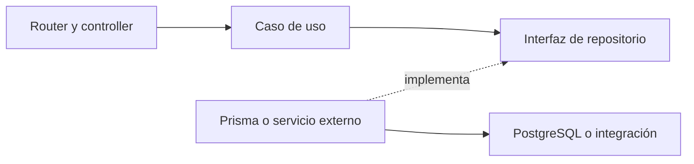

# Backend

> Actualización Docker del 18 de octubre de 2026: para composición, integraciones, permisos de IA y estado funcional actuales consultar [arquitectura Docker](desarrollo-docker.md), [contrato vigente](contrato-desarrollo-docker.md) y [evidencia](../project/estado-desarrollo-docker.md). El detalle siguiente conserva la revisión anterior donde no se ha sustituido expresamente; sus afirmaciones sobre puertos, rutas antiguas o servicios externos no prevalecen sobre esas referencias.

Express se inicia en [`src/server.ts`](../../apps/backend/src/server.ts), carga `dotenv/config`, configura CORS y parsers, monta routers y escucha en `0.0.0.0`, puerto `PORT` o `3000`. No sirve el frontend compilado.

## Organización y dependencias

La forma predominante es `domain/models`, `domain/repositories`, `application/useCases` e `infrastructure`. Los casos de uso reciben interfaces de repositorio; los adaptadores implementan persistencia o integración externa. Hay excepciones: controllers que consultan el repositorio directamente, dominio que importa la interfaz del servicio de correo desde infraestructura y composición al importar módulos. La separación es parcial, no una arquitectura hexagonal estricta.

| Módulo | Reglas y operaciones | Adaptadores |
|---|---|---|
| `auth` | Registro por rol, login, confirmación, recuperación, consultas docentes e intentos | Prisma, bcrypt, JWT y Nodemailer |
| `groups` | CRUD de curso, código, unión, retiro y expulsión | Prisma y generador de código |
| `chat` | Resolver mensaje/contexto, recuperar conocimiento, responder y generar audio | OpenAI, Qdrant, Piper y memoria local |
| `feedback` | Contar intentos, indicar habilitación, generar y guardar feedback | n8n y Prisma |
| `course-analysis` | Generar, guardar y recuperar el último análisis | n8n y Prisma |
| `agent-malvado` | Seleccionar prompt y solicitar una definición | n8n |

## Arranque

Al importar routers se construyen dependencias. `AuthController` exige JWT y configuración de correo; `FeedbackController` exige su webhook; `NativeChatRepository` crea GPT, Qdrant y Piper, que exigen sus variables. Una integración puede no usarse en la interfaz y aun así impedir el arranque si falta su configuración. Consultar [la matriz de variables](../guides/configuracion.md).

El cliente Prisma se genera en `src/generated/prisma`, no en un paquete compartido. La conexión de ejecución usa `DATABASE_URL` con `PrismaPg`; la CLI usa `DIRECT_URL` o, en su defecto, `DATABASE_URL`. En desarrollo se reutiliza una instancia global.

## Identidad

- Registro: valida dominio de correo y longitud mínima de ocho caracteres, comprueba correo/código único, hashea con bcrypt costo 10, crea identidad y luego perfil, genera token aleatorio de 32 bytes con vencimiento de 24 horas y solicita correo.
- Fallo de correo durante registro: se registra en consola y permite completar la operación; puede solicitarse reenvío.
- Login: compara bcrypt, busca profesor antes que estudiante y emite JWT de una hora con identificadores y rol. Devuelve `confirmado`; no rechaza una cuenta sin confirmar.
- Confirmación: comprueba token y expiración cuando existe, confirma identidad y limpia token de confirmación.
- Recuperación: exige cuenta confirmada para una identidad existente, crea token de una hora y envía correo. Cambio de contraseña acepta mínimo seis caracteres y limpia token de recuperación.
- Middleware JWT: valida firma y expiración, adjunta `req.user`. Solo está aplicado en `/auth/me` y `/auth/profesor/:id/estudiantes`; esta última ruta exige rol y coincidencia de profesor.

Crear identidad y perfil son operaciones separadas, sin transacción conjunta. El registro público de profesor no incluye aprobación institucional.

## Cursos e intentos

Crear un grupo crea `curso` y después un código de ocho caracteres alfanuméricos, válido por siete días. Regenerar lo reemplaza. Unión comprueba código, vencimiento y ausencia de cualquier matrícula del estudiante antes de crear una nueva. La comprobación y la inserción no son atómicas.

Expulsión compara el propietario del curso con `id_profesor` recibido en el body; ese valor no está autenticado. Retiro comprueba una matrícula existente. Borrar curso llama a Prisma directamente y puede fallar cuando existen matrículas por las claves foráneas `NoAction`.

Cada guardado de progreso inserta una fila. El resumen cuenta todos los intentos y marca completado si existe cualquier éxito. Sin registros devuelve `{ terminado: false, intentos: 0 }`, aunque el controller incluye una rama de 404 que ese repositorio normalmente no alcanza. El historial se ordena por `id_progreso` ascendente y enriquece el título mediante metadatos locales del backend.

## IA, errores y observabilidad

La generación de feedback cuenta intentos, llama n8n y guarda el resultado. La consulta de estado habilita si no hay feedback o hay intentos nuevos; `generate` no impone esa condición. El análisis de curso llama n8n y persiste usando el `id_curso` devuelto externamente, sin verificar coincidencia con la solicitud ni propiedad del curso.

Los controllers suelen devolver `{ success, data }` o `{ success: false, error }`, pero el chat, generador y algunas operaciones de grupos usan otras formas. Varios errores de infraestructura se devuelven como 400 o 500 con `err.message`; no hay clasificación central de errores, IDs de correlación ni métricas.

El manejador global de errores tiene tres parámetros y Express lo trata como middleware normal. Por tanto no captura de forma global los errores como su comentario sugiere. La mayoría de rutas usa `try/catch`, pero algunos catches solo responden si lo lanzado es `Error`. Ver [revisión](revision-del-sistema.md).

`GET /health` prueba que Express atiende, sin consultar PostgreSQL ni SMTP. La salud de chat comprueba Qdrant y declara GPT/TTS como `true` sin probarlos; la de análisis solo comprueba que exista una URL.

## Evidencia

- [AuthController](../../apps/backend/src/auth/infrastructure/controllers/AuthController.ts), [login](../../apps/backend/src/auth/application/useCases/LoginUseCase.ts) y [middleware](../../apps/backend/src/auth/infrastructure/middlewares/authMiddleware.ts).
- [Grupos](../../apps/backend/src/groups/infrastructure/controller/GroupsController.ts), [unión](../../apps/backend/src/groups/application/JoinGroupsUseCase.ts) y [repositorio de progreso](../../apps/backend/src/auth/infrastructure/repositories/PrismaProgresoRepository.ts).
- [Feedback](../../apps/backend/src/feedback/application/useCases/GenerateFeedbackUseCase.ts) y [análisis](../../apps/backend/src/course-analysis/application/useCases/GenerateCourseAnalysisUseCase.ts).
- [API HTTP](api-http.md), [modelo de datos](modelo-de-datos.md) y [seguridad](seguridad.md).
