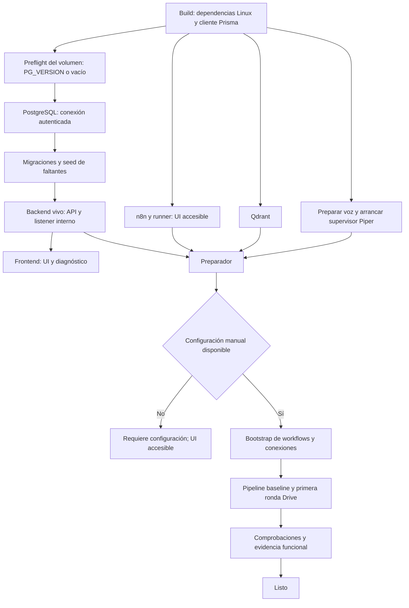

# Contrato técnico del entorno de desarrollo con Docker — v1

- Actualización: **18 de octubre de 2026**; contrastado con la implementación local del repositorio.
- Función: referencia del comportamiento exigido a los componentes y de sus invariantes. No es un plan de trabajo.
- Alcance: desarrollo; OpenAI, Google Drive y SMTP externos; n8n, PostgreSQL, Qdrant y Piper locales.
- Fundamento: [D01–D26](../project/decisiones-desarrollo-docker.md), [auditoría y fuentes](auditoria-desarrollo-docker.md) y [ADRs](../project/adrs/README.md).
- Lectura operativa: [arquitectura implementada](desarrollo-docker.md), [guía de ejecución](../guides/desarrollo-local.md) y [evidencia y límites](../project/estado-desarrollo-docker.md).

Los apartados C01–C12 conservan el detalle y las razones del contrato. «Debe» establece un requisito; no demuestra por sí solo que cada carrera, límite o integración externa esté validado. Las diferencias y comprobaciones pendientes se registran en el estado del entorno, sin presentarlas como decisiones de arquitectura todavía abiertas.

## C01 — Alcance, autoridad y cambios incluidos

El arranque cotidiano se realiza desde la raíz con **`docker compose up --build --watch`**, en modo adjunto. Requiere Docker Desktop con contenedores Linux/WSL y configuración privada inicial. Las fuentes se editan en Windows; Node/Prisma y herramientas de ejecución viven en contenedores. No se exige instalar Node en Windows ni usar Dev Container. El autocompletado del editor puede usar dependencias locales opcionales.

Servicios permanentes: frontend Vite, backend Express, PostgreSQL, Qdrant, n8n regular con SQLite, runner JS externo y Piper supervisado. Preparación y herramientas son procesos auxiliares. OpenAI, Google Drive y SMTP permanecen externos. No se añaden Ollama, Redis, Mailpit, OCR, una segunda base de aplicación ni una cola de trabajos nueva.

| Responsabilidad | Autoridad elegida |
|---|---|
| Identidad y datos educativos | Backend y PostgreSQL existente |
| Revisión publicada, exclusiones y firma de embeddings | Manifiesto funcional PostgreSQL, administrado por backend |
| Admisión de IA y transporte hacia OpenAI | Coordinador/adaptador del backend |
| Prompts, secuencia de feedback/análisis/generación e ingestión | Workflows n8n versionados |
| Configuración cifrada, OAuth y ejecuciones n8n | SQLite privado n8n y APIs soportadas |
| Vectores derivados | Colecciones físicas Qdrant por revisión |
| Historial de tutor | RAM por proceso y estado de UI; temporal |
| Cancelación de síntesis | Supervisor local de Piper |
| Preparación y evidencia de checks | Herramientas/artefactos; no autoridad sobre datos funcionales |

La lista de correcciones funcionales queda cerrada para este trabajo:

1. URLs/proxy, fechas y DTOs del análisis, MIME/audio y validación determinista de respuestas.
2. Eliminar el webhook externo de respaldo del generador y los proveedores/memorias heredados incompatibles.
3. Autorizar **tutor, generación, feedback y análisis**, con ownership de sus recursos; aislar sesiones y retirar estadísticas públicas. Actualizar sus consumidores frontend. Se preservan JWT y roles existentes.
4. Coordinar IA/revisiones/reset y comunicar degradación/contexto perdido sin respuestas inventadas.
5. Alinear recuperación de contraseña de una hora, estado de envío y reenvío de confirmación; alta de cuenta transaccional donde sea necesaria para no dejar identidad educativa parcial.
6. Reconstruir los workflows faltantes y el adaptador Piper dentro de estos contratos.

No se extiende esta fase a una reescritura global de autenticación, ranking, simulación, interfaz o despliegue de producción. El [ADR 0005](../project/adrs/0005-autorizacion-en-servidor.md) sigue siendo más amplio que este alcance. HUs vinculadas: HU001/HU003/HU005, HU020–HU025; no se crean historias artificiales para este documento.

## C02 — Persistencia funcional y PostgreSQL reutilizado

Se reutiliza **`cybersim_postgres_data`**, con nombre explícito y creación si falta; no se marca `external` para exigir creación manual. No se fija `container_name`. Se soporta una instancia de este entorno por equipo; el PostgreSQL elegido y puertos fijos no permiten prometer aislamiento entre clones simultáneos. Una colisión produce diagnóstico, nunca otro destino silencioso.

Antes de iniciar PostgreSQL, un preflight de solo lectura sobre el volumen comprueba PG_VERSION o directorio vacío; no necesita Docker socket. Major 15 se conserva si el volumen es 15; major distinto bloquea con diagnóstico. Compose comprueba pertenencia de recursos y el diagnóstico `status` del host inspecciona existencia/etiquetas con Docker CLI cuando haya conflicto; el preparador no obtiene acceso al daemon para esa inspección. Antes de migrar se comprueba conexión autenticada y destino de `DATABASE_URL`/`DIRECT_URL`. Cambiar variables de inicialización no cambia usuarios/contraseñas existentes. No se ejecuta reset, borrado de volumen, `db push` ni initdb sobre datos reutilizados. `down -v` puede borrar volúmenes y queda fuera del flujo normal.

Se usa la misma datasource/schema actual y un solo historial en [Prisma migrations](../../apps/backend/prisma/migrations). El esquema incorpora cuatro modelos funcionales, sin condicionar su creación a `NODE_ENV`:

| Modelo funcional | Campos/garantías mínimas |
|---|---|
| `coordinacion_integracion` | Singleton `id=1`; `installation_id` UUID; contador de generación; pausa; referencias activa/esperando; revisión publicada y versión de exclusiones. Referencias únicas y cambios transaccionales |
| `operacion_integracion` | UUID; instalación/generación; usuario o actor de sistema; clase; request ID; estado; deadline UTC; fase/child IDs; ejecución n8n; revisión capturada; timestamps; código de error y contadores de tokens. Unicidad instalación/actor/request ID |
| `documento_conocimiento` | Origen e ID estable únicos; revisión/hashes/firma de pipeline; estado válido/pendiente/retirado/rechazado; evidencia y fecha de retirada, última ronda completa |
| `revision_indice_conocimiento` | UUID; instalación; estado preparación/validada/publicada/retirada; cuatro nombres físicos; modelo/dimensión/pipeline; inventario/hash y comprobaciones; fecha de publicación |

La cuarta tabla concreta el estado funcional de admisión/publicación que los tres nombres iniciales no resolvían por sí solos. No registra etapas Docker. El backend es el único escritor de estas tablas. n8n usa HTTP interno y mantiene su motor; no recibe acceso al schema de CyberSim ni escribe sus propias tablas por SQL externo.

Admisión, publicación y confirmación de efectos toman `FOR UPDATE` sobre el singleton en una transacción corta; orden de locks: coordinación → operación/revisión → documentos, siempre igual. Timeout de adquisición 2 s, transacción local 5 s; fallo SQL previo al efecto puede reintentarse hasta dos veces dentro del deadline. Ninguna transacción queda abierta esperando HTTP, IA, SMTP o usuario. El bloqueo es arbitraje local, no cancelación remota. [Locks PostgreSQL](https://www.postgresql.org/docs/15/explicit-locking.html).

Migración y generación de cliente son etapas distintas. El seed completa fixtures faltantes en transacción, con hashes de contraseña calculados antes; conserva contraseña, nombre, expiración y progreso existentes. Colisiones de rol/código se diagnostican. No fuerza unicidad alumno/slug que impida intentos reales. Datos de demostración no son estructura obligatoria ni metadatos de conocimiento inventados.

## C03 — Turno global y transporte de IA

**Selección:** todas las llamadas OpenAI de los recorridos incluidos pasan por el adaptador del backend. n8n conserva la lógica mediante nodos HTTP/Code y herramientas permitidas; no realiza llamadas independientes con una clave OpenAI. Así no dependemos de que un nodo LangChain implemente headers/base URL/cancelación como una cola común.

La clave OpenAI se proyecta solo al backend. Se retira la propuesta de entregarla también a n8n para llamadas directas. Google OAuth queda en n8n. Esto mantiene D03: centralizar transporte, validación y admisión no traslada prompts ni decisiones del workflow a Express. El nodo [HTTP Request de n8n](https://docs.n8n.io/integrations/builtin/core-nodes/n8n-nodes-base.httprequest/) permite integrar contratos HTTP autenticados sin un community node nuevo.

### Admisión

1. Autenticar, validar entrada y ownership. Asignar `operationId` y `deadlineAt` desde recepción; registrar request ID del cliente para deduplicar, nunca como credencial.
2. En transacción: si no hay activa, ocupar turno; si hay activa y no hay interactiva esperando, guardar una espera; tercera interactiva → **429 QUEUE_FULL**. Una sesión no admite dos mensajes simultáneos.
3. La indexación reserva **una unidad de hasta 8 fragmentos o 4.000 tokens**, el menor límite. Si hay interacción esperando, recibe `yield` sin bloquear un worker n8n. Termina/cede; la ronda conserva progreso y continúa después.
4. Al liberar, promover la interacción pendiente vigente antes de otra unidad. Si caducó o se desconectó antes de empezar, cancelarla sin llamar al proveedor.
5. La operación padre conserva turno durante recuperación, llamadas hijas, validación/persistencia y voz. Las hijas usan su permiso; no vuelven a encolarse. Solo una hija activa.

El registro no es una cola con replay automático: las interacciones en espera no se reanudan tras reiniciar el proceso; se cancelan y la UI informa. Indexación pendiente sí continúa por unidades confirmadas. La prioridad continua del usuario puede retrasar sincronización; se muestra antigüedad, sin quitar prioridad ni prometer plazo de sincronización.

n8n permite dos ejecuciones de producción en paralelo: una interactiva y una reconciliación, con una sola reconciliación en curso. **Dos workflows vivos no significan dos inferencias.** No se usa límite n8n=1 para arbitrar D23; el permiso del backend controla todas las llamadas incluidas, también al ejecutar manualmente los workflows distribuidos. Un workflow arbitrario externo al contrato no queda cubierto.

### Transporte interno y seguridad

El backend tiene un listener **interno en 3001**, separado del API de navegador en 3000 y sin publicación al host. Vite nunca proxifica `/internal`. Contratos de referencia bajo `/internal/v1`:

| Operación interna | Responsabilidad |
|---|---|
| `index/reserve` | Obtener permiso de unidad o `yield`; validar workflow y revisión en preparación |
| `operations/{id}/attach` | Asociar una sola ejecución n8n al encargo esperado |
| `operations/{id}/model` | Llamada acotada de modelo; proveedor, modelo y herramientas fijados por clase |
| `operations/{id}/embeddings` | Lote con firma de revisión comprobada |
| `operations/{id}/retrieve` | Recuperación por revisión capturada y exclusiones vigentes |
| `operations/{id}/complete` | Resultado validable; escritura idempotente si sigue vigente |
| `knowledge/*` | Inventario, puntos, exclusiones y publicación validados; no HTTP/SQL arbitrario |
| `maintenance/*` | Pausa, reconciliación y diagnóstico; accesible solo por herramientas, con credencial distinta |

Hay claves distintas para backend→webhooks, n8n→listener y herramientas→mantenimiento. Un permiso firmado contiene instalación/generación, operación, clase, deadline y workflow permitido; no se entrega al navegador ni autoriza por sí solo mantenimiento. Cada hija tiene ID y número de secuencia; duplicado no ejecuta otra llamada, y el mismo ID con cuerpo diferente devuelve 409. Caducidad, firma o generación inválidas se rechazan. Secretos van en credenciales/headers, nunca query strings ni JSON versionado.

La operación de escenario admite hasta **3 rondas de modelo y 6 consultas de herramientas** en total, secuenciales, dentro de tokens/deadline. Continuar tras una herramienta es trabajo distinto, no reintentar una llamada fallida. Las únicas herramientas son recuperación de conocimiento/contexto/topologías/desafíos. No SQL generado, shell, HTTP arbitrario, web search o file search alojado. Feedback/análisis reciben un snapshot autorizado y agregado del backend; los nodos SQL heredados se sustituyen por ese contrato, no por consultas del modelo. Antes de persistir se revalida que cuenta, recurso y relación de propiedad sigan vigentes; una revocación no se ignora por haber empezado antes.

### Estados y resultados inciertos

`esperando → activa → completada | fallida | cancelada | incierta`. La operación activa registra sus fases e hija en vuelo antes del envío externo. Una respuesta de red terminada no prueba que una operación n8n padre haya terminado; se comprueban ambas capas antes de liberar.

- Desactivar retries interactivos en frontend, fetch/SDK, nodos y workflows. Ante 429/5xx/truncamiento se devuelve error; no fallback de modelo ni reparación IA.
- Deadline de UI: responder con error o con texto ya obtenido; no mantener la petición abierta indefinidamente.
- Si queda una llamada viva, el turno permanece ocupado hasta fin comprobado. Interacciones nuevas reciben 503 si el coordinador está incierto.
- Tras crash/hot reload con hija despachada sin cierre, marcar `incierta` y bloquear nueva admisión. No liberar por expiración de lease ni repetir el prompt.
- Reconciliación automática solo cierra si hay evidencia terminal ya disponible. Si no la hay, exige la operación explícita `integrations resolve-uncertain`: detener emisores n8n, confirmar que no hay transporte/worker local vivo y registrar quién reconoce la pérdida de confirmación remota. Incrementa generación, cancela esperas y no repite operaciones.

El último paso es una excepción operativa explícita, no demostración de que OpenAI haya detenido cálculo ni garantía de “exactamente una vez”. La garantía de D23 se refiere a **admisión y llamadas coordinadas de CyberSim**; no podemos certificar una única inferencia física remota tras perder confirmación. No se libera automáticamente mediante una espera arbitraria. [AWS: timeouts](https://aws.amazon.com/builders-library/timeouts-retries-and-backoff-with-jitter/), [idempotencia](https://aws.amazon.com/builders-library/making-retries-safe-with-idempotent-APIs/).

Cada request ID se conserva siete días tras cierre, sin cuerpos de chat, audio ni credenciales. La huella de cuerpo para detectar duplicados es HMAC con clave de servidor por instalación; no se almacena un hash público que facilite adivinar mensajes cortos. Para chat la repetición obtiene el resultado solo si sigue en la RAM de esa sesión; después devuelve 409 RESULT_NOT_REPLAYABLE y no vuelve a generar. Feedback/análisis apuntan al resultado persistido; escenarios se entregan sin añadir persistencia de partidas. Operaciones inciertas/activas no se purgan; después de siete días el cliente debe usar un ID nuevo y nunca reenvía automáticamente una petición antigua.

## C04 — Conocimiento, revisión única y retiradas

### Orígenes y carga reproducible

Se incorporarán `knowledge/base/` y `knowledge/app-context/` como corpus pequeño revisado/versionado, TXT/Markdown UTF-8. Serán rutas nuevas, no archivos ya presentes. Topologías/desafíos se generan desde [el catálogo de escenarios](../../apps/frontend/src/data/escenarios/registry.ts) mediante [el exportador existente](../../apps/frontend/scripts/export-rag-knowledge.ts), adaptado para no mantener una segunda lista manual de escenarios.

El baseline cubrirá cuatro temas usados por las prácticas: malware, firewall, VPN y firmas/criptografía, con objetivo educativo, explicación y ejemplo coherentes con los escenarios. El contexto de aplicación describe objetos consultables y límites del tutor desde sus definiciones versionadas. Cada documento incluye ID estable, procedencia de código/documentación del proyecto y revisión; su autoría no depende de descargar PDF privados ni copiar Drive a Git.

Salida canónica futura del exportador: `apps/frontend/scripts/rag-output/`. El script ya calcula esa ubicación desde su propio directorio; la copia raíz `scripts/rag-output` que aportó el usuario es material de referencia y no una segunda fuente activa. La implementación actualizará el catálogo/exportador y sus pruebas sin reescribir niveles.

n8n ejecuta el mismo pipeline para baseline versionado y Drive. Preparación proporciona a n8n un paquete local de solo lectura con hash/versión; el workflow inicia la carga sin esperar un evento Drive. El backend valida registros y escribe vectores/manifiestos mediante API interna. La periodicidad de Drive depende de n8n, no de reiniciar Express.

Drive usa una carpeta común en Mi unidad y consentimiento individual OAuth del equipo. Se procesa solo el nivel directo de esa carpeta; subcarpetas y shortcuts se enumeran y muestran como excluidos, sin recorrerlos silenciosamente. Solo TXT/Markdown; PDF y otros formatos generan aviso, no una extracción implícita. Documento vacío, binario, UTF-8 inválido o excesivo se rechaza con identidad/motivo visibles. Un documento modificado inválido deja de ser elegible; no se presenta su versión anterior como actual.

Se usa OAuth con `drive.readonly` mediante HTTP Request si la credencial especializada impide ese alcance. No se amplían scopes para hacer pasar un nodo. El scope puede abarcar otros archivos accesibles de la cuenta: el filtro de carpeta no es un límite OAuth. Estado Testing o publicado se muestra tal como esté configurado; este contrato **no exige publicar ni modificar Google Cloud ahora**. Un token Testing que caduque produce `requiere_configuracion`; se conserva el índice según D24 tras la preparación inicial.

### Inventario y confirmación de bajas

Ronda cada **60 s**, sin solapamiento; completar páginas incluso si una página viene vacía con `nextPageToken`. `incompleteSearch`, error de red, cuotas, OAuth y fallo de acceso a la carpeta invalidan la ronda: no incrementan confirmaciones ni purgan datos. Tras apagado se ejecuta inventario completo.

- `fileId` es identidad; renombrar no crea otro documento. Leer metadata antes/después de descargar; si versión/modifiedTime cambia, descartar esa descarga y dejar pendiente.
- Trash o salida de carpeta comprobados sobre archivo conocido, con origen accesible y ronda completa: retirada confirmada inmediata.
- Archivo ausente/404 o denegación individual de permisos: exigir **dos rondas completas separadas al menos 60 s**, carpeta accesible y comprobación individual coherente. Registrar pérdida de acceso, sin afirmar que se borró físicamente.
- 403 de cuota/scope global o 401 nunca confirma una baja. Si no se puede distinguir la causa, queda pendiente y se informa; no se interpreta toda la carpeta como vacía.
- Una nueva aparición posterior se valida/indexa como revisión nueva; la reversión de un manifiesto no anula una retirada registrada.

La retirada actualiza documento y contador de exclusiones en una transacción. Se comprueba al recuperar y justo antes de cada envío al modelo. Si ya se envió contexto, no se puede revocar ese envío; el resultado no se confirma como respaldado por una fuente retirada y se devuelve error sin regenerar. Se retiran puntos físicos de revisiones conservadas en una tarea posterior sin volverlos a autorizar por rollback.

### Publicación

Colecciones físicas `cs_<installation>_<revision>_<tipo>`, con tipos `conocimiento`, `contexto`, `topologias`, `desafios`. IDs se codifican a un formato permitido y estable; nunca nombres privados de Drive. Payload: documento/revisión/origen/hash/fragmento y texto o registro estructurado necesario, no tokens ni correos de alumnos.

1. Crear revisión `preparacion` ligada a instalación y firma: modelo, dimensión, normalización, chunker, esquema y hash de catálogo.
2. Copiar vectores sin cambios solo si coincide toda la firma y hash; generar lo nuevo por unidades con permiso. IDs UUID deterministas por documento/revisión/posición. Repetir upsert no significa que repetir embeddings sea gratis.
3. Validar cuatro colecciones, cantidades, payloads, exclusiones y preguntas locales de referencia. Conocimiento/contexto llevan chunks; topologías/desafíos mantienen JSON estructurado completo y su texto de búsqueda, sin fragmentar posiciones del escenario.
4. En transacción corta, comprobar instalación/revisión/exclusiones de nuevo, marcar revisión validada/publicada y actualizar puntero del singleton. Ese commit es **la única publicación funcional**.
5. Cada consulta captura revisión y firma antes de crear su embedding y usa nombres físicos. Un cambio posterior de puntero no cambia el modelo de esa consulta.
6. Mantener activa y una anterior autorizada, más una preparación. GC solo elimina cuando no hay operación vigente que referencie la revisión y se reconciliaron estados inciertos. No acumular una cuarta revisión: pausar nueva preparación hasta liberar espacio.

Aliases Qdrant son opcionales de administración; no intervienen en readiness ni selección funcional. Si Qdrant no corresponde al manifiesto, bloquear RAG; no adoptar aliases huérfanos. Un fallo antes del commit deja staging; después del commit la revisión publicada ya fue validada. Un cambio de modelo/dimensión crea una revisión completa y no reutiliza embeddings por tener igual dimensión. [Colecciones Qdrant](https://qdrant.tech/documentation/manage-data/collections/), [migración de embeddings](https://qdrant.tech/documentation/tutorials-operations/embedding-model-migration/).

### Recuperación suficiente y contenido no confiable

Tutor: fallo técnico → 503; búsqueda sana sin fuentes elegibles → respuesta de insuficiencia sin llamada generativa. Recuperar hasta 20 candidatos, máximo 8 chunks/4.000 tokens. Antes de responder, validación estructural de citas contra IDs devueltos; citas desconocidas o sin respaldo se rechazan sin reparación IA.

Se usa umbral por colección fijado con el conjunto de referencia, no 0,7 universal. La implementación entrega calibración versionada antes de habilitar RAG; usar un valor explícito inicial y ajustarlo es aceptación de calidad, no una pregunta de arquitectura pendiente. Un resultado por encima de umbral es candidato, no demostración semántica. El prompt permite abstenerse y las evaluaciones incluyen preguntas fuera del corpus.

La calibración requiere al menos cinco consultas positivas y cinco negativas por colección. Se prueba cada frontera entre scores observados y se elige el menor umbral que excluya todos los negativos de referencia y conserve al menos el 80 % de positivos; empate, mayor margen al negativo más cercano. Si no existe, la calibración falla y no se habilita esa recuperación ni se relaja silenciosamente el criterio. Se registran datos, firma y resultado; es un criterio inicial sobre esa muestra, no una tasa garantizada de acierto real.

El generador exige topologías/desafíos válidos y herramientas filtradas. Feedback/análisis usan solo datos autorizados del snapshot y corpus si su workflow lo necesita; no se les atribuye un diagnóstico académico objetivo por existir JSON válido. Contexto se trata como datos, no instrucciones; herramientas permitidas, sin ejecución de contenido. Referencias en respuestas identifican fuente/revisión sin exponer enlaces privados por defecto.

## C05 — Reinicios, reset y mantenimiento

- Arranque con singleton existente: conservar instalación y generación; reconciliar activa/espera antes de admitir. Hot reload no reconstruye automáticamente operaciones ni vacía el índice.
- Preparación de instalación nueva: crear singleton una vez tras migraciones. Si faltan metadatos pero n8n/Qdrant/artefactos conservan evidencia de otra instalación, bloquear para reconciliación; no tratarlo como primer clon vacío.
- Mantenimiento previsto: pausar admisión y nuevos inventarios/unidades; cancelar espera; dejar terminar activa dentro de su deadline. Si queda incierta, no avanzar con una migración/reset como si no hubiera trabajo.
- Reset: **solo manual del desarrollador**, sobre destino comprobado. La herramienta de mantenimiento no ejecuta `migrate reset` por iniciativa propia ni acepta un flag de reset implícito. El usuario puede ejecutar Prisma tras la pausa.
- Después: migraciones y cliente; instalación nueva si se borró el singleton; rechazar tokens/callbacks viejos en cada endpoint y commit; inventariar/reconstruir revisión desde baseline y Drive. Conservar credenciales/SQLite n8n y workflows locales.
- Reset directo sin pausa: el siguiente acceso detecta ausencia/cambio de instalación, invalida sesiones activas y bloquea efectos/IA nueva hasta reconciliar. No puede deshacer una petición ya enviada al proveedor.
- La reconciliación no restaura alumnos ni reproduce interacciones antiguas. Una operación sin registro o de otra generación nunca obtiene registro nuevo a partir de un callback.

Una base shadow para crear migraciones es separada, temporal/de herramientas y sin datos educativos; no es `cybersim_dev_control` ni una dependencia funcional adicional.

## C06 — Identidad, sesiones y API de navegador

JWT Bearer existente, HS256 explícito, firma/expiración/tipos de claims comprobados en runtime. Los nuevos tokens incluyen installationId y se rechazan tokens de otra instalación o sin ese claim: un reset puede reutilizar IDs numéricos y no debe volver válido el JWT de una cuenta anterior. Verificar en PostgreSQL que la cuenta existe, está confirmada y tiene la relación de rol esperada; no tomar IDs de usuario/profesor de body como autoridad. Se conserva duración de sesión de login de una hora; no se añade un sistema de refresh tokens. Tras introducir este contrato se requiere nuevo login para tokens previos.

| Recurso | Autorización de este trabajo |
|---|---|
| Tutor y generador | Estudiante o profesor confirmado |
| Feedback/status | Estudiante consulta/genera lo propio; ID incompatible se rechaza |
| Análisis/latest | Profesor propietario del curso; snapshot incluye matriculados sin intentos |
| Sesión de chat | Solo propietario autenticado; ajena o inexistente → 404 uniforme |
| Estadísticas detalladas/diagnóstico | Listener interno con credencial de mantenimiento; fuera del router público |
| Registro/login/confirmación/recuperación | Públicos por su función; sin otorgar acceso a IA por conocer un correo |
| Health mínimo | Sin datos de usuarios, sesiones, tokens o endpoints privados |

La API incorpora `POST /api/chat/session`: crea un UUID de servidor asociado en RAM a cuenta y `memoryEpoch` aleatorio por proceso. El body de chat envía sesión y epoch; no se adopta un ID libre como sesión nueva. Tras reinicio, caducidad o recarga sin memoria: **409 CONTEXT_LOST**, sin inferencia; UI muestra aviso, crea sesión nueva y conserva el borrador para envío explícito. No reenvía automáticamente el mensaje fallido.

Historial máximo 20 mensajes/4.000 tokens, 60 min inactivo, 50 sesiones globales y 3 por cuenta. Expiración al acceder; limpieza periódica cada 5 min. Al llegar al máximo, retirar sesión inactiva menos reciente, nunca una activa; si todas están ocupadas, devolver 429 SESSION_CAPACITY. El recorte conserva pares coherentes. Logout borra estado de navegador y solicita borrar la sesión propia cuando haya conexión; caducidad limpia el resto. No se persiste conversación ni se crea conversación remota.

Cada mensaje lleva request ID aleatorio; UI y servidor deduplican la confirmación y el par usuario/respuesta se guarda una vez si la operación sigue vigente. La entrega por red no se promete exactamente una vez; un resultado perdido no dispara otra inferencia. La metadata operativa no incluye transcripción ni permite reconstruir el historial tras reinicio.

### Rutas y errores

Se normaliza el cliente a una base vacía/same-origin: envía las rutas de servidor **sin duplicar `/api`**. Vite usa reglas específicas antes de la general:

| Navegador | Backend interno |
|---|---|
| `/api/chat` y subrutas | Mantener `/api/chat...` |
| `/api/agent-malvado` y subrutas | Mantener `/api/agent-malvado...` |
| `/api/auth...`, `/api/progreso...`, `/api/groups...`, `/api/feedback...`, `/api/course-analysis...` | Quitar exactamente el primer `/api` |
| `/api/health/live`, `/api/health/ready` | `/health/live`, `/health/ready` |
| `/internal...` | No proxy; 404 |

Una sola función de construcción de URLs y consumidor autorizado evita reescrituras por repositorio. Todos los clientes afectados usan Bearer y comprueban código HTTP y envelope. Para estos recorridos, la referencia ejecutable es [el router de integraciones](../../apps/backend/src/integrations/routes.ts); [API HTTP](api-http.md) conserva el inventario anterior de los demás módulos.

Errores nuevos consistentes: `{success:false,error:{code,message},requestId,operationId?}`. 400 entrada inválida; 401 identidad ausente/expirada; 403 permiso/cuenta sin confirmar; 404 recurso ajeno/no existente; 409 contexto/estado/contrato incompatible; 413 tamaño; 422 generación semánticamente inválida; 429 capacidad; 502 proveedor/respuesta no conforme; 503 preparación/RAG/coordinador no disponible; 504 deadline. No se envían stacks/prompts/secretos. Consumidores antiguos se adaptan juntos; ningún `200 success:false` se anuncia como éxito.

Chat conserva mensaje, sesión, timestamp y audio opcional, añadiendo `memoryEpoch`, `operationId`, citas y avisos. La insuficiencia de corpus devuelve 200 con estado explícito `insufficient_context`, texto explicativo y sin audio/LLM; no se registra como respuesta respaldada. Texto generado con voz fallida devuelve éxito con `audio:null`, `hasAudio:false` y `AUDIO_UNAVAILABLE`.

## C07 — Plazos y Piper cancelable

Tiempo máximo desde recepción, **incluida espera**: chat/feedback 120 s; análisis/generación 300 s; indexación 60 s por unidad. Los tokens/peticiones no comienzan si ya caducaron. Timestamps UTC para persistencia; reloj monotónico para duración local y presupuesto recalculado tras reinicio.

Se reservan **2 s** para validar/entregar respuesta. Voz: `T=min(15 s, tiempo restante-2 s)`; si T no es positivo, entregar texto sin intentar voz. Llamadas de modelo terminan su presupuesto antes del margen de entrega; ningún retry prolonga el total. Estos son límites de servicio, no promesas de obtener respuesta IA antes del corte.

**Piper elegido:** pequeño supervisor HTTP Python sobre la librería Piper 1.8.0, un worker de proceso con la voz precargada, IPC local y cola de síntesis cero. El servidor HTTP oficial es referencia de WAV/voz, no se adopta su ruta de descarga ni se presume cancelación efectiva por abortar fetch. [Código Piper 1.8.0](https://raw.githubusercontent.com/OHF-Voice/piper1-gpl/v1.8.0/src/piper/http_server.py).

- Única voz configurada: `es_ES-davefx-medium`, fijada con revisión/checksum/licencias. Voz desconocida se rechaza; no fallback ni descarga durante chat.
- `POST /synthesize` interno recibe operación, texto plano y presupuesto ≤15 s; `GET /health` informa worker/modelo. Descargas, listado de voces y parámetros arbitrarios no se exponen.
- Un job por worker. Timeout/desconexión ordena terminar worker: TERM al llegar a T−1 s, KILL si sigue vivo 0,5 s después; confirmar salida antes de reutilizar recurso. Si T≤1 s no se inicia. WAV completo se publica solo tras éxito.
- Al matar worker se elimina archivo temporal, se informa fallo y se precarga otro en segundo plano. No se inicia una segunda síntesis antes de confirmar la muerte de la anterior. Si no puede confirmarse, Piper queda no disponible y se reinicia por mantenimiento/supervisión.
- Si backend cae, el supervisor mantiene su propio deadline y mata el worker. El contenedor usa init y el supervisor es dueño del grupo de procesos del worker. Si supervisor cae, Docker termina ese grupo antes de reiniciar; su health no estará listo hasta recargar voz.
- Texto ya generado no se pierde por Piper. Máximo 4.000 caracteres narrables y 10 MiB WAV: al exceder, entregar texto íntegro con aviso, sin resumir mediante otro LLM.
- MIME `audio/wav`; WAV binario interno, data URL base64 en respuesta compatible del chat, límite de respuesta 14 MiB solo para esa ruta. UI revoca Object URLs y deduplica por operación.

D20 permite texto sin audio después de preparación completa. Primera preparación exige síntesis real local correcta; una caída posterior activa degradación visible, no otra llamada OpenAI.

## C08 — Bootstrap, readiness y workflows

### Grafo de arranque sin ciclos

Backend no depende de completar corpus, OAuth o verify para iniciar su listener. n8n no depende del backend para mostrar su UI. Preparador no bloquea liveness de esos procesos; su fallo bloquea funciones afectadas/readiness. Contenedores iniciados no equivalen a `listo`.

Frontend y n8n se publican en loopback: `http://localhost:5173` y `http://localhost:5678`, bind Docker `127.0.0.1`. Puerto ocupado produce fallo explicable. Backend 3000/3001, PostgreSQL 5432, Qdrant 6333, Piper 5000 y broker runner 5679 quedan internos. Vite conecta a `http://backend:3000`; webhook interno a `http://n8n:5678`. Callback Google **`http://localhost:5678/rest/oauth2-credential/callback`**, concordante con lo mostrado por n8n; `FRONTEND_URL=http://localhost:5173` para enlaces.

`GET /health/live` devuelve 200 si el proceso atiende, sin tocar proveedores. `GET /health/ready` da 200 solo en `listo`; 503 en los demás estados y un código público mínimo. El diagnóstico interno incluye estado por capacidad: `preparando`, `requiere_configuracion`, `error`, `pendiente_validacion`, `listo`, `degradado`. La UI lee ese estado: un 503 agregado no impide login/uso de capacidades explícitamente disponibles tras D20/D24.

- Primera preparación: configuración validada, DB compatible, seed, workflows completos/publicados, Piper probado, baseline y primera ronda Drive válida, Qdrant coherente, SMTP autenticado y evidencia funcional vigente.
- Falta consentimiento/clave → `requiere_configuracion`, sin timeout humano ni falso éxito.
- Falta evidencia funcional externa → `pendiente_validacion`. No realizar esa prueba de pago/envío sin el paso explícito de verify.
- Después de estar listo: Drive caído con revisión válida y Piper caído permiten degradación visible D20/D24. Qdrant no sano bloquea tutor/generador. Un cambio de firma o workflow requerido no aplicado invalida la capacidad correspondiente.
- No repetir toda aceptación por CSS: lockfile/imagen, schema, contratos, prompts/modelos, pipeline/corpus y workflows invalidan los checks afectados. Healthchecks no hacen inferencias pagadas ni envían correo.

Esperas técnicas iniciales: servicio 120 s; migración/seed 180 s cada etapa; descarga de voz 300 s por intento; unidad índice 60 s; indexación inicial 15 min de trabajo por intento conservando avance. Descarga/build muestra aviso tras 20 min y progreso real. Red idempotente: máximo tres intentos con esperas 1 s/2 s y jitter hasta 250 ms dentro del presupuesto. SMTP de envío y operaciones IA interactivas no se reintentan. Un timeout SQL se diagnostica con estado antes de continuar, no se asume rollback de toda una migración.

### Administración de n8n seleccionada

Se elige **API pública REST con clave administrativa de la instancia**, disponible en self-hosted, en lugar de SQL privado o endpoints del editor. La primera preparación manual incluye crear owner y clave API desde Settings y conservarla como `N8N_ADMIN_API_KEY` en el .env privado; no se pide hacerlo en esta tarea. Solo preparador/herramientas reciben esa clave. La Community puede conceder acceso amplio: nunca se entrega a workflows, frontend ni runner. [API pública](https://docs.n8n.io/api/), [autenticación](https://docs.n8n.io/api/authentication/).

La implementación usa el OpenAPI soportado por la versión fijada para crear/listar/leer/actualizar/publicar workflows y crear credenciales. Se comprueba esa capacidad al construir el adaptador; una operación no soportada falla con diagnóstico y no cae a una API privada. Workflow CRUD usa `/api/v1/workflows`; publicación se hace explícita sobre la versión retornada por la API. Evitar actualizar un workflow publicado de forma que se republique por defecto: despublicar durante mantenimiento o usar la opción soportada para guardar draft y publicar después. [Contrato público de workflows](https://docs.n8n.io/connect/n8n-api/workflow.md).

**Manifiesto en `infra/n8n/`:** ID lógico, versión de contrato, archivo/hash canónico, webhook estable, dependencias y tipos lógicos de credenciales. Incluir feedback, análisis, escenarios e ingestión de conocimiento/contexto/catálogos; no importar todo `workspace/n8n`. Los IDs de nodos se conservan; los IDs de instancia de workflows/credenciales se resuelven con un mapa privado de despliegue, no se confunden con identidad lógica.

Bootstrap inicial:

1. API accesible/clave válida; proyecto personal del owner, sin exigir proyectos de pago.
2. Crear solo credenciales faltantes: Google OAuth y headers internos necesarios. Valores desde variables proyectadas; no imprimir respuesta ni exportar secreto. Google queda pendiente de consentimiento del usuario en UI.
3. Crear cada workflow faltante del manifiesto, sustituir referencias lógicas por IDs locales y validar conexiones, tools, headers y ausencia de proveedores/destinos heredados.
4. Publicar explícitamente los requeridos tras validación; comprobar webhooks/versión y actualizar mapa/hash aplicado solo al completar el conjunto.
5. Un crash reanuda por elemento confirmado; no salta todo el bootstrap porque exista un workflow. IDs duplicados ambiguos producen error, nunca una tercera copia.

D06 tras bootstrap:

- Arranque solo compara Git/aplicado/draft/publicado: **no sobrescribe**. Un draft local distinto se conserva y se informa; no altera por sí solo el workflow publicado.
- Git distinto del aplicado → actualización pendiente y no anunciar completo para esa revisión. No aplicar automáticamente aunque no haya conflicto.
- `workflows export` exporta el draft elegido y lo sanea: sin pinData, staticData privada, OAuth, headers reales, IDs de instancia ni destinos privados. Reconstruir referencias lógicas. El usuario revisa/commitea; herramienta no hace Git automáticamente.
- `workflows apply` pausa admisión/ingestión, espera fin o aborta ante incierta, hace copia privada con permisos restringidos y diff de versiones, y requiere opción explícita para descartar un cambio local no exportado. No hay merge automático.
- Aplicar conjunto con triggers despublicados; si falla parcialmente, mantener mantenimiento/error, restaurar versión anterior con la copia bajo la misma operación expresa y comprobarla antes de reanudar. No proclamar atomicidad entre workflows.
- Credenciales no se reimportan ni regeneran en actualizaciones de JSON. Rotarlas es otra operación expresa. Backup n8n incluye SQLite consistente y clave de cifrado; exportar workflow no es backup completo.

Runner externo JS de la misma versión exacta que n8n, sin SQLite, claves administrativas, socket Docker ni montaje de todo .env. Solo dependencias JS permitidas necesarias para Code nodes. No Python runner por omisión. [Task runners](https://docs.n8n.io/hosting/configuration/task-runners/).

## C09 — Edición, herramientas y correo

### Fuentes y mantenimiento

Watch sincroniza código host→contenedor; dependencias Linux quedan en imagen. Excluir `node_modules`, `.git`, .env, dist, generados y datos de infraestructura. Manifiestos raíz/ambos workspaces y lockfile provocan rebuild con `npm ci` desde raíz, npm fijado y cache de descarga BuildKit. No compartir un node_modules mutable entre instaladores ni ejecutar instalación en cada arranque.

Cambios normales de fuente usan HMR/nodemon. Schema/migraciones y dependencias usan mantenimiento explícito: pausar admisión, detener Watch, ejecutar herramientas con rutas de salida montadas al host, aplicar SQL revisado/generar cliente y reanudar con comprobación. No asumir que reconstruir vuelve a ejecutar un one-shot ya completado. Un preparador persistente detecta la nueva huella y bloquea readiness incompatible hasta ese mantenimiento.

`scripts/dev.ps1` funciona como orquestador Windows con Docker CLI; Node/Prisma siguen en el contenedor tools. Contratos de verbos: `status`, `maintenance pause|resume`, `deps`, `migrate create|apply`, `workflows export|apply`, `knowledge reconcile`, `integrations reconcile|resolve-uncertain`, `verify`. Los comandos y sus condiciones de uso se describen en la guía de desarrollo; los recorridos externos requieren la configuración manual del equipo. No hay verbo de reset automático.

El script del host coordina parada/recreación de servicios cuando haga falta; ningún contenedor recibe Docker socket para hacerlo. Montajes de escritura solo en rutas que generan manifiestos/lockfile/migraciones/exports; otras fuentes read-only en tools. Probar renombres, borrados, case/CRLF y reanudación con Watch detenido; recrear desde fuentes vigentes si hay discrepancia, conservando datos.

### SMTP externo

Conservar proveedor y Nodemailer. TLS validado: 465 conexión TLS; 587 STARTTLS requerido cuando corresponde al proveedor. Conexión 10 s, saludo 10 s, socket 20 s, presupuesto de intento de envío 30 s; un envío incierto no se reintenta automáticamente. `verify()` prueba conexión/autenticación, no recepción final. [Nodemailer](https://nodemailer.com/smtp).

Confirmación de cuenta 24 h; recuperación **1 h**, con plantilla y validación concordantes. Token vencido/reutilizado no funciona; no cambiar política de contraseñas dentro de este trabajo salvo validación coherente del flujo ya existente.

Crear identidad y perfil en una transacción; envío después del commit. Si falla, conservar cuenta y mostrar “cuenta creada, envío no confirmado” con `emailStatus:failed|unknown` y vía de reenvío explícita. No recomendar registrarse otra vez. SMTP aceptado produce `emailStatus:accepted`, nunca `delivered`. Recuperación devuelve mensaje público uniforme que no revela si existe cuenta; fallo técnico de envío se registra sin token y se comunica como indisponibilidad, sin deshacer cambios válidos ni prometer entrega.

La prueba con buzón autorizado y consumo de enlaces queda fuera de esta tarea. No se instala capturador local ni se envía correo por healthcheck/arranque.

## C10 — Parámetros fijados para v1, con aceptación posterior

Estos valores **son la selección inicial del contrato**, no resultados medidos. Ajustarlos requiere evidencia y actualizar este contrato/configuración; no otra encuesta general.

| Categoría | Valor v1 |
|---|---|
| Documento/corpus | 1 MiB por TXT/Markdown; 50 MiB de texto activo entre orígenes; contar bytes UTF-8 y avisar qué excede |
| Fragmentación | Estructura Markdown primero, objetivo 500 tokens, máximo 800, solape 75; tokenizer identificado/versionado |
| Entrada de usuario | Mensaje/prompt máximo 16 KiB y 2.000 tokens; contexto de juego validado con whitelist y máximo 8 KiB; cuerpo chat 32 KiB |
| Entrada al proveedor | Presupuesto agregado de llamadas por operación: tutor 12.000 tokens, otras 24.000, contando sistema/esquemas/historial/herramientas y reenvíos |
| Salida al proveedor | Agregada por operación: tutor 1.000; feedback 1.500; análisis 4.000; escenarios 8.000 tokens, incluido razonamiento cuando corresponda |
| Recuperación/historial | 20 candidatos → hasta 8 chunks/4.000 tokens; historial hasta 20 mensajes/4.000 tokens; límites conjuntos con el presupuesto |
| Transporte escenario | JSON completo ≤256 KiB; no truncar para hacerlo caber |
| Modelo tutor/feedback | `gpt-6-luna`, esfuerzo `none`, como candidato fijado inicial configurable |
| Modelo análisis/escenarios | `gpt-6.1-sol`, esfuerzo `low`, Responses para herramientas |
| Embeddings | `text-embedding-3-small`, 1536 dimensiones, firma única y normalización versionada |
| Almacenamiento OpenAI | `store:false` cuando el endpoint lo admita; sin conversación remota persistente ni contexto cruzado entre generaciones |
| Evaluación | 30 casos iniciales: 10 tutor, 5 feedback, 5 análisis y 10 escenarios; añadir negativos/carreras descubiertos |
| Logs Docker | Driver local, 10 MiB × 3 archivos por servicio; IDs de correlación, nunca prompts, cuerpos, JWT o claves |
| Ejecuciones n8n | Errores y manuales para depurar; no éxitos automáticos/progreso. Pruning 72 h o 1.000 elegibles; no anotar salvo diagnóstico expreso |
| Metadatos de operaciones | 7 días tras cierre, sin payloads de conversación; activa/incierta no se elimina; contador diario agregado de consumo 90 días |
| Copias de workflows | Últimas 3 copias previas a apply, máximo 30 días, volumen privado; export saneado separado |
| Disco | Aviso <5 GiB libres; no iniciar nueva revisión <2 GiB en filesystem real de volúmenes; no borrar datos automáticamente |
| Parada | Grace period backend 35 s, n8n 40 s, supervisor Piper 3 s; si se corta trabajo registrar incertidumbre y reconciliar al volver |

Modelos/precios/rendimiento se apoyan en la [investigación I01](investigacion-integral-desarrollo-docker.md); no se consultan ni se migran cuentas reales ahora. Si falta acceso a un modelo, indicar configuración pendiente y no sustituirlo por otro silenciosamente. No confundir `store:false` con Zero Data Retention.

Las respuestas de análisis usan el [DTO existente](../../apps/backend/src/course-analysis/domain/models/CourseAnalysis.ts), fecha ISO UTC y resumen calculado determinísticamente desde todos los matriculados, incluidos los que no tienen intentos. Curso vacío produce totales cero y explicación determinista sin IA innecesaria. Feedback valida sus [cuatro campos](../../apps/backend/src/feedback/domain/models/Feedback.ts). Escenario valida schema y semántica: referencias, posiciones, redes, fases, objetivos, eventos/ataques y nombres compatibles con el motor; no se acepta por parsear JSON. Rechazo, truncamiento y contrato inválido son errores distintos.

### Versiones y recursos

| Componente | Base fijada en el repositorio |
|---|---|
| Node/backend/frontend/tools | Node 24 LTS, candidato 24.22.0, Debian slim; npm exacto tomado de imagen validada y fijado con lockfile |
| PostgreSQL | Major existente 15, candidato parche 15.19; nunca major upgrade implícito |
| n8n/runner | 2.43.7 ambos, sin mezclar tags |
| Qdrant/cliente JS | Servidor 1.18.3 candidato y cliente existente 1.18.0; compatibilidad por comprobar |
| Piper | 1.8.0 y voz fijada con checksum |
| Compose | Mínimo funcional 2.32.2 para Watch usado; probar versión Desktop/Compose/WSL mantenida del equipo |

Las referencias de imágenes y su plataforma están fijadas en [infra/images.lock.json](../../infra/images.lock.json). Las versiones efectivas de herramientas se contrastan con las imágenes construidas; no se deducen de un tag aproximado. Dependencias npm siguen el lockfile, sin actualización masiva implícita. Si un artefacto no existe o tiene incompatibilidad relevante, documentar la sustitución explícita conservando contratos; ese ajuste de ingeniería no reabre D01–D26. Fijar digest no sustituye mantenimiento de parches.

Caps iniciales MiB: PostgreSQL 768; Qdrant 1.024; n8n 1.536; runner 512; backend 768; frontend 512; Piper 1.024; preparación 256. Total nominal 6.400 de 8.192, margen 1.792. Builds pesados serializados y medición de BuildKit aparte. No atribuir ese margen íntegro a procesos ni certificar el objetivo solo sumando caps. Navegador Windows consume RAM fuera de Docker; pruebas con navegador en Docker se incluyen al medir. CPU/modelo/SSD se registran en resultados, no se inventa una garantía para cualquier equipo con 16 GB.

## C11 — Secretos, configuración y validación diferida

Único .env privado raíz, excluido de Git/build/Watch. Plantilla pública con nombres y ejemplos no secretos. Variables proyectadas por servicio, nunca `env_file` indiscriminado ni `VITE_*` secreto. No imprimir `docker compose config` con valores privados en diagnósticos.

Backend: DB/runtime, JWT, OpenAI, SMTP, tokens internos y destinos n8n/Piper/Qdrant. n8n: SQLite/clave cifrado, broker, referencias de credenciales Google/internas. Preparador/tools: clave administrativa n8n y solo datos necesarios para bootstrap. Frontend: origen/rutas públicos. Claves largas aleatorias estables se crean una vez mediante herramienta local que escribe el .env sin mostrar valores; no se regeneran tras un error. Credenciales externas se aportan manualmente después.

La provisión del cliente Google, scopes/estado, cuentas/ACL Drive, presupuesto OpenAI, credenciales SMTP, owner/API key n8n y buzón autorizado **queda diferida por solicitud del usuario**. El diseño determina dónde van y qué pasa si faltan; no pide valores ni intenta acceder ahora.

Verify tiene un perfil explícito, distinto de healthchecks. Define desde ahora estas evidencias, cuya ejecución también queda diferida:

| Prueba futura | Resultado exigido |
|---|---|
| Base vacía/reutilizada y seed repetido | Mismo schema compatible, fixtures sin duplicación/sobrescritura |
| Watch y mantenimiento | Cambio/alta/borrado/renombre/reanudación, lockfile y SQL conservados en host |
| Dos usuarios | Sesión propia y ajena, IDs manipulados, JWT expirado, curso ajeno y cuenta sin confirmar |
| IA/concurrencia | Una activa/una espera/tercera 429, prioridad tras unidad, hijos secuenciales, cero retry oculto |
| Crash/reset | Antigua generación no escribe; incertidumbre bloquea; reconciliación sin replay |
| Conocimiento | Inventario incompleto no purga; baja confirmada excluye todas las rutas; cambio de modelo no mezcla vectores |
| Voz | WAV válido y reproducible; worker lento termina; texto se conserva sin repetir IA |
| Datos/análisis | Curso vacío, alumnos sin intentos, fecha ISO y salida semántica inválida |
| Correo real | Aceptación SMTP y recepción/enlaces probados por separado, con destinatario autorizado |
| Presupuesto | RAM/picos/tiempos y calidad medidos en equipo objetivo, versiones y corpus identificados |

Acta local con huellas de componentes/checks y resultado, sin secretos ni hashes de secretos. Si falta aceptación externa, el entorno informa pendiente en lugar de fabricar evidencia. No hacer pagos ni envíos como parte de esta consolidación.

## C12 — Trazabilidad y mantenimiento del contrato

| Auditoría | Contrato del sistema |
|---|---|
| H01 publicación | C02/C04: manifiesto único, revisión física/modelo y exclusiones |
| H02 turno global | C03: transporte común, admisión SQL, hijos y excepción de incertidumbre |
| H03 reset | C02/C05: identidad/generación, pausa y reconciliación |
| H04 fallback externo | C01/C08/C11: destino requerido, sin servidor de respaldo |
| H05 autorización | C01/C06: alcance explícito, JWT/ownership y sesiones de servidor |
| H06 voz | C07: presupuesto y proceso supervisado cancelable |
| H07 bootstrap | C08: grafo, estados y evidencia separada |
| H08 PostgreSQL | C02: autenticación, major y migraciones |
| H09 Watch | C09: mantenimiento y salidas al host |
| H10 Drive | C04: paginación, comprobaciones de baja y OAuth visible |
| H11 RAG/datos | C03/C04/C10: allowlist, citas, validación y temporalidad |
| H12 correo/retención | C09/C10: expiraciones, estado de envío y conservación |

Los A001–A171 de la auditoría quedan cubiertos por sus grupos: arranque C01/C08; DB C02/C05; n8n C03/C08/C11; corpus C04; IA/audio C03/C06/C07/C10; red/correo/tools C08/C09/C10; recursos/versiones C10; retiradas C01. Las diferencias elegidas aquí son deliberadas: API pública n8n en vez de bootstrap CLI, OpenAI solo por transporte backend, singleton funcional explícito y alcance de permisos concretado.

## Evidencia ejecutable y mantenimiento

| Responsabilidad | Fuente del repositorio |
|---|---|
| Servicios, redes, puertos y Watch | [Compose](../../compose.yaml) |
| Preparación de datos | [Preflight](../../infra/preflight.sh), [migración/seed](../../infra/db-init.mjs) |
| Estado funcional y cambios de estructura | [Schema](../../apps/backend/prisma/schema.prisma), [migraciones](../../apps/backend/prisma/migrations) |
| Admisión y transporte | [Coordinador](../../apps/backend/src/integrations/coordinator.ts), [adaptador](../../apps/backend/src/integrations/model.ts) |
| Rutas y readiness | [Router](../../apps/backend/src/integrations/routes.ts) |
| Conocimiento e inventario | [Conocimiento](../../apps/backend/src/integrations/knowledge.ts), [rondas Drive](../../apps/backend/src/integrations/drive-round.ts) |
| Workflows y herramientas | [Manifiesto](../../infra/n8n/manifest.json), [herramientas](../../infra/tools.mjs), [script Windows](../../scripts/dev.ps1) |
| Síntesis supervisada | [Piper](../../infra/piper/supervisor.py) |

Actualizar esta referencia cuando cambie una garantía, su implementación o la evidencia de aceptación. Las pruebas locales y los límites de cobertura se registran en [estado del entorno](../project/estado-desarrollo-docker.md). Configuración manual de proveedores y aceptación externa son tareas operativas, no una nueva fase de definición.

Acta original de cierre técnico y alcance de su revisión

El texto siguiente corresponde al cierre anterior a la implementación. Se conserva para mantener el origen y los límites de aquella revisión; no instruye detener el trabajo autorizado posteriormente.

**Cierre del punto solicitado:** el contrato técnico v1 queda especificado. Permanecen diferidas provisión manual y aceptación de ejecución; no hay una nueva decisión de arquitectura pendiente que se traslade al usuario.

**Siguiente avance recomendado:** implementar el primer hito de infraestructura y edición, con PostgreSQL reutilizado, frontend/backend, Watch, herramientas, migraciones/seed no destructivos y estados de preparación. Puede construirse sin configurar proveedores reales y debe mostrar las integraciones pendientes. Después se implementan coordinación/permisos, n8n/RAG y voz; finalmente se realiza la provisión y aceptación diferidas.

No iniciar implementación por esta solicitud de cierre documental. Para retomar bastará pedir “implementa el primer hito del contrato Docker v1”; los hitos y su trazabilidad están en el [cierre de planificación](../project/estado-desarrollo-docker.md).

## Evidencia de esta entrega

Diseño contrastado con los informes anteriores, scripts/rutas/DTOs/middleware existentes y documentación primaria adicional de locks, API pública n8n, HTTP Request, task runners y Piper. No se inició Docker, no se ejecutaron migraciones/seed/workflows, no se configuraron secretos ni se probaron proveedores. Los comandos/endpoints/modelos futuros de este documento son contratos por construir, no funciones declaradas disponibles.

