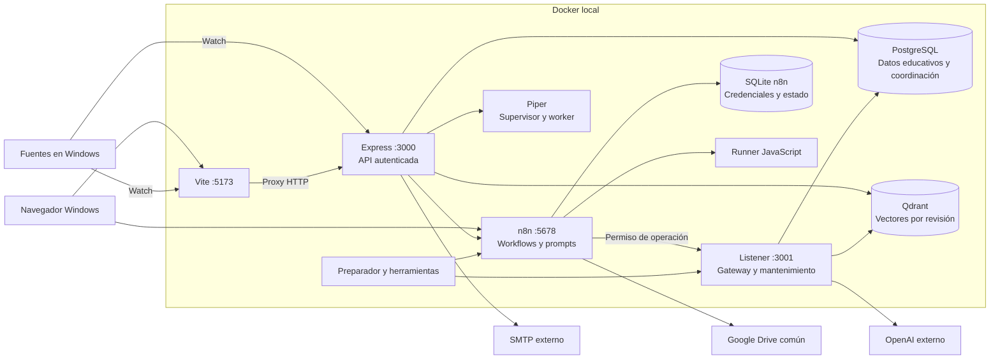
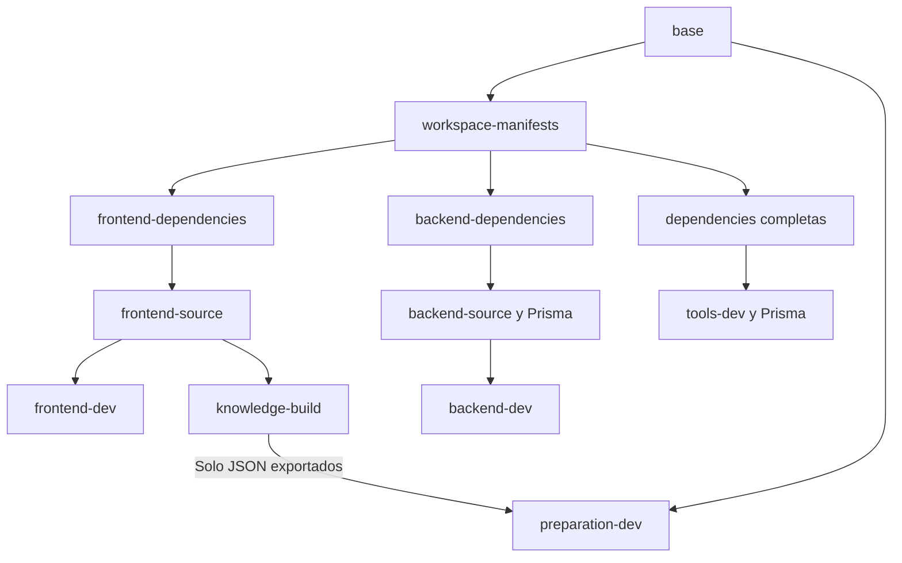

# Arquitectura del entorno Docker de desarrollo

CyberSim ejecuta frontend, backend e infraestructura de desarrollo en contenedores Linux. Las fuentes permanecen en Windows y Compose Watch las sincroniza. OpenAI, Google Drive y SMTP son las integraciones externas elegidas; ejecutar Docker no reemplaza sus credenciales ni el consentimiento Google.

Esta página describe la composición presente en el repositorio. El [contrato C01–C12](contrato-desarrollo-docker.md) conserva mecanismos, límites y justificaciones. El [estado del entorno](../project/estado-desarrollo-docker.md) distingue código disponible, comprobaciones locales y aceptación externa pendiente.

## Componentes y conexiones

Los dos listeners pertenecen al mismo backend. Solo Vite y n8n publican puertos en `127.0.0.1`; PostgreSQL, Qdrant, Piper y el listener interno usan la red Docker. Vite no expone `/internal` mediante su proxy.

## Responsabilidad y ubicación del estado

| Componente | Responsabilidad | Persistencia |
|---|---|---|
| Frontend | Simulación ECS/3D, pantallas, consumidores autorizados y diagnóstico | Partida e historial visual temporales; acceso en el navegador |
| Backend | Identidad, cursos, intentos, autorización y admisión IA | Historial tutor temporal por proceso; datos funcionales en PostgreSQL |
| PostgreSQL | Datos educativos, instalación/generación, operaciones, documentos y revisión publicada | Volumen reutilizado `cybersim_postgres_data`; un historial Prisma |
| n8n | Prompts, secuencia de análisis/feedback/generación e ingestión | SQLite y clave de cifrado estables en almacenamiento propio |
| Runner JS | Code nodes de los workflows | Sin base propia ni acceso al Docker socket |
| Qdrant | Recuperación semántica de conocimiento y catálogos | Colecciones físicas; PostgreSQL selecciona la revisión funcional |
| Piper | Síntesis WAV con voz fijada y worker supervisado | Voz descargada y verificada; sin almacenar conversaciones |
| Preparación/herramientas | Bootstrap, mantenimiento, huellas y evidencia | Artefactos privados; no una base `cybersim_dev_control` |

## Justificación de la distribución

La lógica editable permanece en n8n; el backend concentra las llamadas OpenAI para arbitrar el turno común y validar identidad, presupuestos y resultados. Separar runners permite ejecutar JavaScript sin entregarles SQLite ni la clave administrativa n8n. El singleton PostgreSQL y las transacciones cortas coordinan efectos sin mantener una transacción abierta durante HTTP.

El conocimiento se prepara en colecciones físicas nuevas y se publica cambiando una referencia funcional en PostgreSQL. Así SQL es la única autoridad de publicación. Una retirada se filtra también al consultar y confirmar resultados: conservar un índice anterior no vuelve a autorizar una fuente retirada.

Piper conserva síntesis local sin añadir un LLM al equipo de 16 GB. Su fallo permite devolver el texto obtenido, con aviso de audio no disponible. El objetivo de 8 GB Docker requiere medición; los caps configurados no lo certifican por sí solos.

## Arranque y diagnóstico

Cada build selecciona su etapa en el Dockerfile común. El preflight comprueba el volumen PostgreSQL; `migrate` aplica migraciones y completa fixtures faltantes. Backend y n8n pueden abrir sus interfaces antes de completar OAuth o el corpus. El preparador administra workflows y registra capacidades pendientes.

`/health/live` indica que el proceso responde. `/health/ready`, accesible en el navegador como `/api/health/ready`, informa preparación: un 503 agregado no equivale a todos los componentes caídos. El arranque no consume OpenAI ni envía correo para simular aceptación.

Fuentes: [Compose](../../compose.yaml), [imágenes fijadas](../../infra/images.lock.json), [router y diagnóstico](../../apps/backend/src/integrations/routes.ts), [herramientas](../../infra/tools.mjs).

## Etapas e imágenes de desarrollo

[infra/node.Dockerfile](../../infra/node.Dockerfile) conserva una base Node/Debian común y etapas independientes. Compose elige `build.target` y etiqueta cada resultado por separado; los servicios ya no comparten una única imagen que contenga ambas aplicaciones.

| Etapa | Consumidor | Contenido y trabajo |
|---|---|---|
| `base` / `workspace-manifests` | Etapas de construcción | Node fijado, paquetes del sistema, manifiestos y lockfile raíz |
| `frontend-dependencies` / `frontend-source` | Frontend y exportador | `pnpm --filter … install --frozen-lockfile` filtrado al workspace frontend y sus fuentes |
| `frontend-dev` | Servicio frontend | Vite; no ejecuta generación Prisma ni exportación RAG |
| `backend-dependencies` / `backend-source` | Backend | `pnpm --filter … install --frozen-lockfile` filtrado al backend, sus fuentes y generación Prisma; incluye corpus/metadatos de workflows para validación y huellas |
| `backend-dev` | Servicio backend | Express; no incorpora fuentes frontend ni ejecuta su exportador |
| `knowledge-build` | Construcción del preparador | Ejecuta el exportador del catálogo frontend y produce los JSON de topologías/desafíos |
| `dependencies` / `tools-dev` | Migraciones y herramientas explícitas | Toolchain de ambos workspaces para checks y mantenimiento, cliente Prisma generado; no ejecuta el exportador |
| `preparation-dev` | Preparación y verificación externa | Scripts Node sin dependencias npm, corpus/workflows y solo los JSON copiados desde `knowledge-build` |

Las imágenes son `cybersim-backend-dev:local`, `cybersim-frontend-dev:local`, `cybersim-tools-dev:local` y `cybersim-preparation-dev:local`. Backend y frontend mantienen contenedores, comandos y variables propios. No se han añadido destinos de producción en esta fase.

La raíz sigue siendo el contexto de construcción porque pnpm resuelve los workspaces desde un lockfile común. Un cambio de ese lockfile puede invalidar instalaciones de varios destinos; esto es distinto de ejecutar tareas de otra aplicación. Las fuentes backend no pertenecen al grafo de construcción frontend y viceversa. El preparador sí depende expresamente del catálogo porque lo distribuye como conocimiento.

El [ADR 0011](../project/adrs/0011-pnpm-como-gestor-unico.md) sustituye las referencias anteriores a npm: pnpm 12.14.0 se activa con Corepack, usa `pnpm-lock.yaml` y copia `pnpm-workspace.yaml` antes de instalar. BuildKit cachea `/pnpm/store`; las dependencias enlazadas se conservan en las imágenes. Watch reconstruye al cambiar cualquiera de esos dos archivos. El servicio tools monta Prisma sobre `/workspace/apps/backend/prisma`, conservando las dependencias Linux; los cambios de manifiestos y lockfile se escriben por separado en `/host`.

Compose Watch reconstruye el preparador cuando cambian catálogo, exportador, corpus o workflows; esa reconstrucción no aplica automáticamente cambios a workflows n8n ya instalados. Se mantiene la política de actualización explícita. Las fuentes de aplicación conservan HMR/reinicio de desarrollo.

La estructura aplica las [etapas independientes de BuildKit](https://docs.docker.com/build/building/multi-stage/), [caché y etapas reutilizables de Docker](https://docs.docker.com/build/building/best-practices/) y [filtros de pnpm](https://pnpm.io/filtering). La selección concreta de destinos es propia de CyberSim; las fuentes no imponen estos nombres ni un único diseño universal.

## Referencias

- [Uso y mantenimiento desde Windows](../guides/desarrollo-local.md).
- [Decisiones D01–D26 y razones](../project/decisiones-desarrollo-docker.md).
- [Contrato técnico completo](contrato-desarrollo-docker.md).
- [Evidencia, límites y aceptación](../project/estado-desarrollo-docker.md).
- [ADRs del sistema](../project/adrs/README.md).
