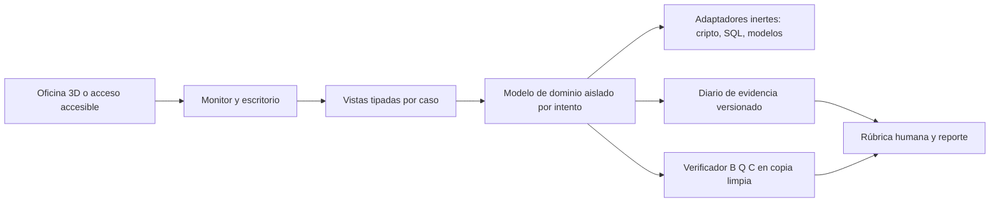

# Escenarios investigativos: integración propuesta

> **Estado actual.** Se conservan los cinco manifiestos, los modelos, los verificadores B/Q/C y el
> sobre de intento. Las interacciones del estudiante se integran en la oficina 3D. Consulta el
> [estado de implementación](../project/ejercicios/implementacion.md) para distinguir lo implementado
> de esta propuesta.

Conjunto 2.0: cinco [fichas canónicas](../project/ejercicios/README.md), manteniendo oficina 3D, monitor y escritorio. Este documento separa evidencia del código revisado de los componentes que faltan. No modifica contratos ni registra aplicaciones.

## 1. Punto de partida comprobado

| Existe | Evidencia local y límite |
|---|---|
| Oficina, transición y monitor | `apps/frontend/src/visual/features/escenarios-simulados/pages/VistaOficina.tsx`, `ScreenTransitionContext.tsx` y `MonitorDesktopOverlay.tsx` bajo visual/common; no reemplazar la navegación por otro producto |
| Ventanas y aplicaciones actuales | `apps/frontend/src/data/apps.ts` y `visual/features/hardening-de-dispositivos/pages/Dispositivos.tsx`; cuatro apps existentes no equivalen a las seis vistas propuestas por caso |
| Construcción de escenarios | `EscenarioBuilder.ts`, contrato `packages/scenario-contract/src/index.ts`; capacidades cerradas, no una API de plugins libres |
| Fases/eventos ECS | `SistemaFase.ts`, `SistemaEvento.ts`: objetivos y acciones esperadas; no un evaluador general por propiedades ni grafo completo de soluciones |
| Terminal simulada | `SistemaComandos.ts`: lectura, listado y SSH simulado; no Git, SQL, shell ni eval |
| Progreso | `ProgresoController.ts`, `PrismaProgresoRepository.ts`: intentos/acciones/finalización; no almacén validado D1–D4 ni corrector de estos casos |
| Feedback | `GenerateFeedbackUseCase.ts`: flujo de generación/persistencia; no rúbrica validada ni tutor inmediato autorizado |

Las rutas abreviadas de sistemas se localizan desde [motor ECS](simulacion-ecs.md), no constituyen archivos nuevos aquí. Véase [arquitectura modular](escenarios-modulares.md) y [regla cuando no alcanza el manifiesto](../guides/escenarios.md#cuando-el-manifiesto-no-alcanza). Un perfil reservado no acredita runtime. Antes de publicar contenido se añaden capacidades, acciones, eventos y verificadores en código confiable, con rechazo de desconocidos.

## 2. Entorno y topología por caso

| Slug canónico propuesto | Oficina / puesto | Activos representados | Vistas específicas; pueden ser pestañas de las aplicaciones definidas en la ficha |
|---|---|---|---|
| andinapay-clave-expuesta | AndinaPay / AP-IR-01, zona Operaciones | AP-DATA-01, AP-KEYS-01 | Repositorio, banco criptográfico, respuesta de claves |
| bibliotecaviva-consultas-seguras | TI de BibliotecaViva / Estación de Análisis | Servidor de Aplicación; base de datos lógica | Editor de cambios confiables, historial/SQL, permisos y errores |
| talentoandino-cargas-seguras | TalentoAndino / Estación de Análisis | Servidor de Aplicación; almacenamiento lógico | Solicitudes de carga, almacenamiento/cuarentena, configuración de entrega |
| andeanlogix-funciones-criticas | AndeanLogix / Estación de Análisis | Servidor de Aplicación; portal público y panel interno | Constructor de peticiones, sesiones/roles, mapa de rutas/red |
| nubeandina-sesiones-no-confiables | NubeAndina / Estación de Análisis | Servidor de Aplicación; almacén de sesión lógico | Inspector de payload, flujo de restauración, dependencias/almacén de sesión |

Los nombres/hosts son etiquetas internas sin DNS, puertos escuchando ni salida de red. No añadir máquinas 3D inútiles para puntuar: un puesto y tarjetas de activos representados bastan para observar la frontera. Los slugs son identidad editorial; asignar ID numérico únicamente después de comprobar unicidad del catálogo. No hay IDs reservados ficticios. Usar entorno office-3d y defaults reales del contrato, no inventar un perfil soportado.

Las fases comunes se proyectan como familiarización fuera del intento, expediente/D1, intervención, entrega congelada, explicación e informe. **No** modelar cada solución como secuencia rígida de objetivos ECS: ECS presenta el contexto, los verificadores evalúan efectos. Reutilizar componentes de monitor/ventanas y acceso directo equivalentes; las nuevas vistas se registran explícitamente, sin relajar el validador para permitir strings arbitrarios.

## 3. Separación de componentes propuesta

| Frontera | Responsabilidad propuesta |
|---|---|
| UI | Envía operaciones admitidas; no decide Q por tarjeta elegida ni muta el estado de otro caso |
| Dominio | Reducir operación validada sobre copia de estado; devolver nuevo estado, efectos y rechazo. Modelos independientes; esquema compartido de evidencia |
| Adaptador cripto | WebCrypto AES-GCM sobre bytes de fixtures y handles del modelo; distinguir fallo de autenticación de fallo técnico |
| Adaptador SQL | Distribución oficial SQLite/WASM fijada en implementación, DB en memoria por prueba dentro de Worker; consulta real, bindings e inspección; authorizer modela read_only, no GRANT inexistente |
| Carga, autorización y restauración | Intérpretes cerrados de fixtures y reglas exactas de fichas; nunca ejecución de scripts, objetos nativos o comandos del alumno |
| Verificador | B/Q/C por propiedades y resultados/efectos; no ruta única. Separar ejecuciones docentes de elegidas por estudiante |
| Registro/reporte | Intento, revisiones y ayudas persistidos con idempotencia y orden; interpretación humana, no inferencia automática de autonomía |

No se propone instalar una biblioteca vulnerable para simular deserialización. En SQL, limitar a entradas y diffs documentados, sin SQL libre; cerrar Worker y reiniciar DB tras tiempo máximo configurado. Timeout no es seguridad superada. Fijar versión/hash/licencia del motor y comprobar compatibilidad en tarea futura; no atribuirle aquí una versión instalada. No utilizar dependencias de aplicación para los cálculos exploratorios de autoría como si probaran el runtime.

### Estado, persistencia y fallos

- Un agregado por `attemptId`: caso/forma, versiones de contenido/motor/verificador/rúbrica/ayudas, secuencia, diagnóstico, revisiones, pruebas, segmento, entrega, explicación y estado técnico.
- Cada comando tiene `operationId`; duplicado devuelve recibo previo sin duplicar efectos ni evidencia. Revisión esperada evita sobrescritura silenciosa; conflicto conserva borrador y solicita recarga, no mezcla estados.
- Guardar revisión crea snapshot inmutable; probar parte del fixture limpio. Staging de migración AP y publicación NA pertenecen al estado de la prueba y deben estar serializados para reanudación o declararse descartados como prueba interrumpida.
- Entrega persiste snapshot y recibo antes de mostrarse confirmada. Caída antes del recibo permite reintento idempotente. No fabricar resultados faltantes al reanudar.
- A2/A3 registra ayuda y sello del segmento previo antes de mostrarla. Reset restaura modelo, no borra exposición. Nueva práctica no sustituye intento.
- Evidencia distingue negocio, auditoría y efectos intermedios. AL rechaza sin modificar envíos/credenciales aunque registre auditoría. TA observa pendiente; NA efectos previos y commit parcial; AP copia histórica/operativa.
- Estado inicial/fixtures y semillas explícitas hacen reproducibles las copias, no secretos aleatorios. No usar reloj de pared para vigencia o expiración de tests.
- Payload malformado/entrada no soportada es un resultado tipado; crash, Worker agotado o escritura fallida es incidencia técnica. NE se aplica a la evidencia afectada, no a todo el perfil indiscriminadamente.

### Autoridad y privacidad

La evaluación en navegador no es anti-cheat ni frontera de autorización real. El backend actual no recalcula estos hechos. Para un piloto formativo se admite esa limitación explícita; un uso de altas consecuencias requerirá validación institucional y diseño separado de arbitraje confiable antes de prometerlo. No reutilizar progreso terminado como mastery.

No capturar pulsaciones, secretos externos ni datos personales de relatos. Usar seudónimo y IDs; retención/consentimiento/accesos institucionales deben fijarse antes de recopilar personas. No enviar claves/payloads/informes a RAG o LLM automáticamente. Los nuevos endpoints futuros deben verificar propiedad del intento y autorización servidor; copiar un ID del navegador no basta.

Decisión y alternativas: [ADR0025, propuesta](../project/adrs/0025-evidencias-y-modelos-de-ejercicios.md).

## 4. Criterio de preparación

Un manifiesto solo se publica cuando existen vistas, acciones, contratos y verificadores testeados; todas las baterías de su ficha pasan en rutas válidas, los rivales fallan por el motivo previsto y alternativas válidas están cubiertas. Evitar una migración destructiva del catálogo anterior: retirada visible y nueva revisión, conservando intentos históricos con su versión. El plan de implementación y la guía detallan dependencias, checks y límites de autorización.
