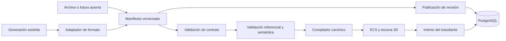
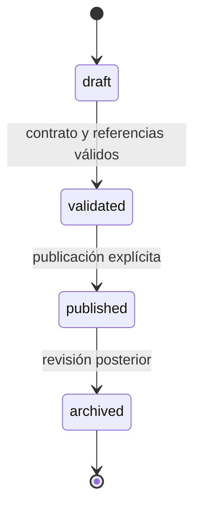

# Arquitectura modular de escenarios

CyberSim representa cada ejercicio como un **manifiesto declarativo, versionado y validado** que se compila al motor ECS. El entorno 3D y las capacidades de ciberseguridad siguen siendo código confiable y reutilizable; el manifiesto únicamente selecciona esas capacidades y aporta topología, reglas, objetivos y evaluación.

Esta página contiene el panorama completo para comprender el diseño. Para modificar el contrato consulta [Contrato de escenarios](contrato-de-escenarios.md); para crear uno sigue [Crear y mantener escenarios](../guides/escenarios.md).

## En un minuto

1. Cada archivo `escenario*.ts` exporta una definición mediante `defineScenario`.
2. El catálogo descubre esos archivos automáticamente y solo muestra revisiones `published`.
3. Antes de jugar, el validador comprueba contrato, referencias y huella SHA-256.
4. El compilador traduce el manifiesto al contrato que consume el ECS existente.
5. PostgreSQL conserva identidad, revisiones inmutables y la revisión usada por cada intento.
6. Los escenarios generados se adaptan al mismo manifiesto y pasan por el mismo compilador.

## Separación de responsabilidades

| Capa | Responsabilidad | Ubicación principal |
|---|---|---|
| Contrato compartido | Versión, estado, capacidades, entorno, semilla, versiones y huella | `packages/scenario-contract/` |
| Contenido | Topología, dispositivos, fases, eventos, ataques y acciones esperadas | `apps/frontend/src/data/escenarios/` |
| Autoría | Completar metadatos reproducibles e inferir capacidades utilizadas | `apps/frontend/src/scenarios/defineScenario.ts` |
| Catálogo | Descubrir módulos, validar, rechazar duplicados y exponer publicados | `apps/frontend/src/scenarios/catalog.ts` |
| Compilación | Validar y adaptar el manifiesto al contrato del ECS | `apps/frontend/src/scenarios/compileScenario.ts` |
| Runtime | Crear entidades/componentes y ejecutar sistemas de la simulación | `apps/frontend/src/ecs/` |
| Presentación | Renderizar oficinas, salas, modelos y controles confiables | `apps/frontend/src/visual/features/escenarios-simulados/` |
| Persistencia | Guardar identidad, revisiones publicadas e intentos vinculados | `apps/backend/prisma/schema.prisma` |

## Dos formas de extender CyberSim

### Crear otro ejercicio con capacidades existentes

Es trabajo declarativo. El desarrollador agrega un archivo de escenario, combina eventos y objetos soportados, lo valida y publica una revisión. No modifica el ECS ni registra el archivo en listas paralelas.

### Crear una capacidad nueva de ciberseguridad

Es un cambio de producto y código. Requiere añadir el comportamiento al ECS o a la presentación confiable, ampliar el registro cerrado de capacidades, crear pruebas y después utilizarlo desde manifiestos. Un dato del escenario no puede introducir scripts, componentes React, rutas remotas ni lógica ejecutable.

## Qué se reutiliza

El perfil `office-3d` reutiliza el layout determinista, arquetipos, prefabs, temas y modelos existentes. Los dispositivos siguen seleccionándose mediante `TipoDispositivo`; los eventos y acciones usan enums del dominio. El manifiesto referencia un perfil y una versión del catálogo de activos, no ubicaciones arbitrarias.

Los perfiles admitidos por el contrato son `office-3d`, `network-topology`, `terminal-lab` y `security-dashboard`. Que un perfil esté reservado en el contrato no significa que ya tenga una experiencia completa: hoy los escenarios publicados utilizan `office-3d`.

## Revisión y reproducibilidad

Una revisión se identifica por:

- `schemaVersion`: versión del contrato;
- `revision`: número inmutable dentro del escenario;
- `contentHash`: SHA-256 de una serialización canónica;
- `engineVersion`, `assetCatalogVersion` y `seed`;
- `environment` y capacidades requeridas.

Modificar contenido sin incrementar la revisión hace que `db:sync-scenarios` falle. Publicar una revisión nueva archiva la publicada anterior, pero no la elimina. Los intentos nuevos guardan revisión y hash; también pueden enlazar la fila persistida. Los intentos históricos anteriores conservan slug y pueden tener esos campos nulos.

La migración crea el esquema y las identidades base, pero no duplica manifiestos dentro del SQL. La preparación local de la base ejecuta `db:sync-scenarios` después de migrar y sembrar, de modo que cada revisión se persiste con su manifiesto completo. En otros entornos, ese comando forma parte del procedimiento explícito de publicación.

## Ciclo de publicación

El futuro administrador deberá operar este ciclo mediante servicios de dominio. No deberá escribir código ni ampliar capacidades desde datos. La interfaz administrativa no forma parte de la implementación actual.

## Fuentes de verdad

- El archivo del escenario es la fuente del contenido incorporado al repositorio.
- `scenarioCatalog` es la única fuente de selección y carga en el frontend.
- `escenario` y `revision_escenario` son la fuente persistida de publicación e historial.
- `revision_escenario` vinculada a `progreso` determina qué contenido produjo un intento.
- El exportador RAG descubre las mismas revisiones publicadas; ya no mantiene una lista propia.

## Límites deliberados

- El ECS continúa ejecutándose en el navegador; versionar un manifiesto no convierte al servidor en árbitro de la simulación.
- `defineScenario` infiere las capacidades actuales desde eventos y objetos administrados. Añadir una capacidad requiere ampliar deliberadamente ese mapeo y el registro compartido.
- La migración incorpora las cinco revisiones publicadas actuales. Después de crear o cambiar escenarios se ejecuta la sincronización explícita de la guía.
- Una huella prueba identidad de contenido, no que el ejercicio sea pedagógicamente resoluble; las pruebas y el recorrido manual siguen siendo necesarios.

## Profundizar

- [Contrato, validaciones e invariantes](contrato-de-escenarios.md)
- [Motor ECS](simulacion-ecs.md)
- [Modelo persistido](modelo-de-datos.md)
- [Guía para crear un escenario](../guides/escenarios.md)
- [ADR 0013](../project/adrs/0013-escenarios-modulares-versionados.md)
