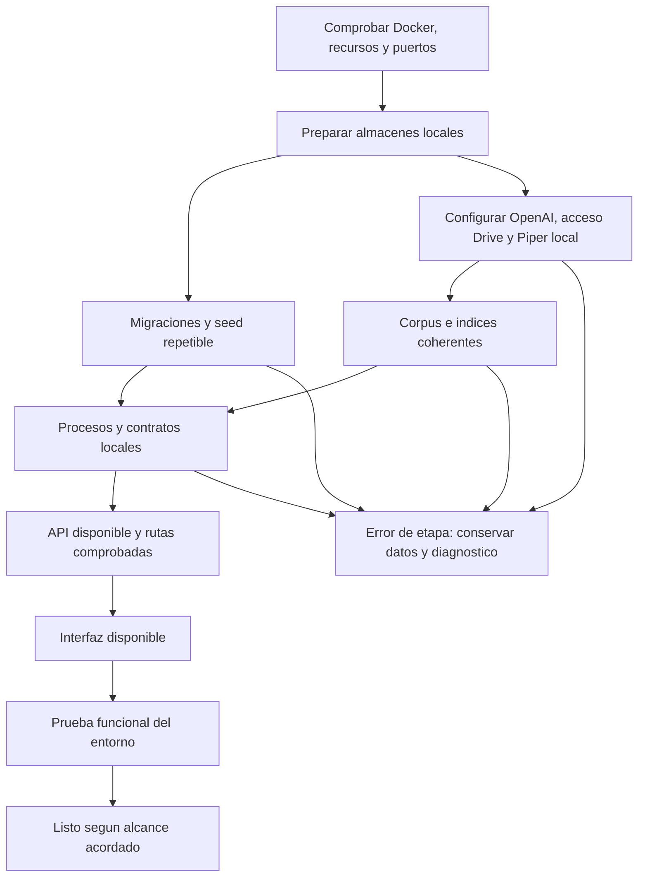

# Evaluación previa del desarrollo local con Docker

Esta referencia conserva las alternativas, riesgos, fuentes y justificaciones que sustentan el sistema. Sus conclusiones se concretan en el [contrato vigente](contrato-desarrollo-docker.md) y los [ADRs](../project/adrs/README.md).

Para consultar lo incorporado al código, las verificaciones y los límites actuales, usar el [estado del entorno](../project/estado-desarrollo-docker.md). Los pendientes que aparecen en el informe original corresponden a su fecha de investigación; las decisiones vigentes están en [D01–D26](../project/decisiones-desarrollo-docker.md).

## Investigación y evidencia conservadas

El contenido original permanece completo, incluidas las opciones retiradas y el motivo de su sustitución.

Leer el informe original y todas sus referencias

Los textos siguientes conservan el contexto de su elaboración. Sus pendientes y expresiones de futuro describen esa revisión histórica; el estado vigente es el indicado arriba. No son instrucciones actuales de ejecución.

# Evaluación previa del desarrollo local con Docker

> Cierre posterior: [contrato técnico v1](contrato-desarrollo-docker.md) terminado por encargo el 18 de octubre. Los pendientes de diseño de esta evaluación son históricos; quedan implementación, provisión manual y aceptación real.

- Fecha: **16 de octubre de 2026**.
- Actualización de decisiones: **18 de octubre de 2026**, D04/D06/D15–D24 confirmadas. Las rondas planteadas están respondidas; faltan parámetros operativos y verificación. Sin implementación.
- Base inspeccionada: `8de71f5`, los cinco exports locales de n8n y las configuraciones Docker de contextual-pii-anonymizer y Zonride-Backend proporcionadas por el usuario.
- Estado: **propuesta en definición; no implementada ni aprobada como contrato completo**.
- Método: lectura de código, configuración y conexiones/expresiones de los JSON; consulta de documentación oficial. No se ejecutaron workflows, modelos, migraciones ni pruebas de carga durante esta evaluación.

Este documento registra fallos posibles y decisiones necesarias para evitar que «todo local con un comando» tenga interpretaciones distintas. No sustituye la [guía vigente de desarrollo](../guides/desarrollo-local.md), que todavía corresponde al sistema actual.

El [registro de continuidad](../project/decisiones-desarrollo-docker.md) conserva el detalle canónico de las decisiones y preguntas para retomar. Tras el aplazamiento del 16 de octubre, el usuario confirmó el 18 de octubre **D04: reutilizar el volumen existente, con eventual reset manual a su cargo** y **D06: JSON en Git y actualización explícita**, tras su [investigación](investigacion-versionado-workflows-n8n.md). No se inicia implementación. El [ADR 0006](../project/adrs/0006-alcance-del-desarrollo-con-docker.md) registra el alcance y el [ADR 0007](../project/adrs/0007-versionado-explicito-de-workflows.md) la política D06 aceptada. La [segunda revisión](revision-detallada-arranque-docker.md) desarrolla condiciones de fallo y originó las preguntas D15–D18, con el estado actualizado a continuación.

Tras responder la segunda ronda, el usuario confirmó **D15: SQLite persistido solo para n8n**, **D16: origen común de Drive**, **D17: cliente OAuth del equipo con autorización individual** y **D18: retirada automática tras confirmación**. El origen está en Mi unidad personal. La tercera ronda cerró D19 (recuperación sana y contexto suficiente), D20 (texto conservado ante fallo de voz) y D21 (generaciones independientes). La cuarta cerró D22 (historial temporal con aviso), D23 (turno único con prioridad al usuario) y D24 (último índice válido con aviso ante fallo de sincronización). No se han configurado credenciales ni implementado estos comportamientos.

## Requisitos confirmados por el usuario

1. Desarrollo en Windows 11, con 16 GB de RAM y sin GPU dedicada.
2. Inicialización sencilla de la infraestructura de desarrollo con Docker. El alcance actual excluye diseñar producción y exige un objetivo de hasta 8 GB asignados a Docker/WSL.
3. **Cambio de alcance confirmado:** usar la API de OpenAI para generación y embeddings y mantener el enfoque actual, sin instalar Ollama ni modelos de chat locales. La propuesta anterior de funcionamiento completamente offline queda sustituida: OpenAI y Google Drive son dependencias externas elegidas. La voz utiliza Piper local como excepción expresa, con su voz descargada y persistida.
4. Corpus mínimo común versionado, elaborado desde el contenido del proyecto; documentos privados adicionales no son requisito para arrancar.
5. Conservar n8n y su responsabilidad sobre los workflows, incluida la detección de cambios del conocimiento en **Google Drive** como proceso independiente de la aplicación. Se retira la propuesta de vigilar una carpeta local cada 30 segundos.
6. Aceptar solo TXT y Markdown como documentos añadidos; PDF y OCR quedan fuera de esta etapa. Esto no excluye los JSON estructurados de escenarios generados por el propio proyecto.
7. No declarar listo un entorno incompleto. Aceptar los límites iniciales de D09, aún por medir, e incluir los bloqueos funcionales concretos de D12.
8. Editar archivos locales y reflejar cambios en Docker como en los proyectos de referencia; no imponer Dev Container. Las herramientas concretas y los volúmenes se detallan abajo.
9. Evaluar y preguntar antes de implementar. Confirmar opciones concretas no equivale a aprobar todo el contrato ni a autorizar cambios en los proyectos de referencia.
10. Un único `.env` privado en la raíz, excluido de Git, para configurar los consumidores del servidor. No incluir la clave OpenAI en el navegador ni en las imágenes.

Se ha acordado un objetivo de 8 GB para Docker y límites de espera, pero todavía no se ha medido el sistema completo con ellos. Tampoco se ha definido un procesador mínimo ni el espacio necesario. Los 16 GB del equipo no equivalen a 16 GB disponibles para los contenedores.

## Referencias de desarrollo aportadas por el usuario

Se leyeron sus configuraciones, sin ejecutarlas ni modificarlas:

| Proyecto | Mecanismo observado | Aplicación propuesta a CyberSim |
|---|---|---|
| contextual-pii-anonymizer | Compose Watch sincroniza código/tests; cambios de manifiestos o lockfiles reconstruyen imágenes. Usa healthchecks, migración antes de servir y volúmenes nombrados | Aprovechar separación entre código, dependencias y datos, y condiciones reales de arranque |
| Zonride-Backend | El target dev monta `./src` en `/project/src`, ejecuta `tsx watch` y configura una variable de polling. Sus dependencias se instalan dentro de la imagen | Editor en Windows, volúmenes selectivos de fuentes, proceso de desarrollo dentro del contenedor y dependencias Linux separadas |

Para CyberSim se propone el estilo de edición de Zonride con fuentes montadas. No se presupone que configurar una variable de polling pruebe la propagación de eventos en todos los equipos: hay que ensayar crear, cambiar, renombrar y borrar archivos. Si se usa polling, limitarlo a fuentes, excluir dependencias/artefactos y medir su CPU. Los stages de producción de Zonride no se incorporan a este alcance.

Las migraciones de CyberSim seguirían versionadas; el arranque no utilizaría `db push` como sustituto del historial. Los volúmenes de fuentes son distintos de los volúmenes de datos: montar código no debe ocultar dependencias instaladas en la imagen ni insertar node_modules de Windows en Linux. Un Node local opcional para herramientas del editor no sería un servicio requerido para arrancar el stack; el autocompletado necesita verificarse aparte.

## Evidencia del estado actual

| Área | Observación comprobada | Fuente |
|---|---|---|
| Arranque | Compose solo proporciona PostgreSQL; publica 5432 y fija el nombre `cybersim-db` | [Compose](../../compose.yaml) |
| Salud | `/health` solo responde desde Express; el chat comprueba Qdrant y declara GPT/TTS verdaderos sin probarlos | [Servidor](../../apps/backend/src/server.ts), [chat](../../apps/backend/src/chat/infrastructure/controllers/ChatController.ts) |
| Frontend | El proxy de desarrollo fija `localhost:3000`; el generador elimina `/api` de la base y el análisis usa otra variable | [Vite](../../apps/frontend/vite.config.ts), [generador](../../apps/frontend/src/visual/features/agent-malvado/infrastructure/services/ScenarioBuilderApiService.ts), [análisis](../../apps/frontend/src/visual/features/course-analysis/hooks/useGenerateCourseAnalysis.ts) |
| Base | La CLI prioriza `DIRECT_URL`; runtime y seed utilizan `DATABASE_URL` | [Configuración Prisma](../../apps/backend/prisma.config.ts), [runtime](../../apps/backend/src/auth/infrastructure/db/prisma.ts), [seed](../../apps/backend/prisma/seed.ts) |
| Seed | Crea filas directamente, sin transacción global ni estrategia para repetirlo | [Seed](../../apps/backend/prisma/seed.ts) |
| IA | Chat y embeddings usan llamadas HTTP sin deadline ni límite explícito de salida/contexto | [GPTService](../../apps/backend/src/chat/infrastructure/services/GPTService.ts) |
| Memoria | El historial del tutor está en RAM, conserva hasta veinte mensajes por defecto y se pierde al reiniciar el backend | [Memoria](../../apps/backend/src/chat/infrastructure/services/ConversationMemoryManager.ts) |
| Audio | El backend produce WAV en base64; el frontend construye un Blob declarado como `audio/mpeg` | [Piper](../../apps/backend/src/chat/infrastructure/services/PiperTTSService.ts), [reproductor](../../apps/frontend/src/visual/features/chat/hooks/useAudioPlayer.ts) |
| Generación | El cliente normaliza respuestas y usa un mismo slug para todos los escenarios generados | [Construcción del escenario](../../apps/frontend/src/visual/features/agent-malvado/presentation/hooks/useScenarioBuilder.ts) |
| E2E | La configuración actual arranca Vite y las pruebas interceptan API; no acredita el stack real | [Playwright](../../apps/frontend/playwright.config.ts) |
| Exportación | El exportador genera datos desde cinco escenarios; resuelve su destino junto a su script, diferente de los JSON raíz entregados | [Exportador](../../apps/frontend/scripts/export-rag-knowledge.ts), [topologías](../../scripts/rag-output/topologias.json), [desafíos](../../scripts/rag-output/desafios.json) |

Los exports de `workspace/n8n` se inspeccionaron como material local: **workspace está ignorado por Git**, por lo que no constituye una distribución reproducible para otro desarrollador. No se copiaron credenciales ni se asume que lo exportado represente una instancia funcionando actualmente.

Consulta de Docker durante esta evaluación: existe el volumen **`cybersim_postgres_data`** y no existe un contenedor llamado **`cybersim-db`** en el motor consultado. El Compose declara `postgres_data` montado en `/var/lib/postgresql/data`; con el proyecto Compose `cybersim`, corresponde al nombre de volumen observado. Se consultaron nombres y montajes, no el contenido, usuarios, versión interna ni integridad de esa BD. La ausencia del contenedor no demuestra que el volumen esté vacío.

En esa muestra se observó:

- Tres cargadores con Google Drive y embeddings Gemini. Los de topologías y desafíos declaran extracción PDF, esperan campos diferentes del JSON actual, contienen referencias a un nodo `Code` inexistente y dejan otro cargador fuera del componente conectado al trigger.
- Un generador con Gemini, embeddings Ollama, Qdrant y Redis. La sesión de Redis es la expresión fija `=1`; `hasOutputParser` está activado sin conexión `ai_outputParser`.
- Un análisis docente con consultas PostgreSQL y Gemini. Los nodos Supabase y HTTP están deshabilitados y fuera del recorrido activo. Su código asigna `fecha: progreso.tiempo` y ordena ese valor como fecha; estudiantes sin progreso pueden desaparecer del resumen porque la agregación parte de filas de progreso.
- No apareció el workflow de feedback individual, un cargador de la colección contextual del tutor ni el servidor HTTP de Piper. Esas piezas están ausentes de la muestra, no se afirma que nunca hayan existido.

### Qué datos intervienen y dónde se utilizan

| Almacenamiento | Contenido | Consumidores |
|---|---|---|
| PostgreSQL de CyberSim | Usuarios y perfiles, cursos, matrículas, intentos/progreso, feedback y análisis guardados | Backend; el workflow de análisis consulta matrículas y progreso |
| Qdrant | Vectores, fragmentos de conocimiento y metadatos | Recuperación del tutor y herramientas de búsqueda del generador |
| Almacenamiento propio de n8n | Definiciones de workflows, nodos, conexiones, prompts, credenciales y estado de ejecución | Motor n8n, interfaz de edición, webhooks y triggers de Drive |
| Redis del export del generador | Historial de su agente según la clave de sesión configurada | Nodo Redis Chat Memory de ese workflow |
| Volumen de Piper propuesto | Archivos del modelo de voz y caché necesaria | Servicio HTTP local de síntesis; no contiene usuarios o matrículas |

No son cinco bases de datos de usuarios. Cada almacenamiento tiene responsabilidades distintas; el medio exacto para los metadatos de n8n se fijará al implementar su persistencia.

Los JSON exportados son **definiciones de procesos**, no el historial de estudiantes ni los documentos de Drive. El backend no importa esos JSON ni ejecuta sus nodos. Envía HTTP al webhook de n8n y consume su resultado:

| Función de CyberSim | Relación real con n8n |
|---|---|
| Análisis docente | Backend envía `id_curso` e `id_profesor`; el export consulta PostgreSQL, prepara estadísticas/prompt, llama al modelo y forma un JSON; el backend persiste la respuesta |
| Generación de escenarios | Backend envía `prompt`; el export usa las herramientas de búsqueda en Qdrant, modelo y memoria para devolver un escenario JSON |
| Feedback individual | Backend tiene un cliente HTTP de n8n y persiste la respuesta; su workflow no apareció entre los exports proporcionados |
| Carga de conocimiento | Triggers de Drive descargan documentos y alimentan Qdrant; es independiente de una petición del usuario a la app |
| Tutor/chat | La implementación actual llama desde el backend a Qdrant, OpenAI y Piper; ese recorrido no pasa por n8n |

Para el arranque automático del nuevo n8n local habrá que importar definiciones adaptadas desde el repositorio a su almacenamiento y publicar los workflows necesarios. **La política de repetir esa importación es lo que origina D06**; hoy ese importador automático todavía no existe en CyberSim.

En los cinco JSON inspeccionados, los objetos de referencia a credenciales contienen solo `id` y `name`; no hay un bloque superior con credenciales exportadas. Importar esas referencias no autentica por sí solo la nueva instancia en Google Drive. El mecanismo de autorización inicial de Drive sigue por definir; no se cuenta como resuelto mediante el `.env` de OpenAI.

## Riesgos y tratamiento propuesto

Las incidencias siguientes mezclan defectos observados y fallos anticipados. Se indica la diferencia; no son resultados de una prueba de ejecución.

| ID | Riesgo y mecanismo | Tratamiento que se propone verificar |
|---|---|---|
| R01 | **Capacidad por comprobar.** Windows, editor y navegador compiten con WSL. WSL documenta un límite predeterminado del 50 % de la RAM; el ajuste real puede ser distinto | Medir dentro del presupuesto acordado en D01. Evitar usar swap intensivo como prueba de que el sistema cabe en RAM |
| R02 | **Fallo anticipado.** n8n, ingestión, builds, bases y Chromium simultáneos pueden agotar memoria o bloquear CPU | La inferencia de chat ya no consume RAM local; secuenciar preparación/pruebas y medir picos igualmente. Limitar llamadas API en curso y cola según D09 |
| R03 | **Arranque incompleto.** Un contenedor en ejecución no garantiza SQL migrado, acceso API configurado, corpus cargado o webhooks publicados | Separar proceso vivo, dependencia disponible y entorno listo. Esperar condiciones reales y mostrar qué etapa falló |
| R04 | **Estado parcial.** Una interrupción durante descargas, seed, ingestión o importación deja una preparación a medias | Marcar una etapa terminada solo después de verificarla; poder repetir el comando sin borrar datos ni aceptar marcadores obsoletos |
| R05 | **Carreras.** Dos procesos de preparación o consumidores arrancando antes de completar sus requisitos duplican filas/documentos o leen esquemas incompletos | Un único responsable de cada inicialización y exclusión mutua. No escribir a la vez el mismo almacén de dependencias ni indexar el mismo archivo por dos ejecuciones de n8n |
| R06 | **Destructividad observada/potencial.** El seed actual no es repetible; `db push` o reset automáticos ocultarían discrepancias | Migraciones versionadas; seed transaccional e idempotente que no cambie contraseñas ni registros existentes. Reset separado, explícito y acotado |
| R07 | **Destino incorrecto.** URL CLI y URL runtime distintas, variables privadas heredadas o credenciales de exports pueden conectar con una BD/proveedor no previsto | PostgreSQL/Qdrant/n8n locales y proveedor OpenAI explícito. Eliminar fallbacks a Gemini, Ollama y webhooks ajenos; no confundir la API autorizada con permiso para cualquier proveedor. Verificar destino antes de escribir |
| R08 | **Red equivocada.** `localhost` del backend, n8n, Vite y navegador identifica procesos distintos | Nombres de servicio en la red interna; URLs alcanzables por el navegador para enlaces. Probar también confirmación y recuperación de contraseña |
| R09 | **Rutas incompatibles observadas.** Proxy `/api`, chat `/api/chat`, generador y análisis componen las URLs de forma diferente | Definir una tabla única de rutas y probar cada recorrido. Elegir entre acceso directo a API o proxy; evitar arreglos por concatenación implícita |
| R10 | **Colisiones.** El nombre fijo de contenedor y los puertos pueden impedir arrancar el entorno si ya están ocupados | Detectar el conflicto sin reutilizar datos ajenos silenciosamente. D04 fija la reutilización del volumen existente. Ejecutar varias copias simultáneas no es un requisito acordado |
| R11 | **Archivos Windows/Linux.** CRLF, permisos, nombres sensibles a mayúsculas y módulos nativos pueden romper los entrypoints o imports | Scripts Linux con LF, encoding estable y permisos explícitos. Dependencias y cliente Prisma generados para el contenedor, sin reutilizar node_modules de Windows |
| R12 | **Pérdida de trabajo.** La sincronización de código hacia el contenedor no define cómo vuelven nuevas migraciones, cambios de lockfile o exports | Diseñar ida y vuelta de archivos fuente y generados según D05; verificar que llegan a Git sin copiar secretos, cachés o dependencias |
| R13 | **Sobrescritura de workflows.** Importar IDs existentes puede reemplazar cambios de la interfaz; importar no equivale a publicar un webhook | Política D06. Separar configuración, importación y publicación; persistir la clave de cifrado de credenciales junto al estado de n8n |
| R14 | **Memoria compartida.** Redis `=1` puede mezclar generaciones; el tutor pierde memoria con cualquier reinicio de nodemon | Definir si la generación es independiente o conversacional. No compartir una sesión global. Declarar el historial del tutor como efímero salvo cambio expresamente acordado |
| R15 | **Vectores incompatibles observados.** Carga con Gemini, consulta con Ollama y tamaños de colección fijados a mano | Unificar indexación y consulta con el modelo de embeddings OpenAI configurado y su dimensión/normalización. Una dimensión coincidente no demuestra compatibilidad semántica. No reutilizar vectores Gemini/Ollama como si fueran de OpenAI |
| R16 | **Índice obsoleto o duplicado.** Reinsertar en cada up, cambiar chunking/modelo sin reindexar o no retirar documentos eliminados altera búsquedas | Manifiesto de fuente/hash/extractor/chunking/modelo; IDs estables y sincronización D11. No reemplazar un índice válido por una carga parcial |
| R17 | **Documentos vacíos o no admitidos.** TXT/Markdown ilegible, vaciado accidental, cambios de encoding o archivos temporales pueden sustituir contenido válido por un índice inútil | D10 excluye PDF/OCR. Validar encoding/contenido/tamaño, distinguir fichero vacío de borrado y registrar errores; no marcar como indexado un archivo que falló |
| R18 | **JSON válido pero escenario inválido.** Parsear JSON y normalizar tipos no demuestra que existan dispositivos, objetivos alcanzables o cierres coherentes | D02 conserva el enfoque actual con API externa; se retira la propuesta de sustituirlo por composición. Validar estructura/referencias/reglas antes de jugar y no devolver un escenario fijo como si fuera generado |
| R19 | **Análisis engañoso.** Fechas incorrectas, alumnos sin intentos omitidos o fallback textual presentado como análisis correcto | D12 acepta corregir estos bloqueos: calcular estadísticas de forma determinista con todos los matriculados, definir el caso vacío y validar el contrato antes de persistir |
| R20 | **Espera ilimitada y duplicación.** Timeout del navegador no implica cancelar n8n/IA; reintentar puede crear varias retroalimentaciones | D09 debe acotar la operación completa, incluida cola. Propagar cancelación donde sea posible, ignorar resultados tardíos y evitar reintentos automáticos de escrituras sin idempotencia |
| R21 | **Audio bloqueante/inválido.** El chat espera síntesis; base64 aumenta transferencia y MIME no coincide | Contrato explícito de voz, MIME correcto, límite de texto/audio y liberación de Blob URLs. Si falla voz tras el arranque, proponer conservar texto con aviso; D08 se refiere a la preparación inicial |
| R22 | **Dependencias externas no declaradas.** Autorizar OpenAI no identifica automáticamente otros proveedores, Drive, decodificadores 3D o descargas del navegador | Mantener un inventario. OpenAI y Google Drive son dependencias externas confirmadas; Piper es local con descarga inicial de voz. No anunciar ejecución integral offline. La librería 3D tiene un decoder Draco remoto por defecto; comprobar su uso |
| R23 | **Descargas y llamadas confundidas.** Descargar imágenes/paquetes durante build es distinto de usar OpenAI durante ejecución; la ingestión puede generar llamadas repetidas | Fijar versiones de imágenes/dependencias y usar hashes para no repetir embeddings de contenido sin cambios. No descargar modelos locales de chat. Las llamadas a API requieren red y la clave D13 |
| R24 | **Exposición y crecimiento.** Puertos abiertos a la LAN, ejecuciones n8n, logs, audios e imágenes antiguas pueden consumir disco o exponer datos | Proponer publicaciones solo en loopback, servicios internos sin puertos al host, límites de retención y rotación; nunca aplicar limpieza global de Docker como recuperación automática |

### Dependencias de inicialización propuestas

Este diagrama describe condiciones propuestas, no servicios implementados ni un orden totalmente lineal. Las tareas independientes podrían prepararse por separado sin exceder el presupuesto de recursos.

Imágenes y paquetes necesitan red cuando no están en caché. Backend y n8n también necesitan salida hacia OpenAI durante ejecución, y n8n hacia Google Drive para sus recorridos de sincronización. La autorización inicial de Google sigue por definir. La lectura y fragmentación de documentos, la obtención de embeddings mediante API y su almacenamiento local en Qdrant son pasos distintos. Tener Qdrant local no hace local la inferencia. El navegador no debe recibir la clave API.

## Registro de decisiones y aclaraciones

Se incorporan las respuestas del usuario conservando sus excepciones y dudas. Las filas pendientes no se consideran aprobadas. D04 ya confirma la reutilización del volumen existente; el soporte de varias copias simultáneas no ha sido solicitado y no se añade como requisito.

| ID | Decisión | Respuesta registrada o propuesta pendiente | Estado |
|---|---|---|---|
| D01 | RAM disponible para Docker/WSL | Objetivo de 8 GB en el equipo de 16 GB; falta medir cumplimiento | Confirmado el objetivo |
| D02 | IA y generación | Usar API de OpenAI conservando el enfoque actual; sin Ollama/modelos de chat locales ni cambio implícito a composición desde catálogo | Confirmado el cambio de alcance |
| D03 | Lugar de mantenimiento de procesos | Conservar n8n | Confirmado |
| D04 | PostgreSQL del nuevo entorno | Reutilizar `cybersim_postgres_data`. Si falla, mostrar el error; el usuario acepta resolverlo mediante reset manual de desarrollo cuando corresponda. No reset automático | Confirmada el 18 de octubre; estado real del volumen pendiente de comprobar antes de uso |
| D05 | Editor y herramientas | Editor local y fuentes sincronizadas con Docker como los ejemplos. Se propone montaje selectivo, dependencias Linux separadas y recarga automática; Dev Container no requerido | Confirmado el estilo; mecanismo concreto propuesto tras inspección |
| D06 | Definiciones de workflows al arrancar | JSON en Git y actualización explícita; primera preparación automatizada, edición local persistida y sin sobrescritura en reinicios normales | Política aceptada el 18 de octubre; mecanismos operativos por cerrar, ver ADR 0007 |
| D07 | Descargas posteriores | Retirada la premisa de offline integral. Las descargas de imágenes/paquetes son las habituales del build; OpenAI necesita red en ejecución | Sustituida por D02; se explica qué se descarga |
| D08 | Fallos durante preparación | No declarar listo un entorno incompleto | Confirmado |
| D09 | Tiempos y concurrencia | Chat 120 s total, voz hasta 15 s dentro de ese plazo, análisis/generación 300 s; una operación de IA activa y una esperando; sin reintento automático | Confirmados como objetivos, sin medir |
| D10 | Documentos adicionales | Solo TXT y Markdown; sin PDF ni OCR | Confirmado; corrige recomendación anterior |
| D11 | Actualización de conocimiento | n8n mantiene Google Drive como origen y actualiza Qdrant independientemente de la app. No sustituir por vigilancia local ni por reindexación al reiniciar la aplicación | Confirmado; D16–D18 cierran origen común, mecanismo OAuth y retirada tras confirmación. Queda la preparación concreta |
| D12 | Correcciones de producto que bloquean uso local | Incluir URLs, fechas/contratos de análisis, MIME de audio y validación de respuestas | Confirmado; lista concreta por cerrar en el contrato |
| D13 | Clave API para cada desarrollador | Un `.env` privado de raíz, excluido de Git, inyectado solo a consumidores del servidor | Confirmado |
| D14 | Voz | Mantener Piper local, incluida la preparación y persistencia de su voz | Confirmado |

La recomendación de IA pequeña local y composición de escenarios ya no forma parte del diseño. Conservar n8n no obliga a conservar nodos deshabilitados. D21 elige generaciones independientes: no se conserva la sesión global `=1`. No se encontró otro uso Redis en workspaces/Compose, por lo que no se añade ese servicio por la memoria descartada; una necesidad adicional requeriría justificación.

### Contexto de las preguntas que no estaban claras

- **D04:** el contenedor ejecuta PostgreSQL; el volumen guarda sus archivos persistentes. El usuario ya eligió reutilizarlo; antes de usarlo se verificará formato/versión/estado. Acepta errores y un reset manual si lo necesita, pero el comando normal no lo ejecutará. La decisión afecta usuarios, cursos, matrículas y progreso, no el código de Git. No volver a preguntar si se prefiere uno nuevo.
- **D06:** n8n ejecuta las definiciones que tiene guardadas en su almacenamiento. Editar un nodo desde la interfaz cambia ese almacenamiento, no actualiza el JSON del repositorio. Importar de nuevo un JSON con el mismo ID puede sustituir la definición editada. Se pregunta si el arranque debe preservar esas ediciones o si el JSON del repo debe prevalecer. Afecta nodos, conexiones y prompts, no las filas de alumnos en PostgreSQL.
- **D07:** la primera ejecución puede descargar imágenes de PostgreSQL, n8n, Node y otros servicios, además de paquetes npm. Cambiar una dependencia puede descargar otro paquete. No se descargarán modelos locales de chat. Piper sí necesita su modelo de voz local según D14. OpenAI y Google Drive necesitan conexión en sus recorridos.
- **D11:** mantener Drive confirma la dependencia externa, pero los exports solo acreditan triggers de creación/actualización. Hay que definir autenticación de cada instancia local, alcance de carpetas y comportamiento al eliminar documentos. El corpus mínimo versionado debe tener una carga inicial reproducible separada de la sincronización posterior de Drive, sin duplicar puntos.

## Políticas complementarias propuestas para el contrato

Estas políticas también necesitan ratificación al cerrar el contrato. Se explicitan para no elegirlas silenciosamente durante la implementación:

- **Plataforma:** declarar arquitectura CPU y versión mínima de Docker/Compose probadas. No presentar la configuración de un equipo como compatibilidad verificada con todos los Windows 11.
- **Datos iniciales:** mantener las cuentas de prueba conocidas y crear solo datos que falten; no restaurar contraseñas, matrículas ni progresos en cada up. Un conjunto demostrativo adicional debe ser distinguible y acordado.
- **Aplicación de cambios:** cambios de código se sincronizan/reinician; cambios de manifiestos/lockfile reconstruyen lo necesario. Crear una migración debe dejar SQL versionable en el host; aplicar migraciones existentes puede formar parte de la preparación. No ejecutar migrate dev/reset automáticamente al guardar el esquema.
- **Red:** direcciones internas por nombre de servicio; publicaciones al host en 127.0.0.1. Proponer frontend 5173, API 3000 si se necesita acceso directo y n8n 5678, con overrides explícitos. PostgreSQL/Qdrant/Piper internos; backend/n8n necesitan salida a OpenAI, n8n también a Google Drive y backend al SMTP externo existente elegido en D25. No añadir Mailpit ni Redis por la memoria global descartada del generador. Un puerto ocupado debe producir diagnóstico, no seleccionar uno silenciosamente.
- **Identidad y administración:** credenciales de desarrollo locales, clave JWT y clave de cifrado n8n estables durante la vida de sus volúmenes. Definir acceso al editor n8n sin depender de una cuenta cloud. No importar credenciales personales de los exports.
- **Fuentes de verdad:** corpus común, workflows adaptados y configuración distribuible en rutas versionadas; corpus privado, secretos y estados en ubicaciones excluidas. Exportar un workflow debe producir un archivo revisable sin credenciales.
- **RAG:** n8n obtiene TXT/Markdown de Drive, fragmenta, solicita embeddings a OpenAI y guarda vectores, texto y metadatos en Qdrant. Separar conceptos, contexto de aplicación y datos de topologías/desafíos; estos últimos proceden de JSON del proyecto, no de subir PDF. El mismo modelo/dimensión/normalización debe indexar y consultar; un cambio invalida el manifiesto correspondiente. Conservar la carga inicial del corpus común sin esperar a que un fichero remoto se modifique.
- **Recuperación:** una etapa fallida no debe dejar el conjunto anunciado como listo. Reiniciar no borra datos ni índice. Un reinicio del backend puede perder conversación efímera; es distinto de perder progreso persistido. El reset destructivo nunca forma parte del comando normal.
- **Respuestas:** no persistir errores de parseo convertidos en textos de éxito ni usar fixtures silenciosamente si el LLM falla. Las estadísticas deben provenir de datos y el texto generado estar identificado como tal.
- **Pruebas:** preparar herramientas y Chromium expresamente; conservar los tests con mocks y complementarlos con integración real que usa API y requiere clave. Limitar workers y secuenciar pruebas pesadas; no afirmar que una suite con mocks demuestra OpenAI operativo. No ejecutar pruebas de producción ni desplegar en los proyectos de referencia.

## Verificación que deberá demostrar la implementación

| Caso | Resultado observable esperado, sujeto al contrato final |
|---|---|
| Clon nuevo sin volúmenes, con configuración D13 y autorización individual D17 preparada | El comando acordado prepara dependencias y configura integraciones; los pasos externos iniciales quedan explícitos y ningún error de credenciales se oculta como éxito |
| Segundo arranque sin cambios | Conserva cuentas, contraseñas, progreso e índice; no duplica documentos ni vuelve a solicitar embeddings sin cambios |
| Corte de una descarga/preparación | El nuevo intento distingue archivos incompletos y continúa o diagnostica; no acepta el entorno como completo |
| Migración fallida o BD inaccesible | Identifica la etapa y destino local; no recurre a reset ni a otra conexión |
| Dos preparadores simultáneos | Un solo escritor efectivo para seed e índice; no duplica ni corrompe estado |
| Cambio de paquete, esquema y workflow | Actualización según política; los archivos generados útiles aparecen en el árbol de Git |
| Cambio/baja de documento de Drive o modelo | El workflow independiente actualiza el índice según D11 sin reiniciar la app; comportamiento de bajas explícito y sin mezclar modelos |
| Alta, confirmación y recuperación | SMTP externo existente (D25), con entrega real comprobada en prueba explícita y enlaces que funcionan en el navegador del host; no enviar en cada arranque |
| Simulación y progreso | Guardar y volver a consultar un intento produce estado persistido real, sin interceptar HTTP |
| Curso vacío/alumno sin intentos | No se omite alumnado ni se inventan estadísticas; se verifica la corrección aceptada en D12 |
| Dos peticiones de IA y saturación | Cumple límites de cola/tiempo y mantiene la interfaz utilizable; no crece una cola sin cota |
| IA devuelve JSON inválido o tarda demasiado | Error explícito sin persistir un análisis falso ni abrir un escenario inválido |
| Servicio de voz elegido falla después de estar listo | Comportamiento de texto/aviso acordado y sin espera indefinida; MIME y reproducción real correctos cuando funciona |
| Reinicio de backend o n8n | Conserva datos persistidos y credenciales; pérdida de historial efímero declarada, sin mezclar sesiones |
| Pérdida de internet o error de API | Funciones dependientes de OpenAI informan su indisponibilidad dentro del deadline; no prometen modo IA offline ni activan otro proveedor silenciosamente |
| Recursos del equipo mínimo | Memoria dentro del presupuesto, tiempos medidos y ausencia de OOM; no equivaler a latencia garantizada para cualquier CPU |
| Workflows modificados desde la interfaz | No se pierden o se reponen según D06, con resultado visible y exportación reproducible |
| Volumen PostgreSQL existente | Reutilizar el volumen acordado D04 y conservar datos en el arranque normal; fallo explícito sin borrar volumen ni ejecutar reset automático |

Los límites de tamaño de TXT/Markdown, historial/contexto, salida del modelo, disco/retención y tiempo de preparación se dimensionarán con el corpus/modelos elegidos y se presentarán antes de aprobar el contrato. No se fijan números supuestamente medidos en esta revisión. No se añade OCR ni extracción PDF.

## Referencias externas contrastadas

- [Microsoft: configuración de WSL](https://learn.microsoft.com/en-us/windows/wsl/wsl-config): límites de la VM y diferencia entre RAM física, memoria WSL y swap.
- [Docker: Compose Watch](https://docs.docker.com/compose/how-tos/file-watch/): sincronización hacia contenedores, reconstrucción de dependencias y módulos nativos que no deben compartirse entre plataformas.
- [Docker: orden de arranque](https://docs.docker.com/compose/how-tos/startup-order/): diferencia entre proceso iniciado, healthcheck y preparación completada.
- [Docker: red de Compose](https://docs.docker.com/compose/how-tos/networking/): resolución por servicio y puertos internos/host.
- [Docker: variables predefinidas](https://docs.docker.com/compose/how-tos/environment-variables/envvars/): nombre de proyecto y precedencia; el basename del directorio participa en el nombre por defecto.
- [n8n: CLI](https://docs.n8n.io/hosting/cli-commands/): importación, IDs existentes, publicación y estado activo.
- [OpenAI: autenticación API](https://developers.openai.com/api/reference/overview): clave secreta en consumidores del servidor, no en el navegador.
- [OpenAI: embeddings](https://developers.openai.com/api/reference/resources/embeddings/methods/create): generación de vectores a partir de texto mediante API.
- [n8n: Google OAuth2](https://docs.n8n.io/integrations/builtin/credentials/google/oauth-single-service/): requisitos para conectar una instancia self-hosted con Google; importar un workflow no concede acceso a Drive.
- [Qdrant: migración de embeddings](https://qdrant.tech/documentation/tutorials-operations/embedding-model-migration/): uso coherente del modelo de consulta e índice al migrar.

La consulta de documentación acredita mecanismos disponibles, no prueba este futuro entorno. El ADR 0006 documenta solo el alcance confirmado; las decisiones finales significativas restantes podrán registrarse en project/adrs cuando tengan respuesta. Esta evaluación no declara aprobado el contrato completo.

