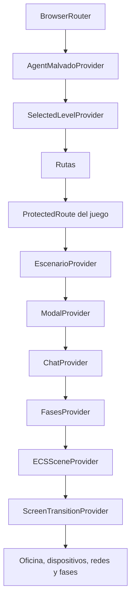

# Frontend

La entrada es [`visual/main.tsx`](../../apps/frontend/src/visual/main.tsx). Usa `createRoot`, `BrowserRouter` y rutas de React Router. `visual/features` contiene pantallas y adaptadores de interfaz; `ecs` contiene comportamiento de simulación; `data` define contenido educativo.

## Funcionalidades

| Directorio en `src/visual/features/` | Responsabilidad |
|---|---|
| `admin-docente-y-estudiante` | Formularios de acceso, correo, perfiles, cursos y vistas docentes |
| `escenarios-simulados` | Selección de nivel, escena 3D, fases, tutorial, logs y ranking |
| `hardening-de-dispositivos` | Escritorio simulado, apps, consola, activos y configuraciones |
| `simulacion-redes` | Tabla y topología, firewall, redes y perfiles VPN |
| `chat` | Interfaz del tutor, selección de contexto y reproducción de audio |
| `feedback` | Estado, generación y presentación de retroalimentación |
| `course-analysis` | Solicitud y presentación del análisis del curso |
| `agent-malvado` | Generación y normalización de desafíos dinámicos |

`visual/common` agrupa componentes, hooks, contextos, estilos e iconos reutilizables. `shared` se comparte dentro del frontend, no con el backend. El módulo `chat/` separa fachada y casos de uso de su transporte HTTP.

## Rutas y guards actuales

| Ruta | Vista | Control del cliente |
|---|---|---|
| `/login`, `/signup` | `AuthPage` | Pública |
| `/verificar-email` | Reenvío y estado de confirmación | Pública |
| `/auth/confirm` | Confirmación por token | Pública |
| `/recuperar-contrasenia`, `/auth/reset-password` | Recuperación y cambio | Pública |
| `/docente` | Panel docente | Token presente, correo marcado confirmado, rol profesor |
| `/docente/grupo/:id` | Detalle de grupo | Igual que panel docente |
| `/docente/estudiante/:idEstudiante` | Historial del estudiante | Igual que panel docente |
| `/seleccion-niveles`, `/perfil` | Vistas de estudiante | Token presente, confirmación y rol estudiante |
| `/`, `/dispositivos`, `/redes`, `/fases-partida` | Juego | Token presente y confirmación; no exige rol estudiante |
| Cualquier otra | `NotFound` | Sin guard |

Los guards leen `localStorage`; no comprueban firma o expiración del JWT. `EscenarioProvider` redirige a selección si no hay escenario en memoria. Al recargar desde dispositivos o redes, la entrada usa `sessionStorage` para reemplazar la ruta por `/`; esto tampoco recupera el nivel.

## Composición del estado

Los providers del juego comparten vida entre las rutas del `Outlet`. La selección 3D se transforma en referencias a entidades ECS y datos de dispositivo. Los hooks `useECS*` conectan eventos del motor con actualizaciones visuales. La escena usa modelos GLTF y modelos procedurales; las posiciones de datos se complementan con layouts y configuración en `escenarios-simulados`.

## Sesión y progreso

`useAuth` guarda `authToken`, `userRole`, `emailConfirmado` y `user`. Logout elimina esas cuatro claves; no hay refresh token ni revocación del JWT en la API. El slug del nivel se guarda aparte como `slug_escenario_actual`. El controlador de progreso obtiene el identificador del estudiante desde `user`.

El ranking consulta la lista de estudiantes y luego el historial de cada uno. Calcula, por escenario completado, `round(1000 × 0.7^fallosPrevios)` hasta el primer éxito y suma esos valores. Ordena por puntaje y nombre; los empates comparten posición. El cálculo está en el navegador, sin endpoint dedicado ni ponderación por tiempo. Las llamadas crecen con el número de estudiantes.

## Transporte HTTP

La configuración central devuelve `VITE_BACKEND_URL` si existe; en otro caso devuelve `/api`. El proxy de Vite elimina el primer `/api`:

| Cliente con base `/api` | Solicitud desde navegador | Express recibe |
|---|---|---|
| Login | `/api/auth/login` | `/auth/login` |
| Progreso | `/api/progreso` | `/progreso` |
| Chat | `/api/api/chat` | `/api/chat` |
| Generador | `/api/agent-malvado/generate` | `/agent-malvado/generate` (no montada) |

La repetición de `/api` en chat deriva de su adaptador actual. El generador elimina `/api` de su base antes de añadir su endpoint; con el fallback `/api` su solicitud pierde el prefijo requerido al pasar por el proxy y termina en 404. Con `VITE_BACKEND_URL=http://localhost:3000`, las llamadas van directamente a Express y ambas rutas coinciden. El hook de análisis de curso usa otra variable, `VITE_API_URL`, y cae a `http://localhost:3000`; debe configurarse también para un despliegue remoto. Los proxies de Vite solo existen en desarrollo y preview.

## Evidencia

- [Guards y sesión](../../apps/frontend/src/visual/features/admin-docente-y-estudiante/hooks/useAuth.ts), [guard general](../../apps/frontend/src/visual/features/admin-docente-y-estudiante/components/ProtectedRoute.tsx) y [guard por rol](../../apps/frontend/src/visual/features/admin-docente-y-estudiante/components/ProtectedRouteByRole.tsx).
- [Configuración HTTP](../../apps/frontend/src/shared/config/apiConfig.ts), [Vite](../../apps/frontend/vite.config.ts) y [hook de análisis](../../apps/frontend/src/visual/features/course-analysis/hooks/useGenerateCourseAnalysis.ts).
- [Selección](../../apps/frontend/src/visual/common/contexts/SelectedLevelContext.tsx), [escenario](../../apps/frontend/src/visual/common/contexts/EscenarioContext.tsx) y [ranking](../../apps/frontend/src/visual/features/escenarios-simulados/hooks/useLeaderboard.ts).
