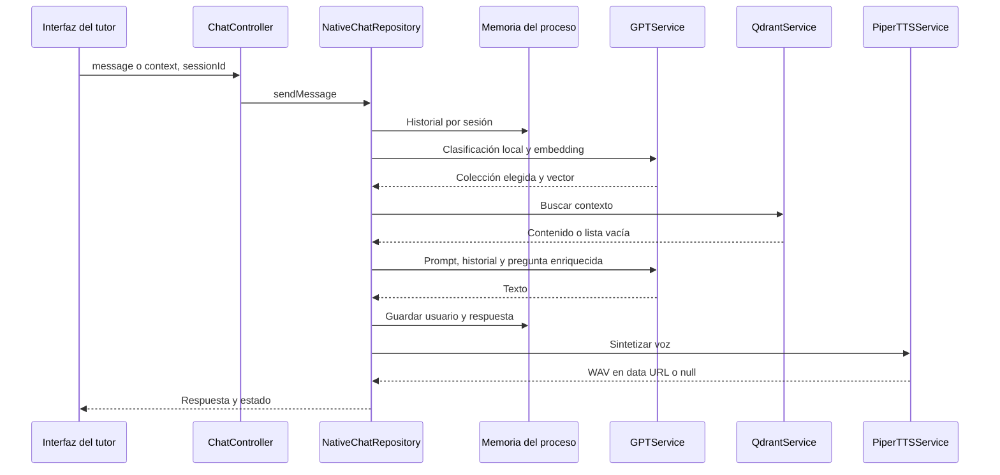

# Integraciones e inteligencia artificial

El repositorio implementa adaptadores; la infraestructura, workflows, corpus, voces y credenciales externas no forman parte de este código. Esta página describe lo observado sin afirmar disponibilidad real de proveedores.

## Chat y recuperación

`GPTService` llama mediante `fetch` a `/embeddings` y `/chat/completions` bajo `OPENAI_BASE_URL` (por defecto la base de OpenAI). Los modelos predeterminados del código son `gpt-4o-mini` y `text-embedding-3-small`; son valores de implementación, no recomendaciones de modelos actuales.

La clasificación de herramienta es determinista por palabras clave. Una consulta contextual con el prefijo del sistema siempre elige `Contexto`; palabras como firewall, VPN, firma o phishing eligen `InformationSecurity`; el resto cae a contexto. No hay una llamada de IA para decidir la herramienta ni ejecución dinámica de tools.

| Colección por defecto | Uso |
|---|---|
| `ciberseguridad` | Conceptos generales de seguridad |
| `ContextoCiberSeguridad` | Contexto educativo de la simulación |

Qdrant busca por vector con `RAG_TOP_K=20` y `RAG_SCORE_THRESHOLD=0.7`, incluyendo payload. Extrae el primer texto disponible en `text`, `content`, `document`, `page_content` o `chunk`; si no encuentra uno, serializa el payload. Los resultados se unen al mensaje enviado al modelo.

Fallos de búsqueda Qdrant se convierten en una lista vacía y permiten continuar sin RAG. Fallos de embedding o generación detienen la respuesta y retornan `success: false`. No existen límites de tiempo explícitos en las llamadas `fetch` a OpenAI, n8n o Piper. El prompt y el material recuperado no son una validación de reglas de aplicación.

## Memoria y audio

La memoria mantiene `sessionId → mensajes, lastAccess` en un `Map` singleton. Retiene veinte mensajes por defecto, configurables con `CHAT_MEMORY_MAX_MESSAGES`. La limpieza se ejecuta cada treinta minutos y elimina sesiones con más de una hora de inactividad. No es una expiración puntual exactamente a la hora. No hay persistencia, aislamiento por identidad autenticada ni coordinación entre réplicas.

Piper exige tanto `PIPER_TTS_API_URL` como `PIPER_TTS_BASE_URL` al construirse. Envía multipart con `text` y voz `female` por defecto. Acepta `audio_base64`, o `url` que concatena con la base para descargar WAV. Devuelve `data:audio/wav;base64,...`. El fallo operativo de voz permite una respuesta de texto sin audio; la falta de variables impide el arranque actual.

## Webhooks n8n

| Función | Body enviado por backend | Resultado esperado y destino |
|---|---|---|
| Feedback | `{ id_estudiante, slug_escenario }` | Cuatro textos: análisis, fortaleza, área de mejora y consejo; PostgreSQL |
| Análisis de curso | `{ id_curso, id_profesor }` | Estadísticas y cinco secciones; PostgreSQL |
| Escenario | `{ prompt }` | Definición externa dentro de `{ success, data }`; normalización en cliente |

El backend no envía el historial completo de intentos a esos dos primeros webhooks. La forma en que el workflow obtiene información adicional no puede inferirse de este repositorio. Feedback confía en el tipado estático de la respuesta; análisis solo comprueba inicialmente `analisis` y `resumen`. No hay firma de webhook ni autorización adicional implementada en esos adaptadores.

El generador usa una URL externa fija como respaldo si falta `N8N_SCENARIO_WEBHOOK_URL`. El prompt predeterminado menciona herramientas `buscar_topologias` y `buscar_desafios` que pertenecen al workflow externo, no a la API Express. El seed y timestamp creados por el controller no se envían a n8n. Las reglas del prompt no garantizan que el resultado recibido cumpla un esquema.

## Exportación de conocimiento

El [exportador](../../apps/frontend/scripts/export-rag-knowledge.ts) importa explícitamente los cinco escenarios activos y escribe dos JSON con estructura y un campo `text` para embeddings:

- `apps/frontend/scripts/rag-output/topologias.json`: zonas, oficinas, dispositivos, redes y personas.
- `apps/frontend/scripts/rag-output/desafios.json`: fases, eventos, ataques y contenido de retos.

La salida se resuelve desde el directorio del script, no desde la raíz. Los JSON preexistentes en `scripts/rag-output/` no son el destino del script actual. Debe acordarse cuál se versiona antes de actualizar material consumido externamente.

El script no llama IA, no carga Qdrant y no se ejecuta durante una partida. La ingestión, fragmentación, embeddings y creación de colecciones se realizan fuera del repositorio. Los nombres de colecciones usadas por el generador externo no están verificables aquí; no asumir que son las mismas del tutor.

Al cambiar modelo de embeddings, reindexar el corpus con el mismo modelo y dimensión utilizados para las consultas. La guía [escenarios](../guides/escenarios.md) explica cómo regenerar la fuente sin publicar automáticamente cambios externos.

## Correo y PostgreSQL

Nodemailer envía confirmación y recuperación usando SMTP. `FRONTEND_URL` construye enlaces a `/auth/confirm` y `/auth/reset-password`, además de controlar CORS en producción. Las rutas HTML del frontend y rutas JSON de Express comparten nombres pero corresponden a servidores distintos.

PostgreSQL es el almacenamiento transaccional; Qdrant no contiene usuarios ni sesiones por diseño de estos adaptadores. La salud HTTP básica no garantiza conexión a ninguno de ellos.

## Evidencia

- [Repositorio de chat](../../apps/backend/src/chat/infrastructure/repositories/NativeChatRepository.ts), [GPT](../../apps/backend/src/chat/infrastructure/services/GPTService.ts), [Qdrant](../../apps/backend/src/chat/infrastructure/services/QdrantService.ts), [memoria](../../apps/backend/src/chat/infrastructure/services/ConversationMemoryManager.ts) y [Piper](../../apps/backend/src/chat/infrastructure/services/PiperTTSService.ts).
- [Feedback n8n](../../apps/backend/src/feedback/infrastructure/repositories/N8nFeedbackRepository.ts), [análisis n8n](../../apps/backend/src/course-analysis/infrastructure/repositories/N8nCourseAnalysisRepository.ts) y [generador n8n](../../apps/backend/src/agent-malvado/infrastructure/repositories/N8nWebhookRepository.ts).
- [Servicio de correo](../../apps/backend/src/auth/infrastructure/service/EmailService.ts), [ADR 0004](../project/adrs/0004-ia-y-conocimiento-externos.md) y [configuración](../guides/configuracion.md).
