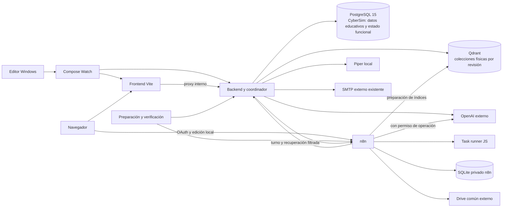

# Investigación y recomendaciones para el desarrollo con Docker

Esta referencia conserva las alternativas, riesgos, fuentes y justificaciones que sustentan el sistema. Sus conclusiones se concretan en el [contrato vigente](contrato-desarrollo-docker.md) y los [ADRs](../project/adrs/README.md).

Para consultar lo incorporado al código, las verificaciones y los límites actuales, usar el [estado del entorno](../project/estado-desarrollo-docker.md). Los pendientes que aparecen en el informe original corresponden a su fecha de investigación; las decisiones vigentes están en [D01–D26](../project/decisiones-desarrollo-docker.md).

## Investigación y evidencia conservadas

El contenido original permanece completo, incluidas las opciones retiradas y el motivo de su sustitución.

Leer el informe original y todas sus referencias

Los textos siguientes conservan el contexto de su elaboración. Sus pendientes y expresiones de futuro describen esa revisión histórica; el estado vigente es el indicado arriba. No son instrucciones actuales de ejecución.

# Investigación y recomendaciones para el desarrollo con Docker

> Cierre posterior: [contrato v1](contrato-desarrollo-docker.md) especificado por encargo. Ante diferencias, prevalecen sus selecciones: API pública n8n, transporte OpenAI coordinado, singleton funcional, revisión SQL única y permisos acotados. Esta página conserva la comparación previa; no acredita implementación.

- Investigación realizada: **18 de octubre de 2026**.
- Código contrastado: `8de71f5`, con los cambios documentales locales conservados.
- Estado: **recomendaciones seleccionadas; implementación y pruebas del stack no iniciadas**.
- Alcance: los cuatro bloques pendientes y los seis temas operativos enumerados en la conversación. Los identificadores I01–I10 organizan esta investigación; no son nuevas decisiones D ni historias HU.
- Revisión posterior del mismo día: **retirada la recomendación `cybersim_dev_control`**. I10 y el diagrama se corrigen según la [investigación específica de persistencia](investigacion-persistencia-operativa.md) y la [propuesta ADR 0008](../project/adrs/0008-persistencia-funcional-compartida-entre-entornos.md): estado funcional en la base de CyberSim con Prisma; preparación Docker sin una base especial.
- Auditoría posterior: [revisión final D01–D26 y parámetros](auditoria-desarrollo-docker.md). H01 corrige I06: el manifiesto SQL sería la única autoridad de publicación; los aliases no coordinan transacciones con PostgreSQL. H02–H12 precisan los demás contratos. Son correcciones propuestas, no implementación ni aceptación del usuario.

La fuente de decisiones aceptadas sigue siendo la [planificación D01–D26](../project/decisiones-desarrollo-docker.md). Este informe propone cómo concretarlas. No convierte sus cifras, dependencias nuevas o comandos futuros en acuerdos del usuario. El [resumen para el proyecto](../project/recomendaciones-desarrollo-docker.md) explica sus consecuencias sin repetir el diseño.

## Método y cobertura

Se compararon alternativas por compatibilidad con CyberSim, facilidad de incorporación de un desarrollador, conservación de datos, coste operativo y recursos dentro del objetivo de 8 GB. Se consultaron documentación y código de mantenedores, prácticas publicadas por AWS Builders’ Library, Google SRE y Microsoft Architecture Center, y discusiones originales de desarrolladores. No existe una única forma de trabajar de todos los «seniors»; las elecciones de este informe son inferencias aplicadas al proyecto, no consensos atribuidos a esas empresas.

Las fuentes están enlazadas en cada tema y se catalogan al final. Un foro sirve para identificar experiencias y riesgos; los contratos de herramientas se contrastan con documentación o código primario. Una incidencia histórica no demuestra que el mismo fallo persista en la versión que se vaya a fijar.

| Tema solicitado | Investigación | Selección recomendada |
|---|---|---|
| Modelos y presupuesto | I01 | Configuración por función, evaluación reproducible y consumo visible |
| Límites y retención | I02 | Presupuestos explícitos y valores iniciales conservadores, ajustados con pruebas |
| Preparación y recuperación | I03 | Compose Watch y preparación por etapas verificables y reanudables |
| Criterios de disponibilidad | I04 | Comprobación de procesos, dependencias y aceptación funcional con evidencias separadas |
| Credenciales externas | I05 | `.env` privado, reparto por servicio, OAuth individual y SMTP existente |
| Conocimiento e índices | I06 | Reconciliación Drive, IDs/hashes y publicación mediante colecciones de revisión |
| Piezas ausentes y contratos | I07 | Reconstrucción acotada de workflows y servidor oficial Piper adaptado |
| Edición y herramientas | I08 | Compose Watch para fuentes; escritura al host solo mediante herramientas explícitas |
| Seed y migraciones | I09 | Migraciones versionadas y seed transaccional que complete faltantes sin sobrescribir |
| Versiones, red y operación | I10 | Versiones fijadas, servicios internos y coordinación global sin Redis adicional |

## Evidencia del proyecto que condiciona la elección

Se releyeron los [workspaces](../../package.json), [scripts backend](../../apps/backend/package.json), [scripts frontend](../../apps/frontend/package.json), [Compose](../../compose.yaml), [configuración Vite](../../apps/frontend/vite.config.ts), [arranque Express](../../apps/backend/src/server.ts), [SMTP](../../apps/backend/src/auth/infrastructure/controllers/AuthController.ts), [GPTService](../../apps/backend/src/chat/infrastructure/services/GPTService.ts), [Piper](../../apps/backend/src/chat/infrastructure/services/PiperTTSService.ts), [configuración Prisma](../../apps/backend/prisma.config.ts) y [seed](../../apps/backend/prisma/seed.ts). Los contratos de [feedback](../../apps/backend/src/feedback/domain/models/Feedback.ts) y [análisis](../../apps/backend/src/course-analysis/domain/models/CourseAnalysis.ts) y el [exportador RAG](../../apps/frontend/scripts/export-rag-knowledge.ts) se contrastaron también.

Los hallazgos anteriores de los exports ignorados de `workspace/n8n` están en la [evaluación](evaluacion-desarrollo-local-docker.md) y la [revisión detallada C01–C16](revision-detallada-arranque-docker.md). No se ejecutaron ni se exportaron credenciales. La existencia histórica del volumen PostgreSQL no demuestra su contenido actual.

## I01 — Modelos, coste y calidad

**Opciones comparadas.**

| Alternativa | Ventaja | Motivo para elegirla o descartarla |
|---|---|---|
| Conservar `gpt-4o-mini` para todo | Menor cambio inicial en el tutor | La página oficial consultada lo marca como deprecated; no es la base recomendada para una nueva configuración |
| Modelo económico para todas las tareas | Configuración y consumo simples | Candidato válido, pero no demuestra calidad suficiente para escenarios complejos |
| Modelo de mayor capacidad para todas las tareas | Reduce decisiones de enrutamiento | Gasto innecesario para preguntas sencillas y embeddings no se resuelven con ese mismo modelo |
| Modelo por función y evaluación común | Equilibra coste y requisitos | **Elegida**; hace explícitos los cambios y permite medirlos |
| Cambio automático al modelo caro tras un fallo | Puede recuperar alguna salida | Descartado: añade gasto y repeticiones contrarias a D09 sin una decisión expresa |

La [selección oficial de modelos](https://developers.openai.com/api/docs/guides/model-selection) distingue modelos eficientes y de mayor capacidad. La [evaluación oficial](https://developers.openai.com/api/docs/guides/evaluation-best-practices) recomienda datos representativos y criterios de éxito. Eso fundamenta el método, no acredita un resultado para CyberSim.

**Selección inicial recomendada, sujeta a acceso y evaluación real:**

| Función | Candidato | Integración propuesta |
|---|---|---|
| Tutor y feedback individual | `gpt-6-luna`, esfuerzo `none` | Tutor puede conservar Chat Completions; feedback con formato estructurado |
| Análisis de curso y escenarios | `gpt-6.1-sol`, esfuerzo `low` | Responses; el agente de escenarios conserva consultas al catálogo y genera el JSON |
| Embeddings de todos los índices y consultas | `text-embedding-3-small`, 1536 dimensiones | Mismo modelo, dimensión y normalización en backend y n8n |

Las páginas de [Luna](https://developers.openai.com/api/docs/models/gpt-6-luna) y [Sol](https://developers.openai.com/api/docs/models/gpt-6.1-sol) respaldan sus capacidades y restricciones: Sol necesita Responses para herramientas; Luna permite function calling en Chat Completions con esfuerzo `none`. El [nodo OpenAI de n8n](https://docs.n8n.io/integrations/builtin/cluster-nodes/sub-nodes/n8n-nodes-langchain.lmchatopenai/) documenta el selector Responses y JSON Schema. Aun así, se debe verificar el ciclo de herramientas del agente con la imagen fijada. No activar web search ni file search alojado: el conocimiento elegido permanece en Qdrant local.

Precios estándar publicados al consultar, USD por millón de tokens: Luna entrada 0,10/salida 0,50; Sol entrada 2/salida 10; [embeddings small](https://developers.openai.com/api/docs/models/text-embedding-3-small) entrada 0,02. Como ejemplo aritmético sin caché, herramientas, razonamiento adicional ni impuestos, 8.000 tokens de entrada y 1.000 de salida cuestan 0,0013 USD en Luna y 0,026 USD en Sol. No es una estimación mensual del proyecto.

Recomiendo registrar función/modelo/tokens/duración y coste estimado por operación, con tabla de precios fechada. Usar un proyecto OpenAI de desarrollo y claves diferenciadas por desarrollador. Un presupuesto monetario debe acordarse con quien paga; no asignarlo por investigación. Los [avisos de gasto](https://developers.openai.com/api/docs/guides/terraform/rate-limits-and-spend) no bloquean tráfico; la documentación actual también distingue [límites duros](https://developers.openai.com/api/docs/guides/spend-limits), cuya aplicación no es instantánea. No prometer un límite exacto al céntimo ni confundir una alarma con un bloqueo.

**Aceptación propuesta:** conjunto inicial de 30 casos en español: 10 de tutor —incluyendo ausencia de contexto—, 5 de feedback, 5 de análisis y 10 de escenarios. Todos los contratos y restricciones deterministas deben cumplirse; revisar relevancia y fidelidad con rúbrica, sin llamar a la IA para calificar automáticamente todo. Incluir rechazos del proveedor y respuestas truncadas. Son pruebas futuras, no resultados obtenidos.

## I02 — Límites de entrada/salida y conservación

**Comparación:** límites máximos del proveedor solamente no protegen RAM/disco de la aplicación; limitar únicamente caracteres no controla el contexto real; comprimir/resumir todo con otra IA añade llamadas y altera contenido. Elijo límites de bytes en transporte, tokens en IA y conservación por edad/cantidad, con rechazo explícito y ajustes documentados.

Microsoft compara fragmentación fija, por oraciones, estructura y semántica en su [guía de chunking](https://learn.microsoft.com/en-us/azure/architecture/ai-ml/guide/rag/rag-chunking-phase). Para TXT/Markdown, propongo respetar encabezados/párrafos y subdividir por tokens; no añadir un modelo para decidir cortes. Ninguna fuente establece un tamaño universal óptimo.

Valores **propuestos para medir**, no límites ya aprobados ni valores oficiales:

| Elemento | Punto inicial | Al excederlo |
|---|---|---|
| TXT/Markdown | UTF-8, 1 MiB por archivo; corpus activo 50 MiB | Rechazar archivo nuevo/revisión, indicar causa y conservar revisión anterior si aún autorizada |
| Fragmentos | Objetivo 500 tokens, máximo 800, solapamiento 75 | Dividir por fronteras legibles; no repetir solapamiento al presentar contexto |
| Unidad de indexación | Hasta 8 fragmentos o 4.000 tokens de embeddings, lo que ocurra primero | Persistir avance y ceder turno a interacción |
| Mensaje/prompt del usuario | 16 KiB y 2.000 tokens | Error de validación antes de llamar al proveedor |
| Contexto tutor | Hasta 20 candidatos recuperados; seleccionar como máximo 8 y 4.000 tokens | Priorizar pertinencia y fuentes; no usar el score 0,7 como verdad universal |
| Historial temporal | 20 mensajes, hasta 4.000 tokens, 60 min de inactividad; máximo 50 sesiones | Retirar pares antiguos; caducidad comprobada al acceder; aviso de pérdida conforme D22 |
| Entrada IA tutor / otras funciones | 12.000 / 24.000 tokens contando instrucciones, esquema y herramientas | Reducir datos redundantes de forma determinista o rechazar; no omitir alumnos en silencio |
| Salida IA | Tutor 1.000, feedback 1.500, análisis 4.000, escenarios 8.000 tokens | Detectar salida incompleta; no completar inventando ni repetir automáticamente |
| Transporte de escenarios | Hasta 256 KiB de JSON validado | Rechazo; nunca truncar un JSON para hacerlo caber |
| Voz | Hasta 4.000 caracteres y 10 MiB WAV; 15 s dentro del plazo global | Entregar texto y aviso de audio no disponible; no cortar texto narrado sin indicarlo |

Los tokens de razonamiento, cuando existan, participan en el presupuesto que corresponda al modelo. Los datos de análisis se agregan sin perder integrantes antes de enviarlos: no se introduce particionado con múltiples llamadas hasta demostrar que hace falta. Los límites por ruta evitan que una respuesta con audio/base64 eleve indiscriminadamente el tamaño permitido a todas las peticiones Express.

**Retención elegida:** logs estructurados sin cuerpos completos/tokens de autenticación, driver Docker `local` con 10 MiB × 3 archivos por servicio; n8n conserva errores y ejecuciones manuales para depurar, no éxitos automáticos ni progreso de cada nodo. Pruning inicial de 72 horas o 1.000 ejecuciones. Sus parámetros se contrastaron también con el [código n8n 2.43.7](https://raw.githubusercontent.com/n8n-io/n8n/n8n%402.43.7/packages/%40n8n/config/src/configs/executions.config.ts).

La [gestión de ejecuciones n8n](https://docs.n8n.io/hosting/scaling/execution-data/) advierte que algunas ejecuciones no son elegibles para pruning y que SQLite reutiliza espacio sin reducir siempre el archivo. El límite por cantidad no es una cuota estricta de disco. El [driver Docker local](https://docs.docker.com/engine/logging/drivers/local/) permite rotación; no usar `json-file` ilimitado. Proponer aviso de poco espacio a 5 GiB libres y pausa de nuevas indexaciones por debajo de 2 GiB, conservando datos; verificar la medición desde el filesystem que contiene cada volumen.

**Prueba necesaria:** extremos de límites, mensajes multibyte, corpus repetido, salida IA cortada, agotamiento de disco simulado y limpieza que nunca borre credenciales/workflows/corpus vigente o progreso educativo.

## I03 — Arranque, esperas y recuperación

| Alternativa | Evaluación |
|---|---|
| Un script largo con pausas fijas | Frágil: un servicio puede tardar más o fallar tras la pausa |
| Solo `depends_on` / contenedor running | No verifica preparación funcional |
| Instalar dependencias y reimportar todo en cada arranque | Lento y contrario a D06; puede sobrescribir ediciones |
| Etapas con condiciones, estado y diagnóstico | **Elegida**, con operaciones repetibles e intervención humana explícita |

Docker diferencia [orden de inicio y condiciones de dependencias](https://docs.docker.com/compose/how-tos/startup-order/). AWS explica por qué los [reintentos y timeouts](https://aws.amazon.com/builders-library/timeouts-retries-and-backoff-with-jitter/) deben tener límites y no multiplicarse entre capas. Adaptación: reintentar comprobaciones de red idempotentes de preparación, con backoff limitado; no reintentar envío SMTP ni generación interactiva automáticamente.

**Comando recomendado para implementar:** `docker compose up --build --watch`, desde la raíz. Es el único comando de arranque cotidiano propuesto; todavía no funciona con el Compose actual. Será adjunto y mantendrá la vigilancia mientras siga abierto. El cierre con Ctrl+C y el posterior `docker compose down` se documentarán preservando volúmenes.

El [CLI Compose](https://docs.docker.com/reference/cli/docker/compose/up/) indica que `--wait` implica modo detached: no se utiliza aquí como sustituto del estado funcional. El comando inicia infraestructura y preparación; necesita Docker Desktop Linux/WSL, `.env` provisionado y, al principio, alta local del propietario n8n y consentimiento Google. Mostrar esas tareas y esperar no equivale a anunciar listo. No automatizar consentimiento ni usar un endpoint privado de n8n para saltarse su alta de propietario.

Etapas propuestas: preflight → generación de cliente/infraestructura y DB → migraciones/seed → inicialización n8n/voz → autorización y conexiones → corpus → aceptación → disponible. Sus huellas y diagnósticos pueden registrarse en artefactos de preparación; no requieren una base ni tablas funcionales de arranque. Los documentos/revisiones/operaciones sí conservan su estado funcional en la base de CyberSim. Volver a comprobar estado al reanudar, en vez de confiar solamente en un marcador.

| Espera | Propuesta inicial |
|---|---|
| Descarga/build | Mostrar progreso; aviso tras 20 min, sin prometer duración máxima dependiente de internet |
| Servicio local tras disponer de imagen | Hasta 120 s; salida con diagnóstico si no se prepara |
| Migración y seed | Hasta 180 s por etapa; detener ante error, sin reset automático |
| Descarga voz | Hasta 300 s por intento, reanudación/comprobación de integridad |
| Autorización humana | Estado `requiere_configuracion`, sin consumir los plazos de las peticiones IA |
| Indexación inicial | 60 s por unidad, 15 min de trabajo por intento; conservar avance y explicar cómo reanudar |
| Arranque ya preparado | Objetivo 120 s sin nuevas descargas ni corpus cambiado, por medir |

No mantener una transacción SQL abierta esperando Google o al usuario. Un timeout de indexación no debe desechar unidades confirmadas. Una operación remota cuyo resultado quedó incierto se reconcilia antes de repetirla; eso no garantiza ausencia absoluta de cobro si la conexión a OpenAI se cortó tras aceptar la petición.

## I04 — Disponibilidad y aceptación

**Comparación:** healthchecks de puertos son baratos pero insuficientes; ejecutar todos los casos de IA/correo en cada healthcheck causa gasto y efectos externos; un E2E con mocks verifica UI pero no proveedores. Elijo tres niveles separados, siguiendo la distinción de observación interna y comprobación de comportamiento del [libro Google SRE](https://sre.google/sre-book/monitoring-distributed-systems/).

| Nivel | Comprobaciones propuestas | Frecuencia |
|---|---|---|
| Proceso | HTTP del servicio, conexión DB, proceso de voz | Healthchecks ligeros; no llamadas pagadas |
| Preparación | Migraciones, seed, manifiesto workflows, OAuth/acceso, colecciones/dimensiones/payload y configuración SMTP | Cada arranque y al cambiar su configuración relevante |
| Aceptación funcional | Cuenta/confirmación/recuperación; intento/progreso; tutor; feedback; análisis; escenario; audio | Preparación inicial y cambios que invaliden la evidencia; proveedores reales con consumo y destinatario definidos |

Recomiendo `/health/live` para el proceso, `/health/ready` para el estado agregado y un diagnóstico por componente accesible desde el entorno de desarrollo. Los nombres son futuros. Un backend vivo puede atender la pantalla de preparación antes de que todas las funciones estén habilitadas, evitando un ciclo donde se necesita la propia API para terminar la indexación.

**D08 se conserva:** no mostrar «entorno completo» mientras falta una etapa obligatoria. Separar `preparando`, `requiere_configuracion`, `error`, `listo` y `degradado`. Tras estar listo, D20 y D24 permiten texto sin voz e índice válido sin sincronización, con aviso; Qdrant técnicamente fallido mantiene D19.

La prueba completa se propone como un perfil explícito `verify` ejecutado por `docker compose --profile verify run --rm verify`. El contenedor, la configuración y la limpieza de datos de prueba todavía deben construirse. Una solicitud de registro real puede enviar correo: requiere un destinatario de desarrollo definido y no se hace en cada reinicio. [Nodemailer verify](https://nodemailer.com/smtp) comprueba conexión/autenticación sin enviar, pero no garantiza aceptación del remitente ni entrega en bandeja.

Conservar un acta de aceptación como artefacto de verificación, con huellas de imagen, lockfile, contratos, workflows, corpus, modelo/dimensiones y perfil probado; no necesita una base de desarrollo. No guardar las claves ni su hash. Una edición de código invalida las pruebas de los recorridos que cambia; un proveedor que fue validado ayer puede fallar hoy. El estado actual depende también de chequeos y fallos recientes. El acta no es un permiso perpetuo ni se usa para saltarse requisitos actuales.

**Pruebas con fallos inducidos:** interrumpir preparación y repetir; Qdrant sin colección/dimensión errónea; Drive con OAuth caducado; archivo eliminado e inventario parcial; audio lento; escenario inválido; resultado n8n tardío; dos solicitudes y tercera rechazada; reset Prisma manual en un entorno de prueba. [Playwright](https://playwright.dev/docs/test-webserver) permite coordinar servicios para E2E, pero se comprobará el stack real existente, sin levantar otra API o interceptar los recorridos que se quieren acreditar.

## I05 — Credenciales, OAuth y correo externo

| Opción | Resultado para este proyecto |
|---|---|
| Secretos en imagen/JSON versionado | Descartada; dificulta revocación y distribución segura |
| Vault/cloud secret manager obligatorio | Exceso de infraestructura y dependencia para esta etapa |
| Compose secrets desde archivos | Alternativa válida, añade archivos y soporte `_FILE` por consumidor |
| `.env` raíz privado y variables expresas por servicio | **Elegida**, por D13; plantilla pública sin valores privados |

Los [secrets de Compose](https://docs.docker.com/compose/how-tos/use-secrets/) son montajes concedidos por servicio, no un almacén cifrado universal ni una capacidad `_FILE` automática de cualquier aplicación. Para respetar el archivo único elegido, recomiendo variables de ejecución seleccionadas; no pasar todo el `.env` a cada contenedor. Sus valores pueden ser inspeccionados por quien controla Docker: no prometer que las variables son secretas frente al administrador local.

OpenAI: claves de proyecto por desarrollador cuando la cuenta lo permita. SMTP: credencial del proveedor existente con alcance de desarrollo; no escoger otro proveedor ni asumir que hay cuentas separadas disponibles. Google: Client ID/Secret del equipo y permisos individuales en la carpeta común; tokens dentro de n8n, con su clave estable. Compartir configuración privada por el gestor de contraseñas/canal privado que tenga el equipo, nunca en Git ni en logs; queda identificar al responsable con acceso real, no pedir claves por el chat.

Para n8n recomiendo crear/importar credenciales iniciales con identificadores estables y valores privados usando mecanismos soportados de la versión fijada, y conservarlas después. `import:credentials` del [Server CLI](https://docs.n8n.io/hosting/cli-commands/) permite bootstrap; un archivo temporal de secretos debe quedar fuera del repo, evitar impresión y borrarse después. No reimportar para sustituir tokens cada arranque. La alta de propietario y asociación al proyecto debe probarse con una instancia vacía: no dar por supuesto un usuario ya existente. Las actualizaciones posteriores de credenciales son expresas y distintas de actualizar JSON de workflows.

El callback OAuth propuesto es `http://localhost:5678/rest/oauth2-credential/callback`, contrastado con el valor que muestre n8n. Hostnames internos Docker no sirven al navegador. El [procedimiento n8n Google](https://docs.n8n.io/integrations/builtin/credentials/google/oauth-single-service/) y [Google OAuth](https://developers.google.com/identity/protocols/oauth2) explican consentimiento y expiración. Para el equipo pequeño recomiendo comenzar como aplicación External/Testing con usuarios de prueba explícitos y aceptar reautorización; no garantiza autorización permanente: el refresh token de Drive puede durar siete días. Cambiar el estado de publicación para evitar esa caducidad requiere comprobar políticas/avisos y acceso al proyecto, no es una acción automática incluida aquí.

Preferir `drive.readonly` cuando el nodo y el flujo lo permitan. Los [scopes de Drive](https://developers.google.com/workspace/drive/api/guides/api-specific-auth) no convierten `drive.file` en acceso a cualquier carpeta preexistente. Si el nodo exige permisos de escritura, evaluar HTTP Request con OAuth compatible antes de ampliar permisos; no asegurar que la credencial especializada permite reducirlos sin comprobarlo.

`drive.readonly` abarca los archivos accesibles por la cuenta, no constituye un permiso OAuth limitado a esa carpeta. El workflow debe aplicar el alcance configurado; la selección de una carpeta en n8n no reduce por sí sola el scope concedido por Google. Una cuenta individual dedicada al desarrollo, con acceso solo al material necesario, es una alternativa para reducir ese alcance sin compartir tokens entre desarrolladores.

SMTP: conservar Nodemailer, TLS validado y remitente autorizado. Para 465, TLS desde conexión; para 587, STARTTLS exigido si corresponde al proveedor. Timeouts propuestos de conexión 10 s y socket 20 s. Nunca desactivar validación de certificado para hacer pasar una prueba. `FRONTEND_URL` apunta al frontend del host, aunque el proveedor sea externo. La caída SMTP debe informar del error sin afirmar que el destinatario recibió el mensaje; revisar el registro ya creado antes de reintentar un alta.

## I06 — Drive, fragmentos y publicación del conocimiento

| Estrategia | Comparación |
|---|---|
| Insertar de nuevo en cada evento | Simple, pero mantiene duplicados/versiones antiguas si cambian los IDs |
| Vaciar y reconstruir las colecciones activas | Fácil de programar; deja búsquedas vacías o parciales y repite embeddings |
| Actualizar puntos activos y luego borrar sobrantes | Menor disco; exposición parcial si la secuencia se interrumpe |
| Revisiones preparadas y cambio de alias | Cambio atómico solo en Qdrant; retirada su autoridad funcional doble con SQL tras H01 |
| Revisiones preparadas y selección única en manifiesto SQL | **Recomendación corregida para el corpus pequeño**; búsquedas fijadas a nombres físicos y firma de embeddings |
| Plataforma de ingestión/cola distribuida adicional | Útil a gran escala; innecesaria para un desarrollador y este corpus |

Google documenta [paginación y consultas de archivos](https://developers.google.com/workspace/drive/api/guides/search-files) y [cursores de cambios](https://developers.google.com/workspace/drive/api/guides/manage-changes). Elijo un workflow de reconciliación n8n con Schedule cada 60 s: inventario completo de la carpeta autorizada durante carga inicial y reconciliación periódica. Evita depender únicamente de eventos nuevos; los documentos previos y cambios durante apagado también se consideran. Para un corpus pequeño prefiero esto a implementar inicialmente todo el feed de cambios. Repetir inventario no repite embeddings si no cambió el contenido.

Alcance propuesto: una carpeta raíz compartida; TXT/Markdown de esa carpeta, sin recursión ni accesos por shortcuts en la primera versión. Rechazar/avisar formatos no admitidos. Si el corpus real usa subcarpetas, ese alcance debe adaptarse expresamente antes de la carga. Los JSON de topologías/desafíos se generan del código versionado en una ruta canónica del repositorio; no se envían los mismos archivos de Drive a las tres colecciones como hacen los exports inspeccionados. No copiar archivos privados a Git.

**Protocolo recomendado:**

1. Registrar origen e identidad: `drive:fileId` o identidad del recurso versionado; hash de contenido normalizado más versión del extractor, fragmentación y modelo/dimensiones. Conservar nombre, revisión, tipo y procedencia.
2. Completar todas las páginas del inventario y validar el resultado. Una ronda fallida nunca representa una carpeta vacía. Ante 401/403 global, detener sincronización sin purga. Un 404 aislado no prueba por sí solo borrado; contrastar identidad, acceso al origen y evidencia de baja/pérdida.
3. Crear revisión de colecciones de preparación. Copiar vectores/payloads sin cambios y calcular embeddings solo de nuevos fragmentos, cediendo el turno entre unidades. IDs deterministas por documento/revisión/posición; verificación de cantidad y hashes.
4. Validar todas las colecciones físicas necesarias —conocimiento, contexto, topologías y desafíos— y su firma de embeddings antes de publicarlas. La [documentación Qdrant](https://qdrant.tech/documentation/manage-data/collections/) garantiza atomicidad de acciones de alias solo dentro de Qdrant, no con PostgreSQL.
5. Publicar el conjunto mediante una transacción del manifiesto SQL, única autoridad funcional propuesta tras [H01 de la auditoría](auditoria-desarrollo-docker.md#h01--p1-dos-autoridades-para-la-revisión-de-conocimiento). Cada búsqueda captura revisión, nombres físicos y firma antes de generar embeddings. Los aliases quedan opcionales para administración. Limpiar preparaciones abandonadas y revisiones anteriores solo cuando no haya consultas activas que las necesiten; no asumir una transacción distribuida.

Las [operaciones de puntos Qdrant](https://qdrant.tech/documentation/manage-data/points/) permiten reemplazar por ID y son base de la repetibilidad. Eso no implica que una petición externa de embeddings pueda repetirse sin coste. Conservar avances y registro de unidades para reconocer resultados ya confirmados.

Para D18, registrar una retirada confirmada inmediatamente en una lista de exclusión durable. Todas las búsquedas de tutor y herramientas del generador pasarían por un adaptador que aplique exclusiones; no dejar una herramienta n8n consultando directamente una revisión antigua sin filtrar. Si no se puede comprobar esa exclusión, bloquear recuperación conforme D19. El alias anterior no autoriza reutilizar contenido retirado. Tras la publicación válida, eliminar físicamente los puntos retirados de revisiones conservadas y los temporales descargados; no crear snapshots de corpus no autorizados como recuperación implícita.

Para tamaño pequeño, mantener como máximo revisión activa y una anterior autorizada, más una preparación temporal. Se necesita espacio transitorio de varias revisiones; comprobarlo antes de iniciar y no atribuir al alias una reducción de disco. Un cambio de embeddings crea nuevas colecciones y vuelve a indexar: no reutiliza vectores por compartir dimensión. [Qdrant storage](https://qdrant.tech/documentation/manage-data/storage/) permite reducir presión RAM mediante almacenamiento en disco; comprobar el parámetro aceptado por la versión elegida, porque la documentación actual introduce opciones posteriores.

**Pruebas:** misma revisión dos veces; archivo que se acorta; modificación durante carga; interrupción antes/después de publicar el manifiesto; cambio de modelo durante una búsqueda; baja confirmada mientras se prepara otra revisión; error de token y página faltante. Usar corpus conocido con preguntas de referencia para calibrar recuperación suficiente, sin prometer que un score garantiza relevancia.

## I07 — Workflows que faltan, contratos y voz

**Alternativas:** importar sin cambios es insuficiente; trasladar todo al backend contradice D03; simular respuestas para declarar éxito contradice D08/D12. Elijo reconstrucción limitada de las piezas ausentes en n8n y adaptaciones verificables de los contratos existentes.

| Pieza | Cambio propuesto y criterio |
|---|---|
| Feedback individual no encontrado | Workflow con datos autorizados del intento y salida `analisis`, `fortaleza`, `area_mejora`, `consejo`; no inventar rendimiento cuando no hay datos |
| Análisis docente | Agregación determinista de todos los matriculados, incluidos quienes no tienen progreso; fechas reales, nunca convertir duración `tiempo` en timestamp |
| Contexto del tutor | Corpus versionado pequeño sobre la aplicación, cargado por el mismo protocolo; probar enrutamiento de preguntas de contexto |
| Generador | Conservar generación IA y consultas a catálogos; retirar memoria Redis global; esquema y validaciones semánticas antes de aceptar |
| Respuestas n8n | Contrato tipado/versionado, errores explícitos, `operationId` y plazos; validación en servidor antes de persistir o devolver a UI |

[Structured Outputs](https://developers.openai.com/api/docs/guides/structured-outputs) restringe la forma, pero admite rechazos y no elimina errores de significado. Elegir esquema estricto y validación determinista de IDs, conexiones, tipos, presupuestos y referencias del escenario. No agregar un ciclo de reparación automática que cobre llamadas adicionales por defecto.

**Piper, alternativas:** imagen comunitaria con API PHP heredada, wrapper propio alrededor del CLI o HTTP oficial. Elijo construir una imagen pequeña desde Piper oficial fijado y adaptar el cliente a su contrato; evita mantener otra API de archivos/URLs solo por compatibilidad histórica. La [API de Piper v1.8.0](https://raw.githubusercontent.com/OHF-Voice/piper1-gpl/v1.8.0/docs/API_HTTP.md) y su [servidor](https://raw.githubusercontent.com/OHF-Voice/piper1-gpl/v1.8.0/src/piper/http_server.py) reciben JSON en `/synthesize` y devuelven WAV, diferentes del multipart y JSON con URL/base64 que espera CyberSim.

Candidato de voz inicial: `es_ES-davefx-medium`, un hablante, español, frente a `es_ES-sharvard-medium` con dos hablantes. Sus model cards documentan procedencia: [davefx](https://huggingface.co/rhasspy/piper-voices/blob/main/es/es_ES/davefx/medium/MODEL_CARD) declara dataset CC0; [sharvard](https://huggingface.co/rhasspy/piper-voices/blob/main/es/es_ES/sharvard/medium/MODEL_CARD) referencia CC BY 3.0. Son información de datasets, no una evaluación legal exhaustiva de todos los artefactos. Piper publica [GPL-3.0](https://github.com/OHF-Voice/piper1-gpl); conservar licencias/avisos y fijar origen, revisión y checksum del modelo y configuración antes de distribuir. No se ha escuchado ni medido ninguna voz. No se presupone que una voz masculina sea una preferencia del usuario: es un candidato técnico reemplazable.

El backend puede convertir el WAV a la respuesta base64 existente para acotar cambios; UI debe usar `audio/wav` y liberar Object URLs. Modelo cargado una vez, una síntesis en curso, sin cola ilimitada; una frase local en preparación comprueba que no solo existe el archivo. Para hacer efectivo el timeout, controlar el proceso de síntesis y confirmar que terminó antes de admitir otra; cortar `fetch` no mata automáticamente trabajo CPU del servidor. Si exige un wrapper de ejecución para ese control, mantenerlo mínimo y documentar el motivo, sin suponer que el servidor Flask ya lo resuelve.

## I08 — Fuentes, dependencias y herramientas de desarrollo

| Opción | Evaluación |
|---|---|
| Bind mount completo y `node_modules` del host | Descartada: paquetes nativos Windows/Linux y árbol oculto por el montaje |
| Bind mounts de fuentes y volúmenes de dependencias | Válida; en Windows puede requerir polling y manejo de cachés obsoletas |
| Compose Watch para fuentes y dependencias en imagen | **Elegida** para el repo actual en `C:\Users\...` |
| Proyecto en filesystem WSL / Dev Container | Buena alternativa de rendimiento, opcional; no exigir mover el repo/editor |

[Docker Watch](https://docs.docker.com/compose/how-tos/file-watch/) recomienda excluir `node_modules` y permite reconstruir ante manifiestos. [Docker WSL](https://docs.docker.com/desktop/features/wsl/best-practices/) y [Vite](https://vite.dev/config/server-options) advierten de eventos de archivos y coste del polling al editar desde Windows. La inferencia para este caso es sincronizar al filesystem Linux y dejar que Vite/nodemon observen allí; medirlo, no garantizarlo por documentación.

| Cambio en el host | Acción seleccionada |
|---|---|
| Fuentes frontend, recursos y fuentes backend | Sync con exclusiones; HMR frontend y reinicio nodemon backend |
| Manifiestos de ambos workspaces o lockfile raíz | Rebuild de imágenes dependientes con `npm ci` desde la raíz |
| Configuración de proceso | Sync + restart donde baste; recrear si cambian variables de entorno |
| Schema Prisma | Reconstruir/generar cliente y señalar que falta migración; nunca aplicar `db push` al guardar |
| Nueva migración | Creación explícita con carpeta Prisma montada al host; SQL queda versionable |
| JSON workflows | Estado «actualización disponible», sin importación por Watch; D06 |

[`npm ci`](https://docs.npmjs.com/cli/v11/commands/npm-ci/) valida el lockfile sin reescribirlo. Cachear descarga con BuildKit y conservar dependencias de Linux en capas de imagen; no instalar en cada arranque ni compartir un volumen mutable de `node_modules` entre dos instaladores. Copiar los manifiestos de ambos workspaces al preparar la capa de instalación. Fijar también npm y la base Node para reproducibilidad.

Watch sincroniza host → contenedor, no exporta automáticamente archivos generados. Recomiendo un servicio/perfil de herramientas que monte expresamente las rutas de manifiestos, lockfile, Prisma/migraciones y exportaciones necesarias; no ejecutar `npm install` o `migrate dev` dentro de una copia efímera creyendo que volverán al host. Durante esos cambios detener Watch para evitar reconstrucción con archivos a medio escribir y reanudar después.

La resolución de tipos del editor en Windows puede necesitar Node/dependencias locales o conexión a un editor de contenedor. Arrancar y probar servicios no debe depender de esa instalación. Documentar las opciones sin prometer autocompletado completo sin dependencias. No copiar binarios nativos Linux al host; excluir artefactos generados y secretos de sync/build.

Hay una [incidencia histórica de Watch al borrar archivos](https://github.com/docker/compose/issues/11066), cerrada y referida a Windows containers/Compose antiguo. No prueba un fallo vigente en Linux/WSL, pero justifica probar altas, cambios, borrados, renombres y cambio de rama con Watch parado/reanudado. Comparar hashes/listado de fuentes al reanudar: `initial_sync` no debe tratarse como garantía de eliminación de cualquier archivo obsoleto sin probarlo. Ante discrepancia, recrear el contenedor desde fuentes vigentes, preservando volúmenes.

## I09 — Base existente, migraciones y seed

| Alternativa | Resultado |
|---|---|
| Reset o `db push` automático | Descartada por D04 y por pérdida de trazabilidad/datos |
| Ejecutar `migrate dev` al arrancar | Inadecuada: puede pedir reset y necesita shadow DB |
| Aplicar migraciones versionadas + seed repetible | **Elegida**; `migrate dev` queda para crear cambios explícitos |
| Restaurar un dump obligatorio | Añade distribución de datos y envejecimiento del dump; no necesario para este seed pequeño |

La documentación [Prisma v7, desarrollo y producción](https://www.prisma.io/docs/orm/v7/prisma-migrate/workflows/development-and-production) diferencia crear y aplicar migraciones. El [CLI v7](https://www.prisma.io/docs/orm/v7/reference/prisma-cli-reference) aclara que `migrate deploy` no detecta drift ni genera el cliente. Elegirlo para aplicar SQL versionado al arrancar no transforma este entorno en producción. Añadir comprobación de estado y de la estructura requerida, no asumir coherencia solo por un exit code.

Reutilizar `cybersim_postgres_data`, verificando antes `PG_VERSION`, destino y acceso. Preferir volumen `external` con nombre configurable para que no cambie con el nombre de carpeta. En un clon sin ese volumen, el paso preparador debe poder crear el volumen vacío: Compose no crea un volumen declarado external ausente. La forma exacta de automatizar ese caso con el comando único necesita resolverse al materializar Compose; no ocultar la incompatibilidad. Para esta máquina ya existe una evidencia histórica, que se debe revalidar.

Propuesta concreta para evitar ese paso host adicional: declarar el volumen con `name: ${POSTGRES_VOLUME_NAME:-cybersim_postgres_data}` sin `external`, de modo que Compose reutilice o cree por nombre; comprobar advertencias/labels y preservar D04. En ese diseño `down -v` puede eliminarlo: no incluirlo en comandos de uso ni limpieza. Si la protección `external` se considera obligatoria, se necesitará un comando preparador adicional o un lanzador; no presentar ambas garantías como compatibles automáticamente. Esta investigación recomienda **nombre explícito sin external** para cumplir un comando, con prohibición documental de borrado automático y prueba de reutilización.

Seed: bloquear un único preparador, calcular hashes de contraseñas fuera de la transacción y crear en una transacción corta lo que falte. Identificar cuentas por correo y relaciones por claves naturales/únicas existentes; comprobar que el registro pertenece al rol esperado. [Prisma seeding v7](https://www.prisma.io/docs/orm/v7/prisma-migrate/workflows/seeding) muestra el patrón upsert, pero un `update` que reescriba contraseñas en cada arranque sería incorrecto para D04. Conservar nombres, claves, expiraciones y progreso editados; no crear otra fila de progreso sin una identidad estable. Ante colisión ambigua, informar, no apropiarse del registro.

En Prisma 7 el seed es explícito: el proyecto tiene un script npm `db:seed`; `prisma db seed` solo se incorporaría tras declarar su configuración. No afirmar que `migrate reset` lo ejecuta automáticamente. `DIRECT_URL` y `DATABASE_URL` deben señalar la misma base local de CyberSim; una base shadow para crear migraciones será independiente y no recibirá el seed ni datos reales.

**Prueba necesaria:** dos preparaciones, preparación interrumpida, contraseña cambiada, alumno con progreso, cuenta del mismo correo/otro rol y estructura con migración fallida. Todo sobre una base de prueba; no resetear el volumen del usuario para investigar.

## I10 — Versiones, recursos, red y coordinación

### Versiones e infraestructura

No se elige Kubernetes, Swarm, múltiples workers n8n ni Redis/BullMQ: complican el objetivo local y D21 eliminó la única memoria Redis observada. Compose más los servicios existentes y un runner n8n son suficientes como propuesta.

| Componente | Candidato recomendado | Condición |
|---|---|---|
| Node de la aplicación | Línea 24 LTS; página consultada publica 24.22.0 | Debian slim/glibc para reducir diferencias de módulos nativos; fijar tag y digest comprobados |
| npm y paquetes | Versión incluida/fijada con Node y lockfile raíz | No actualizar paquetes por el mero trabajo Docker |
| PostgreSQL | 15.19, si `PG_VERSION=15` | Mantener major del volumen; comprobar extensiones y actualización menor |
| n8n | 2.43.7 estable publicada al consultar | Fijar imagen y digest tras comprobar disponibilidad; no `latest`/beta |
| Task runner n8n | Misma versión exacta que n8n | Un sidecar de ejecución JS, sin credenciales externas innecesarias |
| Qdrant | 1.18.3 como candidato de la línea 1.18 del cliente actual | Probar con JS client 1.18.0 y nodos n8n; no afirmar compatibilidad solo por compartir número |
| Piper | 1.8.0; Python/base y dependencias fijados al construir | HTTP y voz contrastados con esa release |
| Compose/WSL | Desktop estable mantenido, Compose >= 2.32.2 como base propuesta | Comprobar features de Watch; registrar versiones efectivamente probadas |

Fuentes: [Node releases](https://nodejs.org/en/about/previous-releases), [PostgreSQL versioning](https://www.postgresql.org/support/versioning/), [n8n Docker](https://docs.n8n.io/hosting/installation/docker/), [Qdrant 1.18.3](https://github.com/qdrant/qdrant/releases/tag/v1.18.3), [Piper releases](https://github.com/OHF-Voice/piper1-gpl/releases) y [Compose Develop](https://docs.docker.com/reference/compose-file/develop/). Son versiones candidatas, no imágenes descargadas ni una matriz de compatibilidad ejecutada. Los digests/checksums deben resolverse y registrarse al preparar archivos; no se inventaron en este informe.

La versión mayor PostgreSQL no se cambia montando la misma carpeta con otra imagen: [pg_upgrade](https://www.postgresql.org/docs/15/pgupgrade.html) documenta la diferencia con una actualización menor. PostgreSQL 15 continúa soportado hasta noviembre de 2027 según la tabla consultada. Reutilizarlo respeta D04 y no obliga a actualizarlo por n8n, que tiene SQLite propio.

Recomiendo runner n8n externo incluso en este desarrollo, porque conserva credenciales reales de Drive/OpenAI. Los [task runners](https://docs.n8n.io/hosting/configuration/task-runners/) aíslan Code nodes y exigen versión coincidente; no son workers ni requieren Redis. Añaden memoria y un contenedor, justificados por ejecutar código con secretos reales en la instancia. No montar Docker socket ni habilitar nodos de comandos del sistema para automatizar el arranque.

Presupuesto inicial de caps, **por medir**: PostgreSQL 768 MiB, Qdrant 1.024, n8n 1.536, runner 512, backend 768, frontend 512, Piper 1.024 y preparador 256. Total máximo nominal 6.400 MiB, dejando 1.792 de los 8.192 MiB para VM/daemon y margen. [Docker resource constraints](https://docs.docker.com/engine/containers/resource_constraints/) permite límites, pero estos no garantizan rendimiento ni limitan por sí solos memoria de builds. Serializar tareas pesadas y medir también instalación/build, indexación y pruebas; detectar OOM. No declarar 8 GB cumplidos mediante swap o suma de caps solamente.

Red propuesta: publicar frontend `127.0.0.1:5173` y n8n `127.0.0.1:5678`; API/DB/Qdrant/Piper internos por defecto, con perfil/override de diagnóstico si hace falta. Frontend usa proxy Vite hacia `http://backend:3000`; el navegador usa rutas relativas con reescritura contrastada para no duplicar ni eliminar el `/api` real del chat. El `localhost:3000` actual de Vite dentro del contenedor apuntaría al propio frontend. Mantener URL pública de n8n/callback distinta del webhook interno backend→n8n. Puertos ocupados producen error explícito.

### Concurrencia, persistencia operativa y reinicios

| Opción | Evaluación |
|---|---|
| Una cola en RAM por servicio | Incumple globalidad y pierde estado en hot reload |
| `N8N_CONCURRENCY_PRODUCTION_LIMIT=1` como único control | No abarca IA del backend, manuales ni todos los subworkflows; puede bloquear el turno de fondo esperando frente al usuario |
| Redis + workers/cola distribuida | Más componentes y política que implementar para una sola instancia |
| Coordinador con otra base `cybersim_dev_control` | Propuesta inicial **retirada**; mezcla preparación local y persistencia funcional |
| Coordinador en backend con registro funcional en la misma base CyberSim | **Recomendación corregida**, administrada por Prisma/migraciones existentes |

La [concurrencia n8n](https://docs.n8n.io/hosting/scaling/concurrency-control/) describe esos límites. No usar una variable de n8n como prueba de D23. Tras la objeción del usuario y la [revisión de persistencia](investigacion-persistencia-operativa.md), retiro la base adicional: los datos funcionales necesarios de documentos, revisiones de índice y operaciones irían a tablas de **la misma base de CyberSim**, con el mismo historial Prisma en todos los entornos que ejecuten esas funciones. Las tareas y diagnósticos Docker no necesitan una base propia. n8n conserva su SQLite propio; no modificar sus tablas internas ni guardar aquí conversaciones o tokens OAuth. La selección concreta de modelos sigue siendo propuesta.

Las [advisory locks PostgreSQL](https://www.postgresql.org/docs/15/explicit-locking.html) sirven para arbitrar acceso, pero desaparecen al cerrar conexión y no detienen un workflow remoto. Combinar transacciones cortas/registro de estado, identidad de operación, ejecución n8n y comprobación de finalización. No mantener una transacción durante una inferencia. Las nuevas tablas se crearían mediante migraciones versionadas en la carpeta Prisma existente; no mediante otra datasource, `CREATE DATABASE` especial o DDL disperso en el arranque. Esto proporciona un ciclo de mantenimiento común entre entornos, sin diseñar el despliegue de producción.

Contrato propuesto: una operación interactiva activa y una esperando; tercera → 429 con indicación de cola llena, sin retry automático. El reloj incluye cola desde recepción: chat 120 s y análisis/generación 300 s conforme D09; para feedback, cuyo plazo no quedó elegido expresamente, propongo 120 s. Voz usa `min(15 s, tiempo restante)`. n8n conserva la lógica de feedback/análisis/generación y la sincronización; sus llamadas participan en el mismo turno con un token interno ligado a la operación. Un subworkflow no vuelve a adquirir el turno que ya posee su padre. No exponer ese token al navegador ni permitir usarlo para dos llamadas simultáneas.

El workflow de sincronización solo solicita turno por unidad pequeña y libera entre unidades; un flujo en espera no debe ocupar el único slot de n8n que necesita una petición interactiva. Las ejecuciones manuales de workflows incluidos también pasan por el control. No se promete coordinación de cualquier workflow arbitrario que un desarrollador cree fuera del contrato.

Tras hot reload o timeout: consultar el estado durable y reconciliar ejecuciones en curso. No liberar un permiso solo porque venció su lease ni permitir que una operación atrasada escriba sobre otra; exigir identificador/generación vigentes antes de confirmar efectos. Si no se puede saber si una llamada sigue activa, marcar estado incierto y bloquear nuevas llamadas hasta resolverla o confirmar su finalización. Esto prioriza respetar D23 frente a fingir recuperación instantánea. No se puede garantizar cancelación del procesamiento remoto de OpenAI solo por abortar HTTP.

Esta persistencia añade solo las tablas funcionales justificadas; no sustituye a n8n por un motor genérico de trabajos. Un reset Prisma de CyberSim **también las elimina y recrea**: detener trabajo antes del reset y reconciliar después con n8n/Qdrant, bloqueando resultados antiguos e índices sin manifiesto validado. Se retira la propuesta de inmunidad al reset mediante otra base. La memoria conversacional sigue temporal según D22. D23 permite que indexación se retrase por interacción continua: mostrar antigüedad/pendientes, sin introducir una garantía de sincronización o quitar prioridad al usuario por omisión.

## Vista de la arquitectura propuesta

Las flechas n8n→backend no trasladan la lógica de workflows a Express: representan coordinación, exclusión de documentos y validación de contratos. Separar permisos de consulta, escritura funcional y migraciones; no dar superusuario PostgreSQL a la IA. La preparación Docker puede producir logs/artefactos descartables, sin una base funcional exclusiva de desarrollo.

## Qué queda por comprobar, sin otra ronda de preguntas técnicas genéricas

La investigación permite proponer una opción por tema. No resuelve información que solo tiene el equipo ni sustituye pruebas de implementación:

- Acceso administrativo al cliente OAuth, remitente/credencial SMTP disponibles, cuentas de desarrolladores y presupuesto real de OpenAI. Proveer por canal privado, no en el chat.
- Muestra real del corpus común para validar la propuesta sin subcarpetas y límites de tamaño; el corpus mínimo versionado permite avanzar sin documentos privados.
- Pruebas de compatibilidad de versiones fijadas, publicación/bootstrap n8n y referencia de credenciales, incluidas altas de propietario nuevas.
- Medición de CPU/RAM/disco y plazos en Windows 11/16 GB sin GPU; ajustar valores solo con resultados.
- Pruebas de repetición/crash/cancelación e invalidación de aceptación, especialmente control global, selección única del manifiesto y consultas por revisión física. Aplicar las correcciones propuestas H01–H12 de la auditoría final al cerrar el contrato.

El usuario pidió investigar y seleccionar recomendaciones, no ejecutar cambios funcionales. El siguiente entregable es materializar estas selecciones en un contrato revisable y después implementar cuando se solicite. No pedir que el usuario escoja nombres de variables o algoritmos de locks; sí explicitar cualquier cambio de alcance necesario al comprobar una incompatibilidad.

## Fuentes y trazabilidad de la investigación

Todas consultadas el 18 de octubre de 2026. Catálogo de fuentes utilizadas, no afirmación de que se ejecutaron sus ejemplos. Las rutas `.md` de OpenAI devolvieron un tipo no admitido por el navegador de consulta; se consultaron sus páginas HTML. Algunas rutas históricas n8n/Prisma redirigen: para Prisma se contrastó explícitamente la documentación v7. Una ruta que falló no se cuenta como evidencia.

| ID | Fuente primaria o discusión original | Uso |
|---|---|---|
| F01 | [OpenAI model selection](https://developers.openai.com/api/docs/guides/model-selection) | Método de elección |
| F02 | [OpenAI Luna](https://developers.openai.com/api/docs/models/gpt-6-luna) | Modelo/precio/API |
| F03 | [OpenAI Sol](https://developers.openai.com/api/docs/models/gpt-6.1-sol) | Modelo/precio/herramientas |
| F04 | [OpenAI GPT-4o mini](https://developers.openai.com/api/docs/models/gpt-4o-mini) | Default observado y estado publicado |
| F05 | [OpenAI embeddings](https://developers.openai.com/api/docs/guides/embeddings) | Dimensiones/configuración |
| F06 | [OpenAI embedding small](https://developers.openai.com/api/docs/models/text-embedding-3-small) | Precio y modelo |
| F07 | [OpenAI Structured Outputs](https://developers.openai.com/api/docs/guides/structured-outputs) | Forma y fallos de salida |
| F08 | [OpenAI evaluations](https://developers.openai.com/api/docs/guides/evaluation-best-practices) | Casos representativos |
| F09 | [OpenAI spend limits](https://developers.openai.com/api/docs/guides/spend-limits) | Bloqueo y límites de enforcement |
| F10 | [OpenAI rate/spend Terraform](https://developers.openai.com/api/docs/guides/terraform/rate-limits-and-spend) | Avisos frente a límites |
| F11 | [Docker Watch](https://docs.docker.com/compose/how-tos/file-watch/) | Sync/rebuild |
| F12 | [Docker startup order](https://docs.docker.com/compose/how-tos/startup-order/) | Dependencias y etapas |
| F13 | [Docker Compose up](https://docs.docker.com/reference/cli/docker/compose/up/) | Watch y wait |
| F14 | [Docker WSL practices](https://docs.docker.com/desktop/features/wsl/best-practices/) | Filesystem/eventos/recursos |
| F15 | [Compose Develop](https://docs.docker.com/reference/compose-file/develop/) | Compatibilidad de acciones |
| F16 | [Vite server](https://vite.dev/config/server-options) | Proxy/watch y Windows |
| F17 | [Docker secrets](https://docs.docker.com/compose/how-tos/use-secrets/) | Alternativa de distribución |
| F18 | [Docker local logging](https://docs.docker.com/engine/logging/drivers/local/) | Rotación |
| F19 | [Docker resources](https://docs.docker.com/engine/containers/resource_constraints/) | Caps y medición |
| F20 | [Docker build practices](https://docs.docker.com/build/building/best-practices/) | Capas/versiones/caché |
| F21 | [n8n execution data](https://docs.n8n.io/hosting/scaling/execution-data/) | Retención y SQLite |
| F22 | [n8n executions config](https://docs.n8n.io/hosting/configuration/environment-variables/executions/) | Variables/plazos |
| F23 | [n8n 2.43.7 executions source](https://raw.githubusercontent.com/n8n-io/n8n/n8n%402.43.7/packages/%40n8n/config/src/configs/executions.config.ts) | Contraste con release |
| F24 | [n8n task runners](https://docs.n8n.io/hosting/configuration/task-runners/) | Aislamiento/sidecar |
| F25 | [n8n Docker](https://docs.n8n.io/hosting/installation/docker/) | Versión estable/persistencia |
| F26 | [n8n encryption key](https://docs.n8n.io/hosting/configuration/configuration-examples/encryption-key/) | Clave estable |
| F27 | [n8n concurrency](https://docs.n8n.io/hosting/scaling/concurrency-control/) | Límites del control nativo |
| F28 | [n8n Server CLI](https://docs.n8n.io/hosting/cli-commands/) | Importar/publicar/reiniciar |
| F29 | [n8n OpenAI node](https://docs.n8n.io/integrations/builtin/cluster-nodes/sub-nodes/n8n-nodes-langchain.lmchatopenai/) | Responses/schema |
| F30 | [n8n Google OAuth](https://docs.n8n.io/integrations/builtin/credentials/google/oauth-single-service/) | Autorización self-hosted |
| F31 | [Google OAuth](https://developers.google.com/identity/protocols/oauth2) | Expiración/revocación |
| F32 | [Google restricted scopes](https://developers.google.com/identity/protocols/oauth2/production-readiness/restricted-scope-verification) | Testing/excepciones y límites |
| F33 | [Google Drive scopes](https://developers.google.com/workspace/drive/api/guides/api-specific-auth) | Alcance de permisos |
| F34 | [Google Drive search](https://developers.google.com/workspace/drive/api/guides/search-files) | Inventario y paginación |
| F35 | [Google Drive changes](https://developers.google.com/workspace/drive/api/guides/manage-changes) | Comparación con feed incremental |
| F36 | [Nodemailer SMTP](https://nodemailer.com/smtp) | TLS/verify y límites de comprobación |
| F37 | [Qdrant points](https://qdrant.tech/documentation/manage-data/points/) | IDs y repetición |
| F38 | [Qdrant collections](https://qdrant.tech/documentation/manage-data/collections/) | Aliases atómicos |
| F39 | [Qdrant storage](https://qdrant.tech/documentation/manage-data/storage/) | Disco/RAM y versiones |
| F40 | [Qdrant 1.18.3](https://github.com/qdrant/qdrant/releases/tag/v1.18.3) | Candidato de servidor |
| F41 | [Microsoft RAG chunking](https://learn.microsoft.com/en-us/azure/architecture/ai-ml/guide/rag/rag-chunking-phase) | Comparación de estrategias |
| F42 | [Microsoft RAG design](https://learn.microsoft.com/en-us/azure/architecture/ai-ml/guide/rag/rag-solution-design-and-evaluation-guide) | Diseño y evaluación por etapas |
| F43 | [AWS timeouts/backoff](https://aws.amazon.com/builders-library/timeouts-retries-and-backoff-with-jitter/) | Recuperación sin multiplicar reintentos |
| F44 | [AWS idempotent APIs](https://aws.amazon.com/builders-library/making-retries-safe-with-idempotent-APIs/) | Efectos repetidos e identidad |
| F45 | [Google SRE monitoring](https://sre.google/sre-book/monitoring-distributed-systems/) | Proceso frente a comportamiento |
| F46 | [Prisma v7 seed](https://www.prisma.io/docs/orm/v7/prisma-migrate/workflows/seeding) | Inicialización explícita |
| F47 | [Prisma v7 CLI](https://www.prisma.io/docs/orm/v7/reference/prisma-cli-reference) | Deploy/drift/generate/reset |
| F48 | [Prisma v7 workflows](https://www.prisma.io/docs/orm/v7/prisma-migrate/workflows/development-and-production) | Crear frente a aplicar migraciones |
| F49 | [PostgreSQL locking](https://www.postgresql.org/docs/15/explicit-locking.html) | Arbitraje y límites |
| F50 | [PostgreSQL CREATE DATABASE](https://www.postgresql.org/docs/15/sql-createdatabase.html) | Alternativa investigada de base separada, posteriormente retirada |
| F51 | [PostgreSQL versioning](https://www.postgresql.org/support/versioning/) | Major soportado |
| F52 | [PostgreSQL upgrade](https://www.postgresql.org/docs/15/pgupgrade.html) | No cambiar major por imagen |
| F53 | [Node releases](https://nodejs.org/en/about/previous-releases) | Línea LTS |
| F54 | [npm ci v11](https://docs.npmjs.com/cli/v11/commands/npm-ci/) | Lockfile e instalación |
| F55 | [Piper HTTP v1.8.0](https://raw.githubusercontent.com/OHF-Voice/piper1-gpl/v1.8.0/docs/API_HTTP.md) | Contrato de síntesis |
| F56 | [Piper HTTP source v1.8.0](https://raw.githubusercontent.com/OHF-Voice/piper1-gpl/v1.8.0/src/piper/http_server.py) | WAV y recorrido real |
| F57 | [Piper releases](https://github.com/OHF-Voice/piper1-gpl/releases) | Versión |
| F58 | [Piper repository](https://github.com/OHF-Voice/piper1-gpl) | Licencia y origen |
| F59 | [Davefx model card](https://huggingface.co/rhasspy/piper-voices/blob/main/es/es_ES/davefx/medium/MODEL_CARD) | Candidato de voz |
| F60 | [Sharvard model card](https://huggingface.co/rhasspy/piper-voices/blob/main/es/es_ES/sharvard/medium/MODEL_CARD) | Alternativa de voz |
| F61 | [Playwright web server](https://playwright.dev/docs/test-webserver) | Pruebas y procesos |
| F62 | [Compose issue 11066](https://github.com/docker/compose/issues/11066) | Riesgo histórico de borrados; no contrato actual |
| F63 | [n8n CI/CD discussion](https://community.n8n.io/t/deploy-workflows-using-ci-cd/3056) | Experiencia de exportación/versionado; D06 ya elegido |
| F64 | [n8n starter Compose](https://github.com/n8n-io/self-hosted-ai-starter-kit/blob/main/docker-compose.yml) | Patrón de primera importación; no copiar su IA local |

## Validación de este documento

Revisión estática de los archivos enlazados y consulta web. En la entrega inicial se comprobaron 82 enlaces locales en seis documentos, cobertura I01–I10, catálogo F01–F64, orden D01–D25, cierre de bloques Markdown y espacios finales; `git diff --check` pasó. La revisión posterior añade D26 y sustituye la base adicional según el informe de persistencia; se vuelven a comprobar los documentos afectados. Sin creación de contenedores, descargas de modelos, llamadas pagadas a IA, envío SMTP, acceso al corpus Drive, seed ni migraciones. Los comandos y servicios propuestos no existen todavía; estas comprobaciones documentales no acreditan el funcionamiento del stack.

