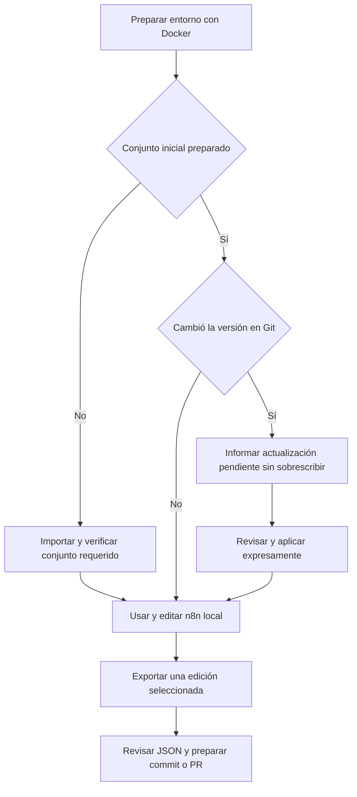

# Investigación de versionado y actualización de workflows n8n

Esta referencia conserva las alternativas, riesgos, fuentes y justificaciones que sustentan el sistema. Sus conclusiones se concretan en el [contrato vigente](contrato-desarrollo-docker.md) y los [ADRs](../project/adrs/README.md).

Para consultar lo incorporado al código, las verificaciones y los límites actuales, usar el [estado del entorno](../project/estado-desarrollo-docker.md). Los pendientes que aparecen en el informe original corresponden a su fecha de investigación; las decisiones vigentes están en [D01–D26](../project/decisiones-desarrollo-docker.md).

## Investigación y evidencia conservadas

El contenido original permanece completo, incluidas las opciones retiradas y el motivo de su sustitución.

Leer el informe original y todas sus referencias

Los textos siguientes conservan el contexto de su elaboración. Sus pendientes y expresiones de futuro describen esa revisión histórica; el estado vigente es el indicado arriba. No son instrucciones actuales de ejecución.

# Investigación de versionado y actualización de workflows n8n

> Cierre posterior: el [contrato v1 C08](contrato-desarrollo-docker.md) concreta bootstrap, API pública, IDs lógicos y actualización expresa. Conserva D06 y sustituye recomendaciones operativas previas incompatibles; la comparación siguiente es el antecedente de investigación.

- Fecha de consulta: **18 de octubre de 2026**.
- Alcance: decisión D06 del entorno **de desarrollo local** de CyberSim.
- Estado: **política recomendada aceptada por el usuario el 18 de octubre; no implementada**.
- Contexto y acuerdos: [planificación D01–D14](../project/decisiones-desarrollo-docker.md).
- Registro de aceptación y límites: [ADR 0007](../project/adrs/0007-versionado-explicito-de-workflows.md). La elección expresa fue «JSON en Git y actualización explícita»; los mecanismos operativos siguen por cerrar.

## Resultado recomendado

Mantener los workflows revisables como JSON en el repositorio, permitir edición en la interfaz local de n8n e importar automáticamente durante la primera preparación. Después, el arranque normal conserva el estado guardado: las actualizaciones de workflows se aplican mediante una operación explícita con revisión y respaldo previo. No implementar una sincronización bidireccional continua ni un sistema de fusión automática de nodos.

Git define la versión compartida por el equipo. La instancia local es un espacio de trabajo y pruebas que puede contener ediciones sin exportar. Estar editando localmente no debe borrar ni publicar archivos en Git automáticamente. Esta política mantiene la inicialización sencilla de un clon y hace explícita la actualización posterior de lógica.

Es una recomendación específica para CyberSim, no una afirmación de que todas las empresas sigan una práctica idéntica. No se verificaron cargos profesionales de participantes ni se hizo una encuesta de adopción. Se contrastaron mecanismos oficiales, código del starter kit y experiencias publicadas por sus propios autores.

## Fuentes y calidad de la evidencia

| Fuente primaria consultada | Qué aporta y qué no demuestra |
|---|---|
| [Documentación de Source Control](https://docs.n8n.io/source-control-environments/) | Función nativa disponible en Business y Enterprise. No equivale a una función incluida en cualquier instalación self-hosted |
| [Reglas de push/pull](https://docs.n8n.io/source-control-environments/using/push-pull/) | Git como referencia, sobrescrituras y promoción deliberada; la documentación recomienda reducir los recorridos bidireccionales sobre una misma instancia |
| [Blog del equipo n8n: workflow versioning](https://blog.n8n.io/workflow-versioning/) | Diferencia control de versiones, historial local y respaldo; un respaldo comunitario no sustituye toda la gestión de entornos |
| [Código del starter kit oficial](https://github.com/n8n-io/self-hosted-ai-starter-kit/blob/main/docker-compose.yml) | El servicio `n8n-import` comprueba si hay workflows antes de importar y omite la carga si ya existen. Es evidencia de inicialización, no un gestor completo de actualizaciones |
| [Exportación e importación oficiales](https://docs.n8n.io/workflows/export-import/) | Formatos, rutas de importación y precauciones sobre contenido del JSON. No demuestra que un archivo importado funcione con las credenciales de otra instancia |
| [CLI de servidor](https://docs.n8n.io/hosting/cli-commands/) | Exportación/importación por ID, sobrescrituras y publicación. No atribuirle flags no documentadas |
| [Nuevo cliente oficial n8n CLI](https://docs.n8n.io/connect/n8n-cli.md) | Cliente de la API con autenticación y operaciones sobre workflows; es distinto de la CLI incluida en el servidor |
| [Paquetes oficiales n8n](https://docs.n8n.io/build/manage-workflows/n8n-packages) y [su importación](https://docs.n8n.io/build/manage-workflows/n8n-packages/import-a-package) | Empaquetado de dependencias/referencias y políticas de conflicto. Continúan en Preview y requieren versión compatible |
| [Foro: deploy workflows using CI/CD](https://community.n8n.io/t/deploy-workflows-using-ci-cd/3056) | Experiencias directas de edición local con Docker, exportación y revisión en Git. Aportes antiguos: ilustran el patrón, no las capacidades de la versión actual |
| [Foro: source code control durante desarrollo](https://community.n8n.io/t/how-to-use-source-code-control-for-example-git-with-n8n/148154) | Uso de nodos n8n para extraer definiciones y enviarlas a Git. Muestra una alternativa de respaldo, no una garantía de gestión de conflictos |
| [Foro: ownership y traslado de workflows](https://community.n8n.io/t/how-should-workflow-ownership-be-transferred-when-moving-an-n8n-workflow-from-development-to-production/317578) | Problemas de IDs, propiedad, credenciales, datos fijados y referencias entre instancias. Son aportes de usuarios, contrastados con documentación |
| [John Kihiu: versioning n8n workflows](https://kihiujohn.github.io/blog/n8n-versioning/) | Experiencia de un desarrollador sobre JSON en Git, ruido de diferencias y referencias de credenciales. No se copian sus comandos o afirmaciones de seguridad sin verificarlos |
| [Repositorio del autor de n8n-as-code](https://github.com/EtienneLescot/n8n-as-code) | Herramienta independiente con sincronización explícita, diferencias y resolución de conflictos; introduce otra dependencia y su compatibilidad debe comprobarse |

Las páginas y repositorios enlazados pueden cambiar. La fecha identifica la consulta, no fija por sí sola una versión utilizable. No se instalaron herramientas ni se probaron imports en CyberSim durante esta investigación.

## Opciones comparadas

| Opción | Beneficio | Coste o límite para este proyecto | Valoración |
|---|---|---|---|
| Source Control nativo | Integración de Git y comparación desde n8n | Requiere Business/Enterprise; no fusiona automáticamente cambios de workflows. No hay una licencia de ese tipo acordada | Buena si ya se dispone de la función; no hacerla requisito de arranque |
| JSON en Git, importación inicial y aplicación explícita posterior | Mantiene el editor visual, se integra con el Git del proyecto y acota las acciones que sobrescriben | Requiere operaciones pequeñas de exportación, revisión y aplicación | **Recomendada para CyberSim** |
| Reimportar todo en cada arranque | El estado se aproxima siempre al repositorio | Puede perder ediciones locales; transforma reiniciar en una actualización de lógica | No recomendada para una instancia de desarrollo editable |
| Respaldo automático a Git con un workflow | Guarda versiones con poca intervención | No resuelve aplicación, publicación ni conflictos; añade credenciales Git y puede versionar trabajo incompleto | Complemento opcional, no solución principal |
| Herramienta comunitaria como n8n-as-code | Ofrece comandos y experiencia de editor más completos | Otro modelo de configuración, dependencias, compatibilidad y resolución que el equipo debe aprender | Evaluar si aumenta mucho el trabajo sobre workflows; innecesaria como requisito inicial |
| Nuevo CLI y paquetes oficiales | Mejor transporte de estructura y referencias entre instancias | Los paquetes siguen en Preview; hay que fijar versiones y validar las funciones disponibles | Vía prometedora; no basar el primer entorno en paquetes experimentales por omisión |
| Motor propio de sincronización/fusión bidireccional | Automatiza muchos casos | Exige gestionar cambios concurrentes, borrados, referencias y publicación; la fusión textual no prueba coherencia del grafo | Complejidad injustificada para esta etapa |

La elección de política no obliga a escribir todo desde cero. Las operaciones deben apoyarse en las interfaces oficiales de n8n. El mecanismo concreto se cerrará con la versión fijada y sus requisitos de autenticación; no utilizar endpoints internos de la interfaz ni editar directamente tablas de n8n como solución de sincronización.

## Lo que enseña la documentación actual

El Source Control nativo no convierte dos modificaciones independientes de un workflow en una versión combinada. Su documentación advierte sobre reemplazar ediciones locales al traer Git. Pagar por esa función aporta integración, pero no elimina la necesidad de una política de edición y actualización.

El starter kit oficial evita importar sus ejemplos cuando encuentra workflows. Para CyberSim conviene conservar la idea de inicialización diferenciada y mejorar la comprobación: no basta con «hay algún workflow», porque una importación interrumpida podría dejar solo parte del conjunto requerido.

La documentación actual recomienda el nuevo n8n CLI para nuevos traslados entre instancias. A la vez, sus paquetes `.n8np` siguen en Preview. La CLI de servidor continúa documentada, aunque se anuncia una futura deprecación de sus comandos de import/export sin fecha. Por tanto, no se presenta el antiguo importador como la recomendación oficial actual para todo caso ni se mezcla sintaxis de ambos clientes.

El JSON es un artefacto revisable, no una garantía de ausencia de secretos. Puede contener nombres/referencias de credenciales y parámetros de nodos con valores sensibles. Los exports locales de CyberSim tienen referencias a credenciales, pero eso no autoriza a versionar todos los exports sin revisión.

## Política propuesta para CyberSim

### 1. Artefactos y propiedad

- Un archivo por workflow mantenido por el proyecto, con una identidad estable y una lista de los workflows requeridos. Los cinco exports encontrados son material de entrada, no cinco componentes automáticamente aprobados.
- La ruta versionada definitiva se fijará al implementar; `workspace/n8n` sigue siendo material local ignorado.
- Mantener credenciales y valores propios de la instancia fuera de Git. Conservar sus referencias mediante una correspondencia local comprobable, sin crear credenciales duplicadas en cada importación.
- Mantener copias locales previas a reemplazos fuera del conjunto versionado y de los archivos que se importan. No tratar esas copias de definiciones como backup completo de la instancia.

### 2. Primera preparación

El comando normal prepara n8n y carga el conjunto requerido cuando la instancia aún no fue inicializada por CyberSim. Comprueba sus dependencias, credenciales/configuración acordadas y publicación de webhooks/triggers. Solo registra la etapa como completa después de validarla.

Si la preparación se interrumpe, al repetir el comando se comprueba cada workflow esperado. No se duplica todo el conjunto por nombre ni se acepta como completa una instancia solo porque contenga uno. Si aparece un objeto previo incompatible, se diagnostica; no se lo reemplaza sin identificarlo.

La preparación puede necesitar los pasos de autorización de Drive aún pendientes en D11. Esta propuesta no afirma que importar JSON autorice Google ni complete por sí solo el arranque.

### 3. Reinicio sin cambio del conjunto compartido

El arranque normal conserva los workflows guardados y sus ediciones. No importa encima de ellos, no exporta a Git ni realiza commits. Las ediciones de la interfaz siguen perteneciendo a la instancia local hasta que el desarrollador decida exportarlas.

Conservar una edición no significa publicarla automáticamente. Se debe distinguir borrador guardado y versión publicada conforme a la versión de n8n elegida.

### 4. Cambio recibido desde Git

El preparador compara una huella del conjunto de definiciones versionadas con el conjunto registrado en la última aplicación correcta. Esta comparación responde a «hay una actualización del repositorio pendiente», no intenta fusionar ni decidir qué edición es mejor.

Si el conjunto cambió, no se reimporta silenciosamente. Se informa de los workflows afectados y de la operación de actualización explícita. Conforme a D08, el entorno no se anuncia como completamente actualizado/listo para esa revisión hasta completar la preparación correspondiente. Los datos persistidos se conservan; no se aplica un reset para resolver una diferencia de workflows.

Si el desarrollador cambia de rama y esa rama contiene otros workflows, se trata del mismo modo: actualización explícita. No se crean volúmenes por rama por este motivo.

### 5. Exportación de una edición local

El desarrollador termina y prueba su cambio en n8n. Una operación explícita exporta **solo el workflow seleccionado** a un archivo candidato y permite revisar la diferencia antes de reemplazar el artefacto versionado.

Si Git ya contiene cambios entrantes, conservar el candidato por separado evita sobrescribirlos durante la propia exportación. El desarrollador decide la versión compartida, revisa el JSON y lo incluye en su commit/PR normal. No se hacen commits automáticos por cada guardado o intervalo.

### 6. Aplicación explícita

La operación selecciona los workflows a actualizar, guarda sus definiciones actuales y presenta las diferencias antes de reemplazarlos. Si hay ediciones locales divergentes, exige conservarlas/exportarlas o descartarlas expresamente; no hace una fusión automática de nodos.

Después de importar o actualizar, verifica referencias, credenciales y publicación, prueba el contrato local acordado y registra la nueva huella solo si el conjunto requerido quedó preparado. Un respaldo no convierte una aplicación parcialmente fallida en éxito. La recuperación debe identificar qué objetos cambiaron, sin prometer una transacción global de varias importaciones si la interfaz utilizada no la ofrece.

La comparación debe distinguir campos funcionales de metadatos variables. No se deben borrar IDs y referencias indiscriminadamente para limpiar diferencias: eso puede romper actualizaciones, subworkflows o webhooks. Tampoco hay que eliminar a ciegas configuraciones legítimas de nodos.

### 7. Borrados y cambios de identidad

Retirar un archivo del repositorio no elimina automáticamente workflows locales. La operación de aplicación debe mostrar las bajas propuestas y requerir una acción explícita para retirar lo que corresponda, sin borrar experimentos ajenos al conjunto gestionado. Renombrar un archivo no debe crear por sí solo un nuevo workflow.

## Recorrido habitual propuesto

Las operaciones de **estado**, **exportación** y **aplicación** son responsabilidades propuestas, no comandos que ya existan en el repositorio. Se ejecutarán en contenedores para no añadir Node local obligatorio. La inicialización del clon continúa automatizada; cambiar lógica compartida es una acción de mantenimiento diferenciada del reinicio diario.

## Límites y validación pendiente

Antes de implementar hay que fijar versión/licencia de n8n, interfaz oficial elegida, acceso inicial a la API si se utiliza, correspondencia de IDs/credenciales, formato de huella y qué versión se exporta/publica. No están probadas aún estas operaciones en CyberSim.

Los casos mínimos de aceptación son: primera carga completa, repetición tras interrupción, reinicio sin cambios, conservación de edición local, cambio recibido de Git, exportación sin pisar cambios entrantes, rechazo de reemplazo divergente no autorizado, importación fallida sin marcar éxito, publicación pendiente o fallida y eliminación explícita de workflows gestionados.

Esta recomendación simplifica la política al evitar sincronización continua y fusión automática. No elimina el trabajo real de validar contratos o adaptar los exports defectuosos identificados en la [evaluación](evaluacion-desarrollo-local-docker.md).

