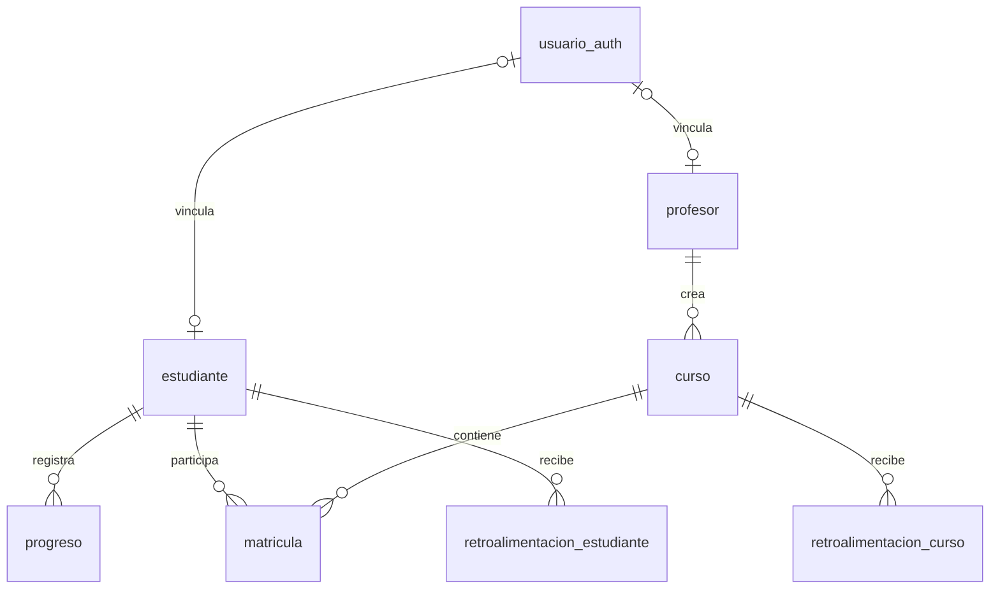

# Modelo de datos

> Actualización Docker del 18 de octubre de 2026: para composición, integraciones, permisos de IA y estado funcional actuales consultar [arquitectura Docker](desarrollo-docker.md), [contrato vigente](contrato-desarrollo-docker.md) y [evidencia](../project/estado-desarrollo-docker.md). El detalle siguiente conserva la revisión anterior donde no se ha sustituido expresamente; sus afirmaciones sobre puertos, rutas antiguas o servicios externos no prevalecen sobre esas referencias.

PostgreSQL persiste identidad y actividad educativa. El esquema vigente está en [`schema.prisma`](../../apps/backend/prisma/schema.prisma), con ocho modelos. No existe una tabla activa de escenarios: el catálogo vive en TypeScript y el progreso se identifica por slug.

## Relaciones

Cada perfil puede carecer de vínculo a identidad porque su FK es opcional. El esquema permite perfiles estudiante y profesor para una misma identidad en tablas distintas; no impone exclusividad de rol. El registro normal crea un solo tipo de perfil y login prioriza profesor.

## Tablas

| Modelo | Identidad y campos relevantes | Restricciones / borrado |
|---|---|---|
| `usuario_auth` | ID, correo, hash, confirmado, tokens, expiración y creación | Correo único; referencias de perfiles `NoAction` |
| `estudiante` | ID, código único, cuatro nombres, FK opcional a identidad | Código y FK únicos; dependencias de matrícula/progreso `NoAction` |
| `profesor` | ID, cuatro nombres, FK opcional a identidad | FK única; cursos referencian con `NoAction` |
| `curso` | ID, propietario, nombre, código y expiración opcionales | Código único; matrículas `NoAction`; feedback de curso en cascada |
| `matricula` | ID, curso, estudiante y fecha | Ambas FKs `NoAction`; sin unicidad de par o estudiante |
| `progreso` | ID, estudiante, slug, resultado opcional, tiempo, acciones y fecha | FK estudiante `NoAction`; múltiples filas por escenario |
| `retroalimentacion_estudiante` | ID, estudiante, slug, cuatro textos, número de intentos y fecha | Cascada al eliminar estudiante; histórico de generaciones |
| `retroalimentacion_curso` | ID, curso, ID profesor desnormalizado, cinco textos y fecha | Cascada al eliminar curso; `id_profesor` sin FK directa |

La mayor parte de IDs son enteros autoincrementales. Matrícula usa una fecha sin hora; feedback usa timestamp y progreso fecha/hora opcional. Los slugs son texto libre, sin FK al catálogo.

## Formatos y consultas

`progreso.acciones` es texto que pretende contener `accionesEsperadas` y `accionesRealizadas`. El backend no comprueba que sea JSON válido. Cada intento se inserta; el resumen cuenta filas y busca cualquier `terminado: true`. El historial ordena por ID, no por puntuación.

La retroalimentación individual almacena el conteo de intentos al generarse. La habilitación compara el conteo actual con el del último feedback. No hay bloqueo o clave única para evitar generaciones simultáneas iguales.

Análisis de curso serializa secciones como JSON en columnas de texto. `resumen` contiene `{ stats, ai }`; la lectura admite además un formato anterior con estadísticas directamente. El ID de curso se toma de la respuesta de n8n. Un JSON mal formado o secciones incompletas pueden fallar al recuperar el análisis.

La única unicidad de matrícula es su ID autoincremental. `hasAnyMatricula` antes de `createMatricula` no garantiza la regla de un curso por estudiante bajo concurrencia. Definir la restricción adecuada requiere decidir si la regla futura seguirá siendo un solo curso o un curso único por pareja. Los intentos repetidos, en cambio, son parte del modelo previsto; el riesgo es reenvío accidental sin idempotencia.

## Migraciones y cliente

| Recurso | Uso |
|---|---|
| [Migración inicial](../../apps/backend/prisma/migrations/20260414142730_init_schema_completo/migration.sql) | Crea las ocho tablas, índices únicos y FKs |
| [Conteo de intentos en feedback](../../apps/backend/prisma/migrations/20260414143617_add_num_intentos/migration.sql) | Añade `num_intentos_al_generar`, valor por defecto cero |
| [Configuración de Prisma](../../apps/backend/prisma.config.ts) | CLI: `DIRECT_URL` con fallback `DATABASE_URL` |
| [Conexión de ejecución](../../apps/backend/src/auth/infrastructure/db/prisma.ts) | Adaptador PostgreSQL sobre `DATABASE_URL` |
| [Seed](../../apps/backend/prisma/seed.ts) | Cuentas confirmadas, un curso, matrículas e intento local |

El cliente se genera en `apps/backend/src/generated/prisma` y el build lo copia a `dist/generated/prisma` con [un script](../../apps/backend/scripts/copy-prisma-client.mjs). Ambas rutas son artefactos ignorados.

Para una base nueva aplicar migraciones con `migrate:deploy`; para cambios de desarrollo crear una migración con `db:migrate`. `db:push` sincroniza sin crear historial y es una alternativa para bases desechables. El seed hace inserciones directas, no es idempotente y usa credenciales conocidas de prueba; no ejecutarlo sobre datos reales.

## Fuera de PostgreSQL

- El ECS y el nivel seleccionado viven en memoria del navegador.
- Tokens y perfil del cliente viven en `localStorage`.
- Conversaciones viven en un `Map` del proceso backend.
- Conocimiento vectorial vive en Qdrant; su ingestión es externa.
- No se persisten definiciones de escenarios generados, progreso parcial de escena ni audio del tutor en estas tablas.

Consultar [ADR 0003](../project/adrs/0003-persistencia-de-intentos.md), [operación de la base](../guides/operacion-y-despliegue.md) y [hallazgos de integridad](revision-del-sistema.md).
