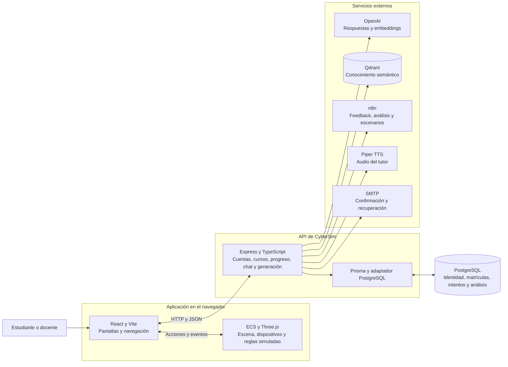

# Arquitectura de CyberSim de un vistazo

CyberSim tiene dos aplicaciones: **el navegador ejecuta la práctica y la escena 3D; Express gestiona cuentas, cursos, intentos e integraciones**. Se comunican por HTTP/JSON. PostgreSQL conserva actividad educativa; el estado completo de la partida permanece en el cliente.

Vista de lectura rápida, documentada el 14 de octubre de 2026 sobre `cc0c9cb`. Para estructura de código y decisiones consultar [visión técnica](vision-general.md) y [ADRs](../project/adrs/README.md).

## Diagrama principal

Las flechas muestran solicitudes/interacción, no replicación de todo el juego en servidor. Los servicios externos tienen adaptadores en código, pero sus despliegues y workflows no están incluidos. Compose del repositorio levanta solo PostgreSQL local.

## Responsabilidades y estado

| Parte | Qué hace | Qué conserva |
|---|---|---|
| Frontend | Rutas, perfiles, cursos, selección, oficina 3D, dispositivos, redes y tutor | Selección y partida en memoria; sesión local en localStorage |
| Motor ECS | Construye escenarios, procesa acciones, eventos, objetivos y fases | Entidades, componentes, relojes y acciones de la partida |
| API | Identidad, consultas educativas, guardado de intentos e integraciones | Memoria temporal de chat por proceso |
| PostgreSQL | Persistencia mediante Prisma | Usuarios, cursos, matrículas, progreso, feedback y análisis |
| Servicios externos | Respuestas, recuperación, generación, audio y correo | Conocimiento Qdrant y estado propio no administrado aquí |

## Cómo transcurre una práctica

1. El estudiante accede y selecciona un escenario del catálogo o uno generado.
2. El frontend construye la escena y ejecuta la simulación con su motor ECS.
3. Acciones locales cambian dispositivos/redes y las verificaciones determinan objetivos y resultados.
4. Al fallar una fase o completar el escenario, se envía un intento a Express y se inserta en PostgreSQL.
5. Perfil/ranking consultan historial; tutor, feedback o análisis usan las integraciones correspondientes.

## Límites que conviene recordar

- Recargar no restaura la partida completa; guardar progreso significa conservar un intento, no la escena entera.
- El servidor recibe resultados del cliente; no reproduce ni certifica sus acciones simuladas.
- Reiniciar Express pierde las conversaciones de su memoria local.
- Hay controles de autorización pendientes: las pantallas protegidas no garantizan que todos los endpoints lo estén.

## Dónde ampliar

| Necesidad | Documento |
|---|---|
| Estructura, tecnologías y procesos | [Visión técnica](vision-general.md) |
| Interfaz y estado del cliente | [Frontend](frontend.md) |
| Reglas del motor | [Simulación ECS](simulacion-ecs.md) |
| Servidor y endpoints | [Backend](backend.md), [API HTTP](api-http.md) |
| Tablas y relaciones | [Modelo de datos](modelo-de-datos.md) |
| Tutor y generación | [Integraciones](integraciones.md) |
| Necesidades de usuarios | [Requisitos](../project/requisitos.md), [HUs](../project/historias-de-usuario.md) |
| Estado y problemas detectados | [Seguridad](seguridad.md), [revisión](revision-del-sistema.md) |

Fuentes principales: [entrada React](../../apps/frontend/src/visual/main.tsx), [controlador de simulación](../../apps/frontend/src/ecs/controllers/EscenarioController.ts), [composición Express](../../apps/backend/src/server.ts), [esquema](../../apps/backend/prisma/schema.prisma) y [Compose](../../docker-compose.yml).
