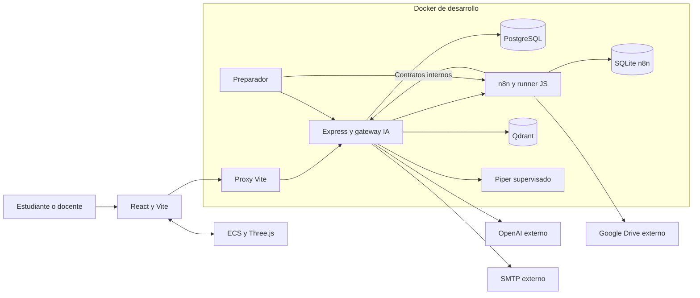

# CyberSim: resumen del sistema para desarrollar

CyberSim permite que estudiantes practiquen ciberseguridad en una oficina 3D: seleccionan un escenario, configuran dispositivos y redes, cumplen objetivos por fases y consultan su historial. Los docentes organizan cursos y revisan resultados y análisis. El tutor, la retroalimentación y la generación de escenarios incorporan IA; las reglas de la simulación se ejecutan en el cliente.

CyberSim tiene dos aplicaciones: **el navegador ejecuta la práctica y la escena 3D; Express gestiona cuentas, cursos, intentos e integraciones**. Se comunican por HTTP/JSON. PostgreSQL conserva actividad educativa; el estado completo de la partida permanece en el cliente.

Esta página reúne el contexto para empezar a modificar el proyecto. **Para preparar el entorno desde cero, continúa con la [guía de primer arranque](../guides/desarrollo-local.md)**. No necesitas leer el resto de la documentación antes de comenzar; sus enlaces amplían asuntos concretos. Actualización: 18 de octubre de 2026.

## Diagrama principal

Las flechas muestran solicitudes, no replicación de toda la partida. Compose incluye aplicaciones, PostgreSQL, Qdrant, n8n, runner, Piper y preparación; sus workflows se distribuyen en el repositorio. OpenAI, Google Drive y SMTP requieren configuración externa. Consultar [el detalle Docker](desarrollo-docker.md) y [su estado verificable](../project/estado-desarrollo-docker.md).

## Cómo se conectan las funciones

El navegador envía HTTP/JSON al proxy de Vite, que lo dirige a Express. El backend autentica al usuario, comprueba sus permisos y consulta PostgreSQL. La partida y la escena 3D no se trasladan a un contenedor: se ejecutan en el navegador del desarrollador.

Para el tutor, el backend recupera contexto de Qdrant y solicita texto a OpenAI; Piper convierte ese texto en WAV cuando está disponible. Los workflows n8n conservan los prompts y la secuencia de feedback, análisis y generación; llaman al gateway interno del backend para usar OpenAI bajo el mismo control de operaciones. La generación de cada escenario es independiente; las sesiones del tutor son temporales y están separadas por propietario.

El corpus inicial y los catálogos se distribuyen con el proyecto. n8n incorpora además los TXT/Markdown de la carpeta común de Google Drive a cada índice local. PostgreSQL identifica la revisión publicada de ese conocimiento. El correo de confirmación y recuperación sale por el SMTP externo configurado.

## Responsabilidades y estado

| Parte | Qué hace | Qué conserva |
|---|---|---|
| Frontend | Rutas, perfiles, cursos, selección, oficina 3D, dispositivos, redes y tutor | Selección y partida en memoria; sesión local en localStorage |
| Motor ECS | Construye escenarios, procesa acciones, eventos, objetivos y fases | Entidades, componentes, relojes y acciones de la partida |
| API | Identidad, consultas educativas, guardado de intentos e integraciones | Memoria temporal de chat por proceso |
| PostgreSQL | Persistencia y coordinación mediante Prisma/SQL | Usuarios, cursos, intentos, análisis, operaciones, documentos y revisión de conocimiento |
| Infraestructura local | Workflows, recuperación y voz | SQLite n8n, vectores Qdrant y voz Piper |
| Proveedores externos | Modelos/embeddings, corpus común y correo | Datos del proveedor; credenciales privadas por servicio |

## Cómo transcurre una práctica

1. El estudiante accede y selecciona un escenario del catálogo o uno generado.
2. El frontend construye la escena y ejecuta la simulación con su motor ECS.
3. Acciones locales cambian dispositivos/redes y las verificaciones determinan objetivos y resultados.
4. Al fallar una fase o completar el escenario, se envía un intento a Express y se inserta en PostgreSQL.
5. Perfil/ranking consultan historial; tutor, feedback o análisis usan las integraciones correspondientes.

## Dónde trabajar en el repositorio

El proyecto contiene dos npm workspaces, `@cybersim/frontend` y `@cybersim/backend`. Comparten el lockfile raíz; las dependencias Linux de ejecución se instalan en la imagen Docker.

| Si cambias… | Empieza en… | Qué debes considerar |
|---|---|---|
| Pantallas, componentes o navegación | [apps/frontend/src/visual](../../apps/frontend/src/visual) | React/TypeScript, estado del cliente y consumidores de API |
| Reglas, acciones o escena simulada | [apps/frontend/src/ecs](../../apps/frontend/src/ecs) | Motor ECS/Three.js; preservar condiciones de objetivos y fases |
| Escenarios del catálogo | [apps/frontend/src/data/escenarios](../../apps/frontend/src/data/escenarios) | Catálogo activo y exportación del conocimiento asociado |
| Cuentas, cursos o intentos | [apps/backend/src](../../apps/backend/src) | Módulos por funcionalidad, contratos HTTP y permisos del servidor |
| Tutor, gateway IA o conocimiento | [apps/backend/src/integrations](../../apps/backend/src/integrations) | Coordinación, sesiones, fuentes, presupuestos y validación |
| Prompts o lógica de workflows | [infra/n8n](../../infra/n8n) | JSON en Git; exportar/aplicar explícitamente, sin sobrescribir al reiniciar |
| Modelo persistido | [apps/backend/prisma](../../apps/backend/prisma) | Prisma, migraciones revisadas y conservación de datos |
| Servicios y arranque | [compose.yaml](../../compose.yaml), [infra](../../infra), [scripts/dev.ps1](../../scripts/dev.ps1) | Red interna, imágenes, preparación y configuración privada |

## Tu ciclo cotidiano de desarrollo

Una vez completada la guía inicial, ejecuta `docker compose up --build --watch` desde la raíz y abre **http://localhost:5173**. Edita las fuentes en Windows: Vite actualiza el frontend y el backend reinicia al cambiar sus fuentes. No necesitas lanzar ambas aplicaciones en terminales separadas.

Los cambios de dependencias, schema, corpus/catálogos y workflows tienen pasos de mantenimiento adicionales, explicados en esa misma guía. Comprueba tipos y las pruebas del área modificada antes de entregar; las pruebas simuladas no acreditan por sí solas una integración externa.

Los datos educativos se conservan en PostgreSQL y n8n mantiene su SQLite y credenciales cifradas. Cerrar con `docker compose down` conserva volúmenes; no usar `down -v` para el cierre diario. `.env` es privado y se genera una vez; no versionarlo ni cambiar las claves locales en cada arranque.

## Límites que conviene recordar

- Recargar no restaura la partida completa; guardar progreso significa conservar un intento, no la escena entera.
- El servidor recibe resultados del cliente; no reproduce ni certifica sus acciones simuladas.
- Reiniciar Express pierde la memoria del tutor y la interfaz informa contexto perdido; cada sesión está vinculada a su propietario.
- Tutor, generación, feedback y análisis comprueban identidad/propiedad en servidor. La revisión global de otros endpoints educativos sigue teniendo un alcance distinto en el ADR 0005.

## Detalle opcional

| Necesidad | Documento |
|---|---|
| Estructura, tecnologías y procesos | [Visión técnica](vision-general.md) |
| Interfaz y estado del cliente | [Frontend](frontend.md) |
| Reglas del motor | [Simulación ECS](simulacion-ecs.md) |
| Servidor y endpoints | [Backend](backend.md), [API HTTP](api-http.md) |
| Tablas y relaciones | [Modelo de datos](modelo-de-datos.md) |
| Tutor y generación | [Integraciones](integraciones.md) |
| Necesidades de usuarios | [Requisitos](../project/requisitos.md), [HUs](../project/historias-de-usuario.md) |
| Estado y problemas detectados | [Seguridad](seguridad.md), [revisión](revision-del-sistema.md) |

Fuentes principales: [entrada React](../../apps/frontend/src/visual/main.tsx), [controlador de simulación](../../apps/frontend/src/ecs/controllers/EscenarioController.ts), [composición Express](../../apps/backend/src/server.ts), [esquema](../../apps/backend/prisma/schema.prisma) y [Compose](../../compose.yaml).
