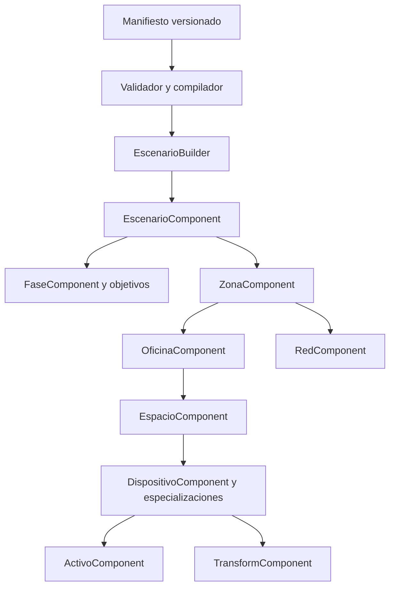

# Simulación ECS

El motor representa entidades por identificadores numéricos y componentes almacenados en `ComponenteContainer`. Los sistemas implementan acciones y reglas; los controladores coordinan el motor con las pantallas. Las operaciones de red, consola y ataques se realizan sobre datos simulados del navegador.

## Piezas principales

| Pieza | Responsabilidad |
|---|---|
| `ECSManager` | Entidades, componentes, registro de sistemas, bus de eventos y acciones |
| `EscenarioBuilder` | Traduce la definición declarativa a entidades y relaciones |
| `EscenarioController` | Singleton de partida; inicializa sistemas, tiempos, logs y persistencia de resultados |
| `NivelController` | Enumera exports activos y carga una definición por identificador |
| `RedController` | Expone operaciones de red a la interfaz |
| `ProgresoController` | Serializa acciones y envía un intento a Express |

El `ECSManager` actual no ejecuta un ciclo general de `actualizar()` ni mantiene automáticamente conjuntos de entidades por componentes: esas partes están comentadas. Los sistemas consultan componentes y se invocan explícitamente o mediante eventos. `removerEntidad()` añade a una cola; el procesamiento genérico de destrucción también está comentado. No debe suponerse un ECS con eliminación automática.

## Modelo de escena

`DefinicionEscenario` representa contenido declarativo con zonas, oficinas, espacios y dispositivos. `defineScenario` completa el sobre reproducible y `compileScenario` valida antes de producir el contrato de ejecución. TypeScript no sustituye la validación runtime de una respuesta generada externamente.

El builder requiere que `SistemaJerarquiaEscenario` ya esté registrado. Crea una entidad de red Internet global, relaciona zonas y redes, incorpora apps del catálogo y construye componentes de ataques y eventos. Dispositivos decorativos enriquecen la escena y se excluyen de interacciones previstas.

## Sistemas

| Sistema | Comportamiento |
|---|---|
| `SistemaJerarquiaEscenario`, `SistemaRelaciones` | Relaciones entre escenario, zona, oficina, espacio y dispositivos |
| `SistemaTiempo` | Reloj de simulación y reloj total, notificación y ejecución por segundos |
| `SistemaEvento` | Ataques, mitigación y verificaciones de acción, red, firma y cierre |
| `SistemaFase` | Avance secuencial de eventos y marcado de objetivos |
| `SistemaRed` | Redes, tráfico, reglas de firewall, VPN y transferencia de activos |
| `SistemaActivo` | Manipulación de activos y verificaciones educativas de firma |
| `SistemaComandos` | Intérprete de consola simulada |
| `SistemaPresupuesto` | Configuraciones y apps; parte del control de monto está desactivada |

`SistemaRed` delega en servicios de conectividad, firewall, configuración, eventos, transferencia y VPN en `ecs/systems/red/`. Las firmas y ataques implementan el modelo pedagógico del juego; no constituyen una infraestructura criptográfica o de redes real.

## Flujo de partida

1. Descubrimiento de una revisión publicada mediante `scenarioCatalog` o adaptación de una generación.
2. Validación del sobre, huella y referencias mediante el compilador canónico.
3. Creación del singleton y registro de jerarquía.
4. Construcción de entidades e inicialización de sistemas y listeners.
5. Creación de reloj simulado y total; carga de eventos ordenados por notificación.
6. Acción del jugador → actualización de componentes → registro de acción → eventos visuales.
7. Cuando el reloj coincide con `tiempoNotificacion`, se notifica; con `tiempoEnOcurrir`, se ejecuta la verificación o ataque.
8. Un objetivo completado avanza el índice de `SistemaFase`. El nombre de evento/ataque debe coincidir exactamente con la descripción del objetivo.
9. `FASE_NO_COMPLETADA` guarda un intento fallido; `ESCENARIO_COMPLETADO` guarda un intento exitoso.

El tiempo simulado se puede pausar al mostrar logs. El reloj total continúa mientras se pausa el simulado. Las comparaciones de programación usan segundos y coincidencia exacta: tiempos fraccionarios o un tiempo de ejecución ausente pueden impedir la activación. `SistemaFase` utiliza `fase - 1` como posición, por lo que los IDs de fase deben ser consecutivos desde uno.

## Catálogo y generación

Los cinco escenarios publicados son `tutorial`, `amenazas`, `criptografia`, `control-acceso` y `hacking-etico`. Los archivos adicionales permanecen `draft`: se validan, pero no aparecen en selección.

El generador normaliza zonas, redes, activos y fases, puede insertar routers y eventos de cierre, deduplica eventos y reconstruye objetivos. Después crea un manifiesto `validated` y utiliza el mismo compilador. Usa el slug común `ai-generated-scenario` y un ID de respaldo `777`; los intentos conservan revisión y SHA-256 aunque esa generación no se publique en el catálogo.

## Persistencia y límites

Se envían `terminado`, `tiempo` total y una cadena de acciones esperadas/realizadas. El servidor almacena un registro por envío, sin guardar la escena, posiciones modificadas o configuración completa. Una recarga pierde la partida.

`formatearAcciones()` concatena JSON manualmente: valores opcionales ausentes pueden producir `undefined` y textos con comillas pueden invalidar la cadena. `SistemaTiempo.destruir()` limpia el reloj simulado pero no el intervalo total. Ambos problemas se detallan en [la revisión](revision-del-sistema.md).

## Evidencia

- [Core ECS](../../apps/frontend/src/ecs/core/ECSManager.ts) y [tipos de escenario](../../apps/frontend/src/shared/types/EscenarioTypes.ts).
- [Builder](../../apps/frontend/src/ecs/utils/EscenarioBuilder.ts), [controlador de escenario](../../apps/frontend/src/ecs/controllers/EscenarioController.ts) y [progreso](../../apps/frontend/src/ecs/controllers/ProgresoController.ts).
- [Tiempo](../../apps/frontend/src/ecs/systems/SistemaTiempo.ts), [fases](../../apps/frontend/src/ecs/systems/SistemaFase.ts) y [red](../../apps/frontend/src/ecs/systems/SistemaRed.ts).
- [Catálogo y compilador](../../apps/frontend/src/scenarios) y [normalización de generación](../../apps/frontend/src/visual/features/agent-malvado/presentation/hooks/useScenarioBuilder.ts).
- [Guía de escenarios](../guides/escenarios.md) y [ADR 0002](../project/adrs/0002-simulacion-ecs-en-cliente.md).
