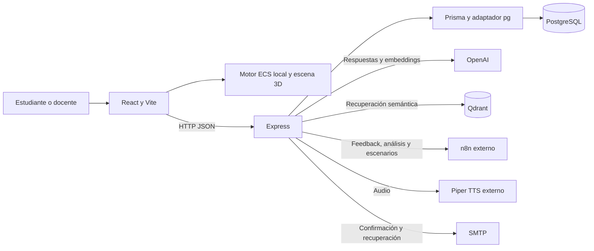

# Visión técnica general

> Actualización Docker del 18 de octubre de 2026: para composición, integraciones, permisos de IA y estado funcional actuales consultar [arquitectura Docker](desarrollo-docker.md), [contrato vigente](contrato-desarrollo-docker.md) y [evidencia](../project/estado-desarrollo-docker.md). El detalle siguiente conserva la revisión anterior donde no se ha sustituido expresamente; sus afirmaciones sobre puertos, rutas antiguas o servicios externos no prevalecen sobre esas referencias.

CyberSim es un monorepositorio con dos aplicaciones TypeScript. El navegador ejecuta la simulación educativa; la API administra identidad, cursos, intentos y conexiones con servicios externos. Las aplicaciones se comunican por HTTP y no tienen un paquete de dominio compartido.

Para una lectura rápida con diagrama y responsabilidades, consultar [arquitectura de un vistazo](resumen.md).

## Contenedores y dependencias



| Área | Tecnologías declaradas | Responsabilidad |
|---|---|---|
| Cliente | React 19, React Router 7, Vite 7 | Navegación, interfaz y estado de sesión local |
| Simulación | TypeScript, ECS propio | Entidades, configuración de dispositivos, fases y reglas simuladas |
| Visualización | Three.js, React Three Fiber, Drei, React Flow | Escena 3D y topología de redes |
| API | Express 5, TypeScript, tsx/nodemon | Adaptadores HTTP y composición |
| Datos | PostgreSQL 15 en Compose, Prisma 7, `@prisma/adapter-pg` | Persistencia relacional |
| IA | `fetch` a OpenAI, cliente REST Qdrant, webhooks n8n | Tutor, recuperación y contenido generado |
| Calidad | ESLint, TypeScript, Vitest, Playwright | Análisis estático y pruebas |

Los manifiestos declaran rangos; `package-lock.json` determina las versiones instaladas. No hay contenedores de frontend, backend, Qdrant, SMTP, n8n ni Piper definidos en Compose.

## Mapa del repositorio

```text
apps/
  frontend/
    src/
      data/           Escenarios, apps y configuraciones educativas
      ecs/            Core, componentes, sistemas, controladores y builders
      shared/         Tipos y configuración utilizados dentro del cliente
      chat/           Dominio, casos de uso y transporte del chat
      visual/         Entrada React, common y features
    scripts/          Exportador de conocimiento RAG
    tests/            Unitarias y e2e
  backend/
    src/
      server.ts       Entrada Express
      auth/           Identidad, correo y progreso
      groups/         Cursos y matrículas
      chat/           Tutor, memoria, recuperación y audio
      feedback/       Retroalimentación individual
      course-analysis/ Análisis de cursos
      agent-malvado/  Generación de escenarios
    prisma/           Esquema, migraciones y seed
    tests/            Unitarias
docs/                 Architecture, guides y project
tests/concurrencia/   Scripts manuales que modifican datos
scripts/rag-output/   Exportaciones versionadas preexistentes
.github/workflows/    CI de pull requests
```

## Distribución de estado

| Estado | Dónde vive | Consecuencia |
|---|---|---|
| JWT, rol, perfil y marca de confirmación | `localStorage` del navegador | El cliente puede alterarlos; no son autoridad para el servidor |
| Nivel seleccionado, entidades y fases actuales | React y ECS en memoria | Una recarga no restaura una partida completa |
| Intentos y acciones enviadas | PostgreSQL | Historial persistente, basado en entradas del cliente |
| Conversaciones del tutor | Memoria del proceso Express | Se pierden al reiniciar; no se comparten entre réplicas |
| Conocimiento semántico | Qdrant externo | Requiere ingestión y embeddings compatibles |
| Escenario generado | Contexto React tras una llamada n8n | No se conserva su definición en PostgreSQL |

## Límites de diseño

La arquitectura es modular por funcionalidad, con separación de dominio, aplicación e infraestructura en buena parte del backend y en el chat del cliente. No todos los módulos siguen la misma estructura: `groups/application` contiene casos de uso directamente y `groups/infrastructure/controller` usa el nombre singular. Algunos controllers consultan repositorios directamente.

Las reglas del juego se calculan en el navegador. La API guarda resultados, pero no reproduce ni certifica la simulación. El modelo permite registrar intentos sin una definición de escenario persistida. Los análisis de IA son apoyos pedagógicos, no una evaluación verificable del motor en el servidor.

## Evidencia y decisiones relacionadas

- [Manifiesto raíz](../../package.json), [frontend](../../apps/frontend/package.json) y [backend](../../apps/backend/package.json).
- [Composición HTTP](../../apps/backend/src/server.ts), [entrada React](../../apps/frontend/src/visual/main.tsx) y [Compose](../../compose.yaml).
- [ADR 0001: workspaces y módulos](../project/adrs/0001-workspaces-y-modulos.md) y [ADR 0002: simulación local](../project/adrs/0002-simulacion-ecs-en-cliente.md).
