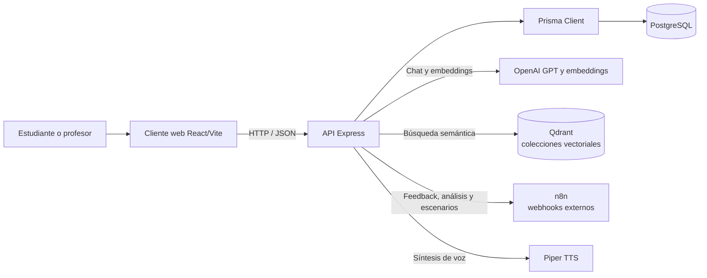
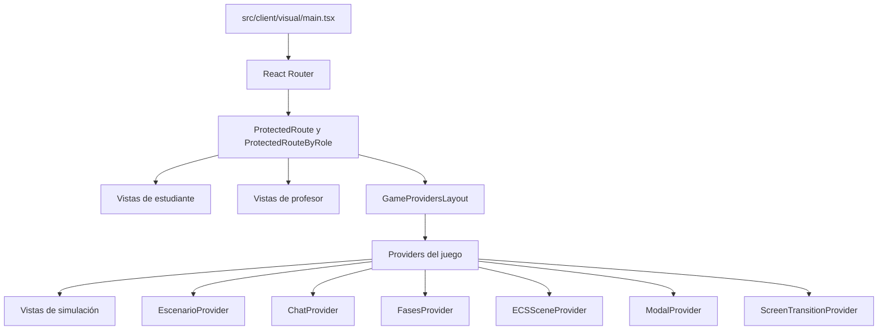
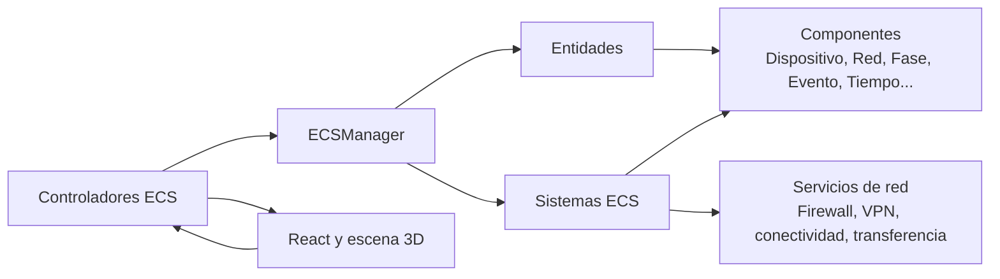
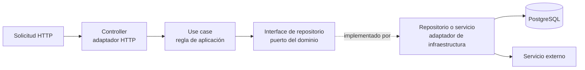
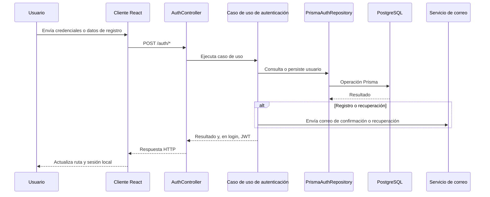
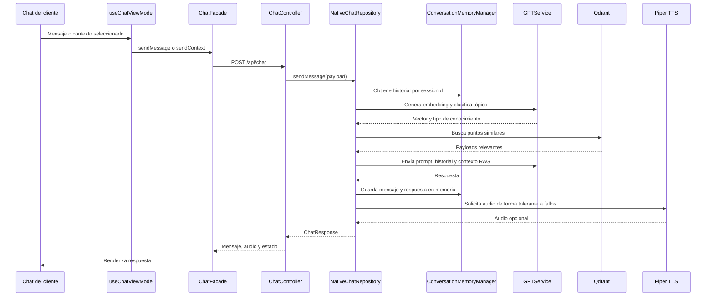
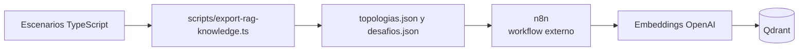
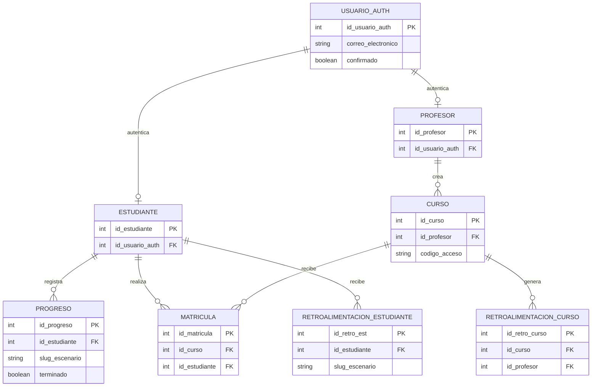
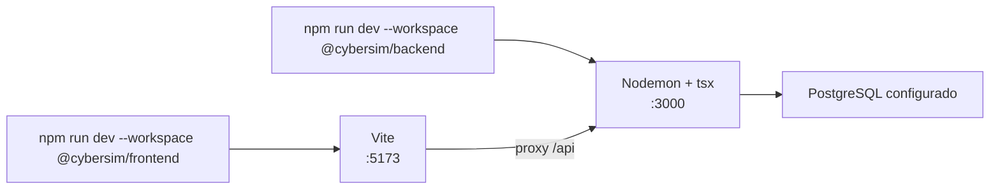

# Arquitectura de CyberSim

CyberSim es una plataforma educativa de ciberseguridad que combina una aplicación React, una API Express, una simulación 3D basada en ECS, persistencia relacional y servicios externos de inteligencia artificial. La arquitectura está organizada por funcionalidades y aplica separación de dominio, casos de uso e infraestructura principalmente en el backend.

## Resumen ejecutivo

| Área | Responsabilidad | Tecnología principal |
|---|---|---|
| Cliente | Interfaz, navegación, simulación 3D y estado de la partida | React, Vite, React Router, React Three Fiber |
| Servidor | API HTTP, autenticación, reglas de aplicación e integraciones | Express, TypeScript |
| Dominio | Entidades, contratos y puertos de cada funcionalidad | TypeScript |
| Persistencia | Usuarios, cursos, matrículas, progreso y análisis | PostgreSQL, Prisma |
| IA conversacional | Respuestas y embeddings para el chat | OpenAI mediante `GPTService` |
| Búsqueda semántica | Recuperación de contexto para el chat | Qdrant |
| Automatización | Retroalimentación, análisis y generación de escenarios | n8n mediante webhooks |
| Voz | Conversión de respuestas del chat a audio | Servicio Piper TTS |

## Vista general



El cliente y el servidor se ejecutan como procesos separados durante el desarrollo:

- Vite sirve el frontend en `http://localhost:5173`.
- Express sirve el backend en `http://localhost:3000`.
- El proxy de Vite permite que el cliente consuma la API mediante `/api` durante el desarrollo.
- PostgreSQL local se levanta con Docker Compose.

## Estructura del repositorio

```text
src/
├── client/
│   ├── data/                         # Escenarios y configuraciones estáticas
│   ├── ecs/                          # Componentes, sistemas y controladores del juego
│   ├── shared/                       # Tipos y utilidades compartidas del cliente
│   └── visual/
│       ├── common/                   # Componentes, contextos, hooks y estilos comunes
│       └── features/                 # Funcionalidades visibles de la aplicación
└── server/
    ├── auth/                         # Identidad, roles, correo y progreso
    ├── groups/                       # Cursos, grupos y matrículas
    ├── chat/                         # Chat, memoria, GPT, Qdrant, TTS y RAG
    ├── feedback/                     # Retroalimentación de estudiante mediante n8n
    ├── course-analysis/              # Análisis de cursos mediante n8n
    ├── agent-malvado/                # Generación de escenarios mediante n8n
    └── server.ts                     # Composición y arranque de Express

prisma/
├── schema.prisma                     # Modelo relacional
└── migrations/                       # Evolución del esquema

scripts/
└── export-rag-knowledge.ts           # Exportación de conocimiento de escenarios

tests/
├── *.test.ts                         # Pruebas unitarias y de sistemas
└── e2e/                              # Pruebas end-to-end con Playwright
```

## Arquitectura del cliente

El cliente utiliza React Router para separar autenticación, vistas de profesor, vistas de estudiante y rutas de la simulación. Los providers componen el estado transversal de la aplicación.



### Funcionalidades principales del cliente

| Funcionalidad | Responsabilidad |
|---|---|
| `admin-docente-y-estudiante` | Login, registro, confirmación de correo, roles, perfil y vistas docentes |
| `escenarios-simulados` | Selección de niveles, oficina 3D, fases, eventos, objetivos y leaderboard |
| `hardening-de-dispositivos` | Interacción con sistemas operativos, aplicaciones y configuraciones de dispositivos |
| `simulacion-redes` | Topología, firewall, VPN, redes y tráfico |
| `chat` | Chat flotante, mensajes, modo contexto y reproducción de audio |
| `feedback` | Solicitud y presentación de retroalimentación |
| `course-analysis` | Solicitud y presentación de análisis para cursos |
| `agent-malvado` | Generación de escenarios mediante el agente externo |

## Motor de simulación ECS

La simulación representa entidades mediante componentes y aplica comportamiento mediante sistemas. Los controladores coordinan escenarios, niveles, progreso y redes.



El flujo de una acción de juego es local al cliente en la mayoría de los casos:

1. La interfaz captura una acción del jugador.
2. Un controlador o hook obtiene la entidad afectada.
3. Un sistema ECS modifica componentes y relaciones.
4. La interfaz observa el estado actualizado y renderiza la escena, logs u objetivos.
5. El progreso se guarda en el backend cuando corresponde.

La base de datos no contiene el estado completo de la escena 3D. Los escenarios y configuraciones se definen principalmente como datos TypeScript en `src/client/data` y se instancian en el motor ECS.

## Arquitectura del backend

Cada funcionalidad del servidor sigue, con distintos niveles de profundidad, esta separación:

```text
feature/
├── domain/
│   ├── models/                      # Entidades y modelos del dominio
│   └── repositories/                # Interfaces o puertos
├── application/
│   └── useCases/                    # Casos de uso y reglas de aplicación
├── infrastructure/
│   ├── controllers/                 # Adaptadores HTTP
│   ├── repositories/                # Persistencia o servicios externos
│   ├── services/                    # Integraciones técnicas
│   └── middlewares/                 # Preprocesamiento transversal
└── index.ts                         # API pública del módulo, cuando aplica
```



### Módulos del servidor

| Módulo | Responsabilidad | Persistencia o integración |
|---|---|---|
| `auth` | Registro, login, JWT, correo, roles y progreso | Prisma, PostgreSQL y SMTP |
| `groups` | Creación de cursos, códigos de acceso, matrículas y grupos | Prisma y PostgreSQL |
| `chat` | Mensajes, contexto, memoria temporal, RAG y audio | GPT, Qdrant y Piper TTS |
| `feedback` | Generación y consulta de retroalimentación | n8n y PostgreSQL |
| `course-analysis` | Análisis agregado de cursos | n8n y PostgreSQL |
| `agent-malvado` | Solicitud y normalización de escenarios generados | n8n |

## Composición de Express y API

`src/server/server.ts` carga las variables de entorno, configura CORS y middleware JSON, crea dependencias compartidas y monta los routers.

| Ruta | Responsabilidad |
|---|---|
| `GET /health` | Salud básica del servidor |
| `/auth` | Registro, login, confirmación y recuperación de contraseña |
| `/progreso` | Guardado y consulta de progreso |
| `/groups` | Cursos, grupos y estudiantes |
| `/feedback` | Retroalimentación de estudiante |
| `/course-analysis` | Análisis de cursos |
| `/api/chat` | Mensajes, sesiones, estadísticas y salud del chat |
| `/api/agent-malvado` | Generación de escenarios |

La composición actual instancia algunos adaptadores al importar los controllers. Por eso las variables requeridas por esos adaptadores deben estar configuradas antes de iniciar el servidor.

## Flujo de autenticación



El middleware de autenticación valida el JWT en los endpoints protegidos. La autorización por rol se aplica también en el cliente mediante `ProtectedRouteByRole`; la validación del servidor es la frontera de seguridad efectiva.

## Flujo del chat y RAG

El chat usa GPT para generar respuestas y embeddings. Qdrant contiene conocimiento compartido, no conversaciones individuales.



### Colecciones vectoriales

| Colección | Tipo de conocimiento |
|---|---|
| `ciberseguridad` | Conceptos generales de seguridad informática |
| `ContextoCiberSeguridad` | Escenarios, topologías, dispositivos, fases, objetivos y ataques |

La selección se realiza en `GPTService.analyzeTopicForTool()`. Después `NativeChatRepository` llama a `searchInformationSecurity()` o `searchContexto()` en `QdrantService`.

El flujo de recuperación utiliza `RAG_TOP_K` y `RAG_SCORE_THRESHOLD`. Si Qdrant falla o no devuelve resultados, el repositorio continúa el flujo y GPT responde sin contexto recuperado. El historial conversacional se guarda por `sessionId` en memoria del proceso y no en Qdrant.

### Ingestión del conocimiento



`export-rag-knowledge.ts` transforma escenarios existentes en JSON; no genera descripciones mediante IA, no ejecuta durante el juego y no carga directamente Qdrant. La aplicación no contiene los workflows de n8n, por lo que la ingestión depende de infraestructura externa.

Cuando cambia el proveedor o modelo de embeddings, las colecciones deben reindexarse. Los vectores generados por distintos modelos no deben mezclarse en una misma colección.

## Persistencia y datos

PostgreSQL contiene el estado transaccional de usuarios y actividades educativas.



El estado de una partida y sus configuraciones de simulación se mantienen principalmente en el cliente. El backend persiste progreso, pero no replica toda la escena ECS.

## Integraciones externas

| Servicio | Uso | Configuración principal |
|---|---|---|
| OpenAI | Respuestas GPT y embeddings | `OPENAI_API_KEY`, `OPENAI_MODEL`, `OPENAI_EMBEDDING_MODEL` |
| Qdrant | Búsqueda vectorial del chat | `QDRANT_URL`, `QDRANT_API_KEY` y colecciones |
| n8n | Feedback, análisis de cursos y escenarios | Variables `N8N_*_WEBHOOK_URL` |
| Piper TTS | Audio de respuestas del chat | `PIPER_TTS_API_URL` o `PIPER_TTS_BASE_URL` |
| SMTP | Confirmación y recuperación de cuentas | `SMTP_*` y `FROM_EMAIL` |
| PostgreSQL | Persistencia relacional | `DATABASE_URL` o configuración Prisma |

n8n no está desplegado en el repositorio; los workflows y su operación pertenecen a infraestructura externa.

## Desarrollo y despliegue

### Desarrollo local



Comandos principales:

```bash
npm install
# Con PostgreSQL disponible y las variables de conexión configuradas:
npm run db:push --workspace @cybersim/backend
# En terminales separadas:
npm run dev --workspace @cybersim/frontend
npm run dev --workspace @cybersim/backend
```

### Producción

```bash
npm ci
npm run build --workspaces
npm run start --workspace @cybersim/backend
```

El frontend se compila con Vite y el backend con su propio `tsconfig.json`. Cada aplicación define sus scripts en su workspace; la raíz declara ambos workspaces y permite instalar sus dependencias conjuntamente. Las credenciales y URLs de servicios externos se configuran en el entorno de despliegue; no deben incluirse en el repositorio.

## Pruebas y validación

| Tipo | Comando | Alcance |
|---|---|---|
| Unitarias | `npm run test --workspaces` | Casos de uso, ECS, autenticación, grupos, progreso y correo |
| E2E | `npm run test:e2e --workspace @cybersim/frontend` | Rutas, autenticación y flujos principales del frontend |
| Lint | `npm run lint --workspaces` | Reglas estáticas de TypeScript y React |
| Build | `npm run build --workspaces` | Compilación de frontend y backend |
| Cobertura | `npm run coverage --workspace @cybersim/frontend` | Reporte de cobertura de Vitest |

Las pruebas E2E que dependen del backend requieren PostgreSQL y las variables de entorno correspondientes. Las integraciones externas deben probarse con sus servicios configurados o mediante mocks.

## Decisiones y límites arquitectónicos

- La simulación ECS es responsabilidad del cliente para mantener una interacción visual inmediata.
- El servidor concentra autenticación, persistencia, reglas de aplicación e integraciones externas.
- PostgreSQL es la fuente de verdad para identidad, matrículas, progreso y análisis persistidos.
- Qdrant es una base de conocimiento vectorial compartida; no es almacenamiento de usuarios ni de sesiones.
- La memoria del chat actual es temporal y vive en memoria del proceso del servidor.
- n8n se integra mediante webhooks, pero sus workflows no forman parte del código versionado.
- Las interfaces de repositorio permiten sustituir adaptadores externos sin cambiar los casos de uso.

## Puntos de entrada para mantenimiento

| Necesidad | Punto de entrada |
|---|---|
| Agregar una ruta HTTP | Controller del módulo y montaje en `src/server/server.ts` |
| Cambiar persistencia | Interface del repositorio en `domain/repositories` y adaptador en `infrastructure` |
| Cambiar el proveedor LLM | `src/server/chat/infrastructure/services/GPTService.ts` y la dependencia del repositorio de chat |
| Cambiar recuperación RAG | `src/server/chat/infrastructure/services/QdrantService.ts` |
| Agregar escenarios | `src/client/data/escenarios` y el registro correspondiente |
| Regenerar conocimiento de escenarios | `scripts/export-rag-knowledge.ts` |
| Cambiar una pantalla | Feature correspondiente en `src/client/visual/features` |
| Cambiar tablas o relaciones | `prisma/schema.prisma` y una migración |
