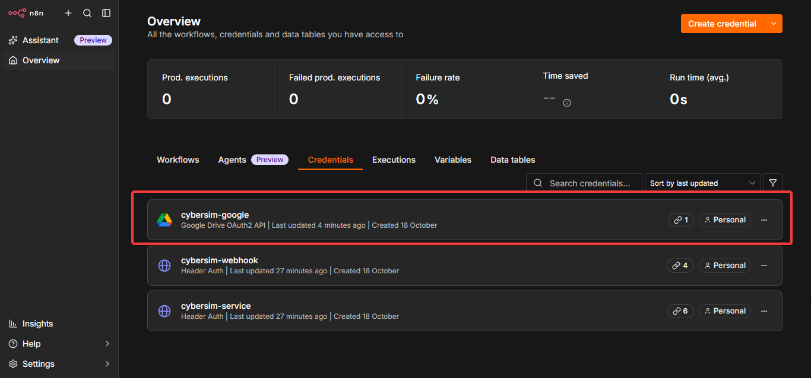
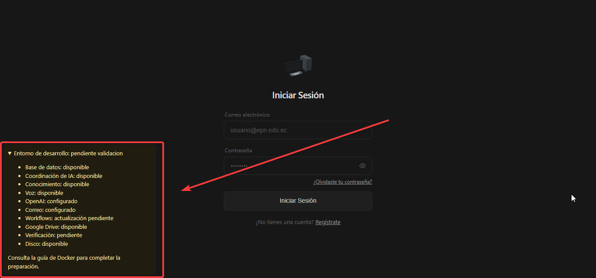

# Guía del desarrollador: primer arranque y trabajo local

Esta guía explica cómo iniciar CyberSim en Windows y hacer tu primer cambio. Para conocer los componentes y encontrar dónde trabajar en el código, consulta el [resumen de CyberSim](../architecture/resumen.md).

## 1. Prepara las herramientas y el proyecto

Necesitas:

- Windows 11 con Docker Desktop, WSL y contenedores Linux.
- Docker Compose 2.32.2 o superior, con soporte para Watch (sincronización de cambios).
- Git y un editor de código.
- Un equipo con 16 GB de RAM.
- Conexión a Internet para descargar imágenes, dependencias y el modelo de voz, y para utilizar las integraciones externas.

Clona el repositorio desde la URL facilitada por el equipo y abre su carpeta en el editor. Ejecuta los comandos de esta guía en una terminal PowerShell situada en la raíz del proyecto, donde están `compose.yaml` y `package.json`.

Inicia Docker Desktop y comprueba que usa contenedores Linux:

```powershell
docker version
docker compose version
```

`docker version` debe mostrar tanto el cliente como el servidor. Si el servidor no responde, termina de iniciar Docker Desktop y revisa su configuración de WSL.

Docker ejecuta Node, pnpm, Prisma y PostgreSQL. Puedes trabajar con el editor en Windows sin instalar esas herramientas por separado.

## 2. Crea la configuración local

Prepara los secretos de los servicios locales:

```powershell
./scripts/dev.ps1 init
```

El script crea `.env` en la raíz a partir de [.env.example](../../.env.example) y genera los secretos que usan los servicios locales. Si el archivo ya existe, completa los secretos vacíos o ausentes y conserva los valores configurados. Puedes repetir el comando sin cambiar los secretos ya generados. Al terminar muestra `Configuracion local lista`.

Toda la configuración local se edita en ese `.env` raíz. Mantén sus valores privados y fuera de Git. Las credenciales de OpenAI, Google y correo pueden completarse después del primer arranque, como indica el paso 5.

Antes de arrancar, comprueba que Compose puede leer la configuración:

```powershell
docker compose config --quiet
```

Si termina sin errores, continúa al paso 3. Esta comprobación no inicia contenedores ni muestra los secretos. Si indica que falta una variable como `JWT_SECRET`, `INTERNAL_SIGNING_KEY` o `N8N_ENCRYPTION_KEY`, vuelve a ejecutar `./scripts/dev.ps1 init` y repite la comprobación. Estos secretos se generan localmente; no tienes que solicitarlos a un proveedor.

## 3. Inicia la aplicación

```powershell
docker compose up --build --watch
```

Mantén esta terminal abierta: muestra los logs y sincroniza los cambios del código con los contenedores. El primer arranque tarda más porque descarga dependencias, construye las imágenes y prepara el modelo de voz.

El arranque prepara la base de datos, aplica las migraciones y crea las cuentas y los datos de demostración que falten. También inicia frontend, backend y los servicios de automatización, búsqueda y voz. Espera a que el frontend muestre el mensaje de Vite con la dirección del servidor antes de abrir la aplicación. La construcción de las imágenes puede terminar antes de que los servicios estén listos.

| Dirección | Qué encontrarás |
|---|---|
| `http://localhost:5173` | Aplicación y diagnóstico de preparación |
| `http://localhost:5678` | n8n, la herramienta de automatización de las integraciones |

Accede a la API desde el frontend, que dirige las solicitudes al backend. La base de datos y los demás servicios internos se utilizan desde los contenedores.

## 4. Comprueba el arranque e inicia sesión

Comprueba primero los contenedores desde otra terminal PowerShell:

```powershell
docker compose ps -a
```

Antes de abrir `http://localhost:5173`, comprueba estos estados:

| Servicio | Estado esperado |
|---|---|
| `volume-check` y `migrate` | `Exited (0)`: tareas completadas correctamente |
| `postgres` y `backend` | `Up` y, tras sus comprobaciones, `healthy` |
| `frontend` | `Up`, con el puerto `127.0.0.1:5173` publicado |

`Created` significa que un contenedor todavía no ha arrancado. Si alguno de los servicios anteriores muestra `Created` o `Exited` con un código distinto de cero, consulta los logs antes de continuar:

```powershell
docker compose logs --tail=100 volume-check postgres migrate backend frontend
```

PostgreSQL espera a `volume-check`; la migración espera a PostgreSQL; el backend espera a la migración, y el frontend espera al backend. Un fallo al principio de esta cadena impide que se publique el puerto 5173, aunque n8n u otros servicios estén activos.

Con el frontend activo, abre `http://localhost:5173` y revisa el diagnóstico de preparación.

En una instalación nueva puedes entrar con estas cuentas:

| Perfil | Correo | Contraseña inicial |
|---|---|---|
| Profesor | `profesor@test.com` | `password123` |
| Estudiante | `estudiante1@test.com` | `password123` |
| Estudiante | `estudiante2@test.com` | `password123` |

Comprueba que puedes iniciar sesión y consultar los datos de demostración. Las cuentas vienen confirmadas, por lo que este primer acceso no requiere enviar correo.

Estas cuentas solo se crean cuando `SEED_DEMO_DATA=true`, valor que el servicio de desarrollo fija en Compose. Staging debe activarlo explícitamente; **producción nunca lo define o lo define en `false`**, porque el seed crea credenciales conocidas.

Si faltan credenciales externas, el diagnóstico indicará qué funciones requieren configuración. Puedes abrir la aplicación y trabajar en el código mientras completas esos accesos; las funciones de IA, Google Drive y correo necesitan sus respectivas integraciones.

## 5. Configura las integraciones que necesites

Solicita al responsable del equipo las credenciales y el acceso de lectura a la carpeta compartida de Google Drive. Completa los siguientes campos en el `.env` raíz:

| Integración | Configuración |
|---|---|
| OpenAI | `OPENAI_API_KEY`, con acceso a los modelos indicados en `.env.example` |
| Google Drive | `GOOGLE_CLIENT_ID`, `GOOGLE_CLIENT_SECRET` y `GOOGLE_DRIVE_FOLDER_ID` proporcionados por el equipo |
| Correo SMTP | `SMTP_HOST`, `SMTP_PORT`, `SMTP_SECURE`, `SMTP_USER`, `SMTP_PASS` y `FROM_EMAIL` |

Para configurar n8n y autorizar Google Drive:

1. Abre `http://localhost:5678` y crea la cuenta administradora de tu instalación local.
2. Crea una clave de API pública en n8n y guárdala como `N8N_ADMIN_API_KEY` en el `.env` raíz.
3. Detén el comando de arranque con `Ctrl+C` y vuelve a ejecutar `docker compose up --build --watch`. Así los servicios reciben las variables que acabas de editar.
4. Comprueba la preparación desde otra terminal con `docker compose logs --tail=50 preparation`. El servicio crea las credenciales `cybersim-service`, `cybersim-webhook` y, si configuraste `GOOGLE_CLIENT_ID` y `GOOGLE_CLIENT_SECRET`, `cybersim-google`. También importa los seis workflows del repositorio; el de Drive necesita además `GOOGLE_DRIVE_FOLDER_ID`.
5. Actualiza la página de n8n. En **Credentials** debe aparecer `cybersim-google`, y en **Workflows** deben aparecer los flujos de CyberSim. Si faltan y el log muestra `preparation_pending` repetidamente, resuelve el error antes de continuar. Tener el contenedor activo no garantiza que la preparación haya terminado.

   La credencial de Google Drive se encuentra en **Overview → Credentials**, resaltada en la imagen:

   

6. Abre la credencial Google Drive `cybersim-google` y autoriza tu cuenta con acceso a la carpeta compartida. Comprueba en esa pantalla la URL de retorno OAuth; la configuración local usa `http://localhost:5678/rest/oauth2-credential/callback`. La credencial solicita acceso de solo lectura a Drive.

Cada vez que edites `.env`, detén y vuelve a ejecutar el comando de arranque para aplicar los valores. Watch sincroniza código; los cambios de configuración requieren recrear los servicios.

Abre `http://localhost:5173` y despliega **Entorno de desarrollo**, en la esquina inferior izquierda. Allí puedes ver el estado de OpenAI, Correo, Google Drive y los demás servicios. Si alguno indica **requiere configuración**, revisa sus datos en este paso.



El estado **configurado** significa que CyberSim detectó los datos necesarios para intentar la conexión. Por ejemplo, Correo puede aparecer configurado porque completaste las variables SMTP, aunque una contraseña incorrecta impida enviar mensajes. Para confirmar que funciona hay que realizar un envío y comprobar que el correo llega.

**Verificación: pendiente** indica que aún faltan comprobaciones de funcionamiento con los proveedores. La sección [pruebas de integraciones](#pruebas-de-integraciones) explica cómo ejecutar esas comprobaciones. Puedes continuar con el primer cambio de código del paso 6; para utilizar las funciones de IA, Drive o correo, completa también la configuración y las pruebas de los servicios correspondientes.

## 6. Haz tu primer cambio

Con `docker compose up --build --watch` activo:

1. Edita un texto de un componente en `apps/frontend/src/visual` y guarda el archivo.
2. Comprueba el cambio en el navegador; el frontend se actualiza automáticamente.
3. Para trabajar en el backend, edita sus fuentes en `apps/backend/src` y observa el reinicio en los logs.

El [mapa del código](../architecture/resumen.md#dónde-trabajar-en-el-repositorio) te ayuda a elegir el módulo. Si estás haciendo una prueba de edición, restaura el texto al terminar.

Al reiniciar el backend se pierde el historial temporal de las conversaciones del tutor. La aplicación informa de la pérdida de contexto para que puedas iniciar una conversación nueva.

## Trabajo diario y cierre

En los siguientes días, inicia Docker Desktop y ejecuta desde la raíz:

```powershell
docker compose up --build --watch
```

La configuración, la base de datos y los accesos guardados por n8n se conservan entre arranques. El inicio completa los datos de demostración que falten y conserva las contraseñas y el progreso existentes.

Para terminar, pulsa `Ctrl+C` dos veces. Puedes retirar los contenedores conservando los datos con:

```powershell
docker compose down
```

Usa `down` sin `-v`: la opción `-v` elimina los volúmenes que contienen datos. Mantén las credenciales PostgreSQL de `.env` coherentes con las de tu base de datos; editar esas variables no cambia las credenciales ya guardadas en ella.

## Consulta para tareas de mantenimiento

Estos apartados se usan cuando necesitas modificar el esquema, las dependencias o las integraciones.

### Migraciones y dependencias

Detén Watch antes de ejecutar mantenimiento. Para crear una migración tras editar el esquema, o aplicar migraciones existentes:

```powershell
./scripts/dev.ps1 migrate create --name descripcion_del_cambio
./scripts/dev.ps1 migrate apply
```

El script pausa las operaciones de integración, detiene las aplicaciones, ejecuta la tarea y reconstruye los servicios. Revisa el SQL generado antes de incluirlo en Git. Si falla, las integraciones permanecen pausadas: revisa el error antes de continuar.

La acción `./scripts/dev.ps1 deps` actualiza `pnpm-lock.yaml` mediante pnpm dentro de Docker. Para añadir o retirar dependencias, usa `./scripts/dev.ps1 deps add --filter @cybersim/frontend paquete` o `./scripts/dev.ps1 deps remove --filter @cybersim/frontend paquete`. Para la raíz, utiliza `-w`. Revisa los manifiestos y el lockfile antes de incluirlos en Git. Las migraciones montan solamente el directorio Prisma sobre la imagen de herramientas, conservando sus dependencias Linux aunque tengas dependencias Windows en el host. Consulta [mantenimiento](mantenimiento.md) y [estado del entorno](../project/estado-desarrollo-docker.md) para los detalles y límites de estas herramientas.

### Flujos de n8n

Los flujos compartidos se versionan en [infra/n8n](../../infra/n8n). Para exportar tus cambios locales o aplicar los del repositorio:

```powershell
./scripts/dev.ps1 workflows export
# Revisar los JSON y el diff antes de incluirlos en Git.
./scripts/dev.ps1 workflows apply
```

`export` escribe archivos en el repositorio; conserva primero cualquier edición pendiente en esos archivos. `apply` realiza una copia de respaldo y actualiza los flujos instalados. Si detecta ediciones divergentes, resuélvelas o expórtalas antes de aplicar. Conserva las credenciales y los datos privados de n8n fuera de Git.

### Comprobaciones del código

Con el entorno iniciado, ejecuta los checks en contenedores:

```powershell
docker compose --profile tools run --rm tools pnpm --filter @cybersim/backend run typecheck
docker compose --profile tools run --rm tools pnpm --filter @cybersim/frontend run typecheck
docker compose --profile tools run --rm tools pnpm --filter @cybersim/backend run lint
docker compose --profile tools run --rm tools pnpm --filter @cybersim/frontend run test
docker compose --profile tools run --rm tools node infra/test-db.mjs
```

`test-db.mjs` crea una base temporal, aplica migraciones y datos de prueba, ejecuta los tests backend y elimina esa base al terminar. Usa este comando para mantener las pruebas separadas de los datos con los que trabajas en la aplicación.

### Pruebas de integraciones

`./scripts/dev.ps1 verify` informa las verificaciones externas pendientes. La variante `./scripts/dev.ps1 verify --external --budget-ack` utiliza proveedores reales: puede consumir OpenAI y enviar correo al destinatario indicado en `VERIFY_RECIPIENT`. Ejecútala cuando hayas acordado el presupuesto y el destinatario de prueba. Los criterios están en C11 del [contrato de desarrollo](../architecture/contrato-desarrollo-docker.md).

Para investigar un fallo, consulta la [arquitectura del entorno Docker](../architecture/desarrollo-docker.md) y el [estado de las verificaciones](../project/estado-desarrollo-docker.md). Puedes comprobar el backend mediante `http://localhost:5173/api/health/live` y su preparación mediante `http://localhost:5173/api/health/ready`.
