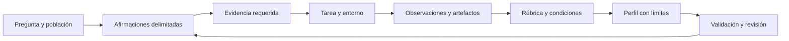

# Marco para investigar y evaluar conocimientos de ciberseguridad

**Pregunta rectora:** «Qué tanto saben los estudiantes de ciberseguridad y cómo evaluarlos».

**Recomendación:** diseñar CyberSim como instrumento de evaluación basado en evidencias, con diagnóstico conceptual, tareas prácticas, justificación y comprobación de resultados. Informar un **perfil por caso y dimensión**, distinguiendo desempeño autónomo y asistido; no convertir terminar escenarios en una medida de conocimiento general.

Versión documental: **marco propuesto1.2, aplicación temática actualizada al conjunto2.0**. Investigación bibliográfica y análisis local; **sin aplicación a estudiantes, calibración ni validación empírica del instrumento**. Se conservan D1–D4, niveles0–3/NE, ayudas A0–A3 y validación V0–V5. Se sustituyen únicamente alcance/ejemplos de ejercicios por los cinco casos del compañero. El [paquete vigente](ejercicios/README.md), su [investigación](ejercicios/investigacion-especificaciones.md) y [comprobaciones](ejercicios/verificacion-especificaciones.md) son canónicos. Las anteriores [evidencias F](evidencia-marco-evaluacion.md) y [soluciones preliminares](soluciones-evidencia-ejercicios.md) conservan fundamento e historia, no los diseños vigentes. No se implementa software.

**Aclaración de la versión 1.1:** terminar sí aporta evidencia del criterio alcanzado; no identifica automáticamente comprensión o autonomía fuera de esas condiciones. Se permiten prototipos de investigación antes de una validación completa. Además, solicitar explicación puede modificar la actuación; su momento forma parte de lo que se está midiendo. Estas precisiones sustituyen interpretaciones absolutas de la recomendación inicial, no declaran una eficacia ya probada.

## 1. Cómo utilizar el marco

1. Definir a qué estudiantes, momento curricular y decisión educativa se dirige la evaluación.
2. Consultar una de las [cinco especificaciones completas](ejercicios/README.md), o completar la plantilla del marco para un ejercicio futuro: afirmación, evidencia, tarea, rúbrica y explicaciones alternativas.
3. Diseñar primero lo que debe poder observarse; después elegir la interfaz y el entorno mínimos que lo hagan observable.
4. Revisar contenido con especialistas, observar cómo interpretan la tarea estudiantes de la población objetivo y pilotar la puntuación.
5. Utilizar resultados solo para las interpretaciones respaldadas; ampliar los usos después de reunir evidencia adicional.

Los pasos son responsabilidades iterativas, no una prohibición de prototipar antes del paso 4. El prototipo puede ser el material necesario para observar estudiantes. Las [especificaciones 2.0](ejercicios/README.md) definen ya consignas, materiales, operaciones, soluciones, ayudas y corrección de los casos vigentes; las [soluciones anteriores](soluciones-evidencia-ejercicios.md#4-materiales-concretos-propuestos-por-caso) conservan el razonamiento preliminar, no sustituyen su clave vigente.

**Antes de reclutar participantes deben resolverse:** población e institución, prerrequisitos, modalidad/idioma, disponibilidad de muestra, responsables, procedimiento ético y decisión educativa prevista. No bloquean la elaboración documental, pero sí impiden cerrar un protocolo de campo o calcular una muestra definitiva.

## 2. Formalización del problema investigativo

### 2.1 Qué falta conocer

En los materiales examinados no se encontró un estudio local de estos casos vigentes que permita describir, con precisión y límites explícitos, qué conocimientos y capacidades muestran los estudiantes. Tampoco se aportó evidencia de que las observaciones producidas por CyberSim sustenten esa interpretación. Resolver ambas cuestiones permitiría identificar necesidades educativas sin confundir familiaridad con la aplicación, ayuda recibida o éxito eventual con conocimiento autónomo. Esto describe el alcance de lo revisado, no demuestra que ningún estudio externo exista.

La contribución buscada es **un procedimiento de medición y su evidencia de validez para usos delimitados**. La aplicación es un recurso instrumental. Una experiencia atractiva, estable o realista puede facilitar el estudio, pero no responde por sí sola a la pregunta investigativa.

### 2.2 Preguntas operacionales

| ID | Pregunta | Resultado que permitiría responderla |
|---|---|---|
| PI1 | ¿Qué identifican, explican y realizan los estudiantes en cada caso aprobado? | Distribución de evidencias y niveles por caso/dimensión, con faltantes, condiciones e incertidumbre |
| PI2 | ¿Qué evidencias permiten distinguir comprensión de acierto, repetición o ayuda? | Contraste entre explicación, actuación, pruebas y variante; análisis de discrepancias |
| PI3 | ¿La puntuación es suficientemente consistente para el uso propuesto? | Acuerdo entre evaluadores, funcionamiento de criterios y estabilidad entre tareas/variantes pertinentes |
| PI4 | ¿Qué barreras ajenas al constructo distorsionan la interpretación? | Entrevistas, incidencias y análisis de interfaz, lenguaje, experiencia previa y acceso |
| PI5 | ¿Hasta dónde se pueden generalizar los resultados? | Evidencia sobre otras tareas del mismo caso y límites de población/contexto |

La fase inicial es **descriptiva y de desarrollo/validación de medición**, no una prueba causal de que CyberSim mejora el aprendizaje. Si luego se estudia mejora educativa, requerirá otra pregunta, diseño y análisis; no basta reutilizar PI1 con una comparación antes/después.

### 2.3 Unidad y alcance de inferencia

- Unidad de observación: respuesta, decisión, artefacto o prueba de un estudiante dentro de una tarea identificada y unas condiciones conocidas.
- Unidad de informe inicial: **estudiante × caso × dimensión × condición de ayuda**. Para la cohorte: distribución de estos perfiles, no una clasificación universal.
- Población objetivo: pendiente de delimitar con la institución. “Estudiantes universitarios que han cursado fundamentos de ciberseguridad” es una **población candidata**, no una condición ya acordada.
- No se infieren automáticamente: competencia profesional integral, trabajo en equipo, ética general, inteligencia, empleabilidad ni conocimientos de toda la ciberseguridad.
- No se identifican aún prevalencias poblacionales ni efectos educativos: no se han recogido datos locales.

## 3. Alcance temático vigente y calidad de los antecedentes

El usuario sustituye expresamente los ejercicios anteriores por los de su compañero en `workspace/Escenarios-cibersim.md`. La [copia íntegra versionable](ejercicios/fuentes/escenarios-companero.md) fija la procedencia; su hash y tratamiento de ambigüedades constan en el índice del conjunto.

| Caso vigente | Narrativa y tarea |
|---|---|
| CWE-321 — AndinaPay | Clave criptográfica embebida, historia, volcado sintético, recuperación y continuidad |
| CWE-89 — BibliotecaViva | Historial SQL de préstamos, parametrización, propietario y permisos |
| CWE-434 — TalentoAndino | CV/fotos, admisión, almacenamiento, entrega y legado |
| CWE-306 — AndeanLogix | Funciones críticas sin autenticación, roles, red y mantenimiento |
| CWE-502 — NubeAndina | Restauración de sesiones, tipos/efectos, integridad y autoridad |

El Excel inicial es antecedente de la selección anterior, no definición del conjunto vigente. CWE-319 no se incorpora; CWE-1427/CWE-200 y las antiguas historias434/502 quedan retiradas. No se reconstruye la comparación de riesgos del compañero ni se atribuye a este cambio una aprobación institucional o validación científica de la selección.

CWE describe debilidad, no competencia educativa ni equivalencia automática con OWASP. En particular, autenticación ausente (306) y autorización por roles son propiedades distintas: se estudian juntas en AndeanLogix sin identificarlas. La importancia/frecuencia de ataques no prueba discriminación del instrumento. Se conservan las reservas sobre referencias del Excel, incluido DOI duplicado para títulos diferentes, como antecedente no saneado; no se utiliza esa duplicación para respaldar las nuevas fichas.

## 4. Fundamento y decisiones de diseño

El diseño centrado en evidencias de [Mislevy, Steinberg y Almond (2003)](https://cresst.org/wp-content/uploads/TR597.pdf) organiza la relación entre el modelo de lo que se quiere inferir, las observaciones relevantes y las tareas que las producen. Se adopta esa relación, **no la obligación de implementar un modelo bayesiano** desde el primer prototipo.

La validación argumentativa de [Kane (2013)](https://doi.org/10.1111/jedm.12000) obliga a justificar las interpretaciones y usos de las puntuaciones. Por ello se separan cuatro preguntas: ¿puntuamos bien la actuación?, ¿se mantiene en otras tareas pertinentes?, ¿qué permite inferir fuera de ellas?, ¿es defendible la decisión educativa tomada?

Las siguientes son **propuestas para CyberSim**, no resultados experimentales ni una configuración óptima demostrada:

| Decisión propuesta | Razón y apoyo | Coste o límite |
|---|---|---|
| Combinar evidencia conceptual y práctica | El CCI aporta un antecedente específico de medición conceptual; las tareas añaden observación de actuación [F03, F08] | Más tiempo de autoría/corrección; una modalidad no valida la otra |
| Rúbrica analítica específica por caso | Permite explicitar qué se considera evidencia; la revisión de rúbricas respalda su potencial para mejorar consistencia [F09] | Requiere ejemplos, entrenamiento y comprobar acuerdo real |
| Separar autonomía de ayuda | Una misma solución cambia de significado según el apoyo recibido [F06, F15] | Más estados de registro; no existe una penalización universal justificada |
| Verificar efectos, no una secuencia única | Los modelos de trazas pueden omitir soluciones correctas no previstas [F08] | Hay que mantener alternativas y canal de revisión |
| Informar dimensiones, no un total de “ciberseguridad” | El muestreo de tareas y el alcance restringen la generalización [F02, F28] | Menor simplicidad que un ranking; requiere explicar perfiles |
| Elegir fidelidad funcional antes que apariencia | El entorno debe representar las decisiones relevantes, no añadir barreras visuales [F14] | No permite proclamar transferencia a sistemas reales sin estudiarla |

Los identificadores F remiten al [registro de fuentes](evidencia-marco-evaluacion.md#fuentes-y-acceso-real). Las fuentes justifican principios o antecedentes; **la combinación, número de dimensiones, rúbrica y política de ayuda que siguen son decisiones locales revisables**.

## 5. Modelo de competencias observables

Cada caso se evalúa en cuatro dimensiones. Son un esquema de autoría y reporte, **no cuatro factores psicométricos ya establecidos**.

| Dimensión | Afirmación delimitada | Evidencia admisible | Qué no la demuestra por sí solo |
|---|---|---|---|
| D1. Diagnosticar | Reconoce la condición relevante y la diferencia de un caso benigno | Selección de evidencias, ubicación de la frontera de confianza, identificación del actor/activo | Nombrar una CWE, pulsar una alerta o acertar una pregunta aislada |
| D2. Explicar y decidir | Explica un mecanismo causal y elige una medida pertinente con límites | Explicación breve vinculada a datos; predicción de qué cambiaría bajo otra condición | Texto largo, vocabulario técnico o repetir una recomendación |
| D3. Intervenir | Produce una configuración o artefacto que satisface la propiedad requerida | Estado/artefacto comprobable y procedencia de la acción | Haber abierto una herramienta, seguir clics o entregar una flag copiada |
| D4. Verificar y delimitar | Comprueba seguridad y función legítima, y reconoce lo no demostrado | Prueba adversa y benigna, interpretación del resultado y limitación | Ver un mensaje verde, bloquear todo o una sola ejecución favorable |

**Autonomía, seguridad de la ejecución y transferencia se informan aparte**: la ayuda es una condición; los incidentes pueden invalidar una sesión; la transferencia necesita una tarea distinta. No sumar esos elementos como si fueran rasgos independientes medidos por cada clic.

Cada ficha relacionará sus objetivos con las competencias locales y, cuando sirva, con conocimientos/habilidades/tareas del [NICE Framework, SP 800-181 Rev. 1](https://csrc.nist.gov/pubs/sp/800/181/r1/final). El mapeo debe citar texto, identificador y versión consultados. Aquí **no se inventan identificadores NICE ni se asigna un rol laboral completo** a cinco ejercicios.

### Matriz de especificación mínima

Por cada objetivo, completar una fila antes de construir el entorno:

| Objetivo | Afirmación | Tarea que la provoca | Evidencia y regla de puntuación | Explicación rival | Contraste que la debilita |
|---|---|---|---|---|---|
| Ejemplo CWE-434/D2 | Distingue validar en cliente de hacer cumplir la política en servidor | Comparar dos configuraciones sobre el mismo conjunto de archivos sintéticos | Predice cuál rechaza el tipo peligroso y explica dónde se hace cumplir | Reconoce un icono o recuerda la pantalla | Variante con nombres e interfaz distintos, conservando la frontera de confianza |

No asignar una competencia solo porque una acción aparece dentro de un escenario. Si una tarea exige simultáneamente varias habilidades, documentar la dependencia; los casos diferentes no bastan para separar estadísticamente habilidad, tema y dificultad.

## 6. Diseño común de una sesión

### 6.1 Secuencia propuesta

1. **Familiarización neutral:** practicar controles con contenido sin la solución de los casos vigentes. Verificar accesibilidad y comprensión de instrucciones. Registrar barreras; no puntuar velocidad.
2. **Tarea inicial:** resolver una instancia con recursos previamente especificados y producir artefacto y pruebas. Si interesa actuación sin planificación inducida, no intercalar preguntas dirigidas para enseñar o explicar cada paso.
3. **Cierre del registro inicial:** por entrega o solicitud de ayuda. Lo observado antes permanece separado de lo obtenido después. Conservar condiciones, no asumir que una interacción es neutral por llamarla evaluación.
4. **Variante, si corresponde:** para estudiar generalización anterior a enseñanza adicional, administrarla antes de preguntas explicativas dirigidas, pistas o feedback que puedan modificar el conocimiento. Aun así, ya hubo exposición a la primera tarea; no llamarla medición independiente de toda experiencia previa.
5. **Comprobación conceptual/explicativa:** recoger una razón, predicción o representación breve pertinente al objetivo. Si ocurre al cierre, no tratarla como reproducción infalible del pensamiento inicial. Si el objetivo exige planificar antes de actuar, colocarla antes y declarar esa condición, en lugar de mezclar ambas administraciones.
6. **Apoyo/práctica opcional:** ofrecer ayudas graduadas y feedback formativo; conservar su efecto y no reetiquetar el resultado como autónomo. Una variante posterior describe desempeño tras esa exposición, no transferencia inicial sin enseñanza.
7. **Informe y debriefing:** evidencias, condiciones, incertidumbres y siguiente necesidad de aprendizaje. La satisfacción se recoge aparte.

Un diagnóstico conceptual previo sigue siendo una alternativa, pero puede orientar la actuación posterior aunque no se dé feedback. Su orden, contenido y posible exposición a soluciones deben declararse. No hay una secuencia única óptima establecida para los casos vigentes. El [análisis de reactividad y formatos](soluciones-evidencia-ejercicios.md#32-momento-de-cada-observación) fundamenta esta revisión; no se considera toda verbalización equivalente a una explicación dirigida.

Esta secuencia no obliga a administrar los casos vigentes en una sola sesión. El tiempo, orden y pausas se determinan con pilotaje para evitar fatiga. Contrabalancear orden entre estudiantes cuando se comparen casos y registrar si una tarea revela la solución de otra.

### 6.2 Condiciones de ayuda

| Código local | Condición | Tratamiento del resultado |
|---|---|---|
| A0 | Sin ayuda de contenido; materiales estándar declarados | Evidencia autónoma dentro de esas condiciones, no “sin recursos” universal |
| A1 | Aclaración de interfaz o accesibilidad, sin contenido resolutivo | Mantener separada su descripción; examinar si realmente fue neutral |
| A2 | Pista conceptual o de localización | Evidencia asistida desde ese momento; conservar lo anterior |
| A3 | Procedimiento explícito, solución parcial o respuesta revelada | Evidencia de ejecución con guía; no inferir solución independiente |

Registrar el texto/versión y momento de cada ayuda, no solo un contador. No restar puntos por pedirla de forma arbitraria: informar **qué logró antes y después**. Ayudas de accesibilidad no son automáticamente pistas conceptuales.

La política sobre documentación, colaboración, internet y asistentes de IA debe fijarse antes de la sesión. En la fase autónoma puede autorizarse un conjunto común de documentación; la ayuda generativa que aporta razonamiento o solución cambia la condición. Ninguno de los cinco casos vigentes exige un LLM como objeto; un futuro caso que lo utilice no convierte ese objeto automáticamente en tutor o evaluador.

## 7. Puntuación e interpretación inicial

### 7.1 Rúbrica base: niveles de evidencia, no certificados de dominio

Aplicar cada descriptor a cada dimensión y **con los anclajes específicos del caso**:

| Registro | Significado |
|---|---|
| NE | No hay evidencia interpretable: fallo técnico, criterio no presentado, artefacto ausente por pérdida de registro u otra causa identificada |
| 0 | Hubo oportunidad y observación válida, pero la respuesta/actuación contradice el criterio o no lo satisface |
| 1 | Hay elementos pertinentes, pero falta una parte esencial o persiste una contradicción sustantiva |
| 2 | Satisface los elementos esenciales definidos para esa tarea y dimensión |
| 3 | Satisface el criterio y además discrimina un contraste o límite predefinido más exigente |

La escala 0–3 es **ordinal y propuesta**. Un 3 no demuestra competencia profesional ni transferencia; el contraste puede seguir dentro de la misma tarea. No promediar NE como cero. Un criterio no intentado con oportunidad válida se registra como `no_attempt`, y solo recibe 0 si la política de omisión preespecificada lo establece; no es equivalente a pérdida técnica.

No se fija un aprobado universal de 70/100 ni se transforma el perfil en porcentaje de conocimiento. Para usos clasificatorios posteriores, definir desempeño mínimo, método de establecimiento de cortes, panel, incertidumbre y consecuencias; el trabajo de [Zieky y Perie (2006)](https://www.ets.org/research/policy_research_reports/publications/publication/2006/dbkw.html) es un antecedente metodológico, no un corte transportable.

### 7.2 Reglas de corrección

- Puntuar el artefacto y las afirmaciones verificables, no longitud, estilo o dominio del inglés si no son objetivos explícitos.
- Finalización y explicación son evidencias falibles complementarias, no garantías alternativas. Una relación causal puede elicitarse brevemente; reconocerla, construirla y expresarla en distintas modalidades no son desempeños equivalentes por defecto.
- Cada nivel debe disponer de un ejemplo ancla, contraejemplo y solución alternativa admisible.
- Las pruebas automáticas determinan hechos acotados; las explicaciones y discrepancias exigen revisión humana durante el pilotaje.
- Si una solución es válida pero no coincide con la ruta prevista, remitirla a revisión sin marcarla automáticamente como incorrecta. Conservar el resultado original y la adjudicación.
- No contar pruebas o clics duplicados como evidencias independientes; varios observables del mismo producto forman un conjunto dependiente.
- Si un mismo fallo causa varias consecuencias, documentar qué dimensiones afecta y por qué. No penalizarlo repetidamente por costumbre ni otorgar D3 por una buena explicación sin intervención.
- Un bloqueo total puede cumplir una condición de seguridad, pero incumplir la tarea legítima. El informe debe mostrar ambos resultados.
- Conservar puntuaciones individuales de evaluadores **antes** de la conciliación; el consenso posterior no mide el acuerdo inicial.

### 7.3 Ejemplo de informe individual, enteramente ficticio

> CWE-434, instancia U-A, rúbrica 1.0, condición A0: D1=2, D2=1, D3=2, D4=1. Identificó el punto de carga y aplicó una política que rechazó el archivo peligroso del conjunto previsto. No explicó por qué el control del cliente era insuficiente ni comprobó la conservación de la carga legítima. Tras pista A2 completó esa prueba; se informa aparte. La evidencia permite describir esta actuación, no concluir dominio general ni transferencia.

No ocultar una debilidad de explicación con el éxito técnico. Un estudiante que explica bien y falla al operar también merece un perfil distinto; la discrepancia es un dato investigable.

## 8. Cinco ejercicios definidos: especificación2.0

El [contrato común](ejercicios/README.md) y cada ficha detallada fijan consignas, materiales, escenarios, estado/operaciones, soluciones admisibles, ayudas, pruebas y anclas de rúbrica. Son diseño completo para prototipado, no software implementado o validación con personas.

| Caso | Ficha canónica |
|---|---|
| CWE-321 AndinaPay | [Claves e historia](ejercicios/cwe-321-andinapay.md) |
| CWE-89 BibliotecaViva | [Consulta y préstamos](ejercicios/cwe-89-bibliotecaviva.md) |
| CWE-434 TalentoAndino | [Carga y entrega](ejercicios/cwe-434-talentoandino.md) |
| CWE-306 AndeanLogix | [Identidad y funciones](ejercicios/cwe-306-andeanlogix.md) |
| CWE-502 NubeAndina | [Restauración y efectos](ejercicios/cwe-502-nubeandina.md) |

El diagnóstico solicitado es anterior al menú de controles; la explicación se recoge después de entregar. Su reactividad se declara, los recursos originales A0 permanecen y los resultados inmediatos son hechos, no pistas resolutivas ocultas. Se conservan D1–D4, A0–A3 y0–3/NE; no existe una nota total. La [investigación adicional](ejercicios/investigacion-especificaciones.md) registra17revisiones por caso y la [verificación](ejercicios/verificacion-especificaciones.md) diferencia cálculos de autoría y pruebas futuras. El [plan de implementación](ejercicios/plan-implementacion.md) es un handoff, no implementación efectuada.

## 9. Evidencia que CyberSim tendría que conservar

### 9.1 Lo observado hoy

La [arquitectura modular](../architecture/escenarios-modulares.md) dispone de identidad/revisión/hash del contenido. El código de `ProgresoController` obtiene esa identidad y serializa acciones con `accion`, `objeto`, `tiempo` y `val`; `EscenarioController` guarda intentos al fallar fase o completar escenario. El repositorio de progreso conserva resultados y resume intentos/finalización. Esto aporta trazabilidad técnica, **no una escala educativa calibrada**.

Evidencia local: [ProgresoController](../../apps/frontend/src/ecs/controllers/ProgresoController.ts), líneas 105–156; [EscenarioController](../../apps/frontend/src/ecs/controllers/EscenarioController.ts), líneas 253–274; [PrismaProgresoRepository](../../apps/backend/src/auth/infrastructure/repositories/PrismaProgresoRepository.ts), líneas 11–75. El [caso de uso de feedback](../../apps/backend/src/feedback/application/useCases/GenerateFeedbackUseCase.ts) no demuestra que su juicio tenga validez educativa.

Los perfiles reservados, un catálogo de capacidades o condiciones booleanas no prueban que existan laboratorios funcionales de los casos vigentes. La [guía de escenarios](../guides/escenarios.md) requiere detener la autoría declarativa cuando falta capacidad/verificador/presentación.

### 9.2 Contrato conceptual futuro, no cambio de esquema actual

| Grupo de datos | Contenido mínimo | Para qué se necesita |
|---|---|---|
| Identidad del instrumento | Caso, tarea, variante, revisión/hash, rúbrica, verificador y versión de política de ayuda | Saber qué se administró y corrigió |
| Condiciones | Sesión seudonimizada, orden, recursos, ayudas, adaptaciones, interrupciones y modalidad | Evitar comparar condiciones distintas como equivalentes |
| Evidencia | Acción semántica con referencia al objeto, artefacto/estado, respuesta conceptual, explicación y pruebas | Reconstruir la base observable del juicio |
| Calidad del registro | Origen de la observación, secuencia, integridad, fallo técnico y ausencia justificada | No convertir una pérdida de telemetría en desconocimiento |
| Puntuación | Dimensión, descriptor, evidencia citada, evaluador, fecha, versión y adjudicación | Auditar y reproducir decisiones |
| Exposición previa | Instancias vistas, intentos anteriores y feedback revelado | Distinguir primera actuación de aprendizaje por repetición |

Propuesta de separación de responsabilidades: **entorno presenta → verificador produce hechos → rúbrica interpreta evidencia → informe delimita inferencias**. Es conceptual; no se modifica ahora una API ni un contrato compartido.

Minimizar registros: no capturar todo por defecto, ni almacenar secretos reales, conversaciones privadas o historial ajeno al ejercicio. Definir responsables, accesos, retención y eliminación antes del campo. Si se necesita información de grupos para estudiar equidad, justificarla y protegerla; su ausencia limita lo que se puede afirmar.

## 10. Protocolo para validar el instrumento

### 10.1 Alternativas que deben poder distinguirse

| Explicación | Patrón esperado | Prueba informativa | Decisión si se observa |
|---|---|---|---|
| Comprensión situada | Explicación y actuación coherentes; predice un contraste pertinente | Caso base más contraste sin feedback previo sobre ese contraste | Conservar la interpretación delimitada y estudiar generalización |
| Memorización de ruta | Finaliza la instancia conocida, pero no explica ni resuelve una variante equivalente | Cambiar superficie y conservar mecanismo, comprobando equivalencia de demandas | Rediseñar evidencia y limitar inferencia a ejecución de esa instancia |
| Barrera instrumental | Diagnóstico conceptual pertinente, pero dificultad para operar; mejora tras aclaración neutral | Familiarización y observación del proceso, sin enseñar solución | Revisar interfaz/prerrequisitos; no atribuir todo a desconocimiento |
| Dependencia de ayuda | Mejora solo tras pista de contenido | Comparar evidencia anterior y posterior, no solo puntuación final | Informar logro asistido y necesidad específica |
| Verificador incompleto | Artefacto válido marcado como fallo o bloqueo total premiado | Casos de control, solución alternativa y revisión de discrepancias | Corregir verificador y revisar afectados con versión explícita |

Son predicciones de diseño, no hipótesis ya contrastadas. Si varios patrones siguen siendo compatibles, conservar la ambigüedad en vez de etiquetar al estudiante.

### 10.2 Fases y decisiones de avance

Las fases organizan tipos de evidencia, no una cascada obligatoria de construcción. Un prototipo de investigación puede aparecer en V0–V2; revisión experta y pruebas lógicas son útiles para su diseño, sin reemplazar la observación de cómo responde la población. La fidelidad se elige según la incertidumbre: a veces harán falta mecanismos funcionales antes de poder pilotar.

| Fase | Qué hacer | Evidencia de salida | Cuándo volver atrás |
|---|---|---|---|
| V0. Especificación | Cerrar población, usos, constructos, cobertura y condiciones | Fichas completas y registro de supuestos | Uso o competencia no observable |
| V1. Contenido | Especialistas revisan correspondencia causal, relevancia, cobertura, claves y alternativas | Juicios independientes, razones y cambios; no solo una media de aprobación | Desacuerdo sustantivo o dependencia oculta |
| V2. Proceso de respuesta | Entrevistas cognitivas/pensamiento en voz alta con perfiles de la población; observar barreras | Qué entendieron, qué evidencia usaron y qué respuestas resultaron ambiguas | La tarea se resuelve por pista superficial o evalúa otra cosa |
| V3. Pilotaje operativo | Administrar versión congelada; doble corrección independiente de un conjunto planificado | Registros completos, desacuerdos, distribución, incidencias y carga de trabajo | Pérdida de evidencia, rúbrica ambigua o efecto suelo/techo |
| V4. Estudio de medición | Recoger muestra acorde a precisión; examinar variantes, consistencia y relaciones previstas | Estimaciones con intervalos, supuestos y limitaciones | Precisión insuficiente, sesgo o generalización no respaldada |
| V5. Uso delimitado | Informe diagnóstico/formativo y seguimiento de consecuencias | Decisiones pedagógicas auditables y revisión de errores | Daño, interpretación excesiva o nueva población/versión sin evidencia |

No se impone un número mágico de expertos o alumnos. Justificar diversidad, cobertura y recursos para V1/V2; para V3/V4 justificar precisión y análisis según el objetivo. Una reunión de expertos no reemplaza observar estudiantes, ni un pequeño pilotaje demuestra ausencia de sesgo.

En V2, distinguir entrevistas exploratorias, pensamiento en voz alta no dirigido y preguntas explicativas. Estas últimas pueden intervenir sobre aprendizaje/rendimiento; no trasladar tiempos o puntuaciones a una administración silenciosa como si fueran iguales. La evidencia cualitativa ayuda a revisar el diseño, no demuestra que toda la población interprete la tarea igual.

### 10.3 Plan de análisis mínimo

- **Descriptivo principal:** por caso/dimensión, conteos de niveles, respuestas erróneas recurrentes, NE y omisiones; separar condición de ayuda y exposición previa. Informar denominador: elegibles, participantes, presentados, registros válidos y exclusiones con motivo.
- **Acuerdo de puntuación:** acuerdo exacto y tabla de desacuerdos; para criterios ordinales considerar kappa ponderado con pesos predefinidos. Si se justifica un resumen continuo y se usa ICC, declarar modelo, acuerdo absoluto/consistencia, unidad individual/promedio e intervalo [F10]. No intercambiar correlación con acuerdo.
- **Generalización:** observar más de una tarea/variante pertinente por afirmación antes de proclamar estabilidad. Si el diseño y datos lo permiten, estudiar variación persona, tarea y evaluador [F28]; no ajustar modelos no identificables con cuatro escenarios únicos.
- **Estructura:** no calcular un alfa global de cuatro temas heterogéneos para declarar el instrumento válido. Si se pretende una escala común, justificar primero estructura, dependencias y cobertura; IRT, análisis factorial o trazado de conocimiento no se añaden por prestigio metodológico [F03, F11].
- **Relaciones externas:** anticipar qué debería relacionarse con qué y por qué. Comparar con evaluación independiente pertinente, no con la misma regla reescrita. Correlación con notas o experiencia puede ser informativa, pero no una verdad de referencia perfecta.
- **Equidad:** revisar idioma, acceso, dispositivos y familiaridad; analizar patrones por grupos solo cuando haya base ética y tamaño/precisión. Diferencias brutas no prueban sesgo; ausencia de significación tampoco demuestra equidad.
- **Sensibilidad:** repetir conclusiones bajo reglas razonables preespecificadas de omisión, ayuda y exclusiones. Separar análisis principal de exploraciones surgidas tras ver los datos.
- **Tiempos/errores:** utilizarlos para diagnóstico de proceso, no como puntos de conocimiento por defecto. Un tiempo largo puede reflejar lectura, reflexión, barreras o latencia.

**CCI como antecedente, no atajo:** [Poulsen et al.](https://doi.org/10.1145/3451346) estudian conocimiento conceptual tras un curso inicial. La sección 5.3 del [manuscrito de autores](https://cisa.umbc.edu/wp-content/uploads/sites/468/2022/01/CATS-ACM-TCE-to-appear-validation-of-CCI-4-24-21.pdf) declara falta de evidencia para su uso como pretest y limitaciones demográficas/institucionales. No copiar sus ítems ni asumir permiso, equivalencia en español, validez pre/post o equivalencia con estos casos vigentes. Las adaptaciones requieren evidencia propia [F26].

### 10.4 Muestra y precisión

La recomendación de [Lakens (2022)](https://doi.org/10.1525/collabra.33267) es justificar la muestra según la inferencia, precisión o restricciones reales, no heredar una cifra de otro estudio. En este proyecto faltan población disponible, precisión requerida y diseño; por tanto **no hay un tamaño definitivo calculado**.

Ejemplo aritmético exclusivamente ilustrativo: para planificar una proporción con aproximación normal, observaciones independientes y muestreo aleatorio simple, `n ≈ 1.96² × 0.5 × 0.5 / 0.10² = 96.04`, redondeado a **97**, corresponde a un margen aproximado de ±10 puntos porcentuales al 95 %. **No es una recomendación de reclutamiento ni valida un instrumento**. Cohortes por conveniencia, agrupación por aula, no respuesta, varias comparaciones y estimación de acuerdo requieren otras consideraciones; el análisis final debe emplear intervalos apropiados, no prometer ese margen por el mero número reclutado.

### 10.5 Cómo contrastar la configuración recomendada

La recomendación multimodal es provisional. Para decidir si la información adicional compensa su coste, proponer en V3 una comparación acotada entre **C1: resultado final**, **C2: resultado + explicación + pruebas estructuradas** y **C3: C2 + trazas detalladas**. Son condiciones de información para corregir, no tres productos a implementar ahora.

Con los mismos intentos y versiones congeladas, asignar paquetes de evidencia a evaluadores entrenados, evitando que una persona recuerde el mismo caso en varias condiciones; cegarlos a la identidad y, cuando proceda, al resultado de la variante. Medir desacuerdos/adjudicaciones, tiempo y coste de corrección, errores del verificador descubiertos y relación con un criterio independiente pertinente. La variante de desempeño puede ser ese criterio solo si no se usó para construir las reglas y si su propia corrección es defendible; no es una verdad absoluta.

Predefinir qué mejora mínima justificaría más evidencia y qué coste sería aceptable con el equipo, sin elegir umbrales después de observar qué condición gana. Si C2 añade información útil respecto a C1 y C3 no mejora la decisión en relación con su coste, preferir C2; si las explicaciones añaden principalmente barreras lingüísticas, rediseñar su elicitación. No afirmar que ese resultado ya ocurrió. Esta prueba compara utilidad de configuraciones de medición, **no eficacia de aprendizaje causada por la aplicación**.

### 10.6 Si después se investiga aprendizaje

Separar la medición del conocimiento existente de una intervención de enseñanza. Una mejora pre/post de un solo grupo puede mezclar práctica, otras clases, exposición a respuestas y cambios del instrumento; no adjudicarla automáticamente a CyberSim. Un estudio causal requeriría comparador pertinente, asignación defendible, control de diferencias iniciales, resultados preespecificados, tratamiento de pérdidas y análisis acorde a la unidad de asignación. No es un requisito para describir el nivel actual, ni una autorización para iniciar ese estudio ahora.

## 11. IA, integridad y límites de automatización

La IA puede apoyar la autoría de borradores o feedback revisable, pero no se convierte en juez educativo validado por estar integrada. [Zheng et al. (2023)](https://papers.nips.cc/paper_files/paper/2023/hash/91f18a1287b398d378ef22505bf41832-Abstract-Datasets_and_Benchmarks.html) estudian sesgos de jueces LLM en preferencias de respuestas; ese resultado no valida ni invalida automáticamente la calificación estudiantil, pero justifica probar sesgos y acuerdo antes de ese uso.

Propuesta de controles: mantener rúbricas/claves fuera del control del texto del alumno; tratar sus respuestas como datos, no instrucciones; no permitir que una respuesta modifique la política de puntuación; conservar versión, evidencia citada y posibilidad de revisión humana. Auditar respuestas concisas, verbosas, parafraseadas y deliberadamente instructivas. Hasta contar con evidencia suficiente, la calificación interpretativa sigue bajo responsabilidad humana.

La investigación con estudiantes debe separar participación de coerción académica, explicar finalidad y datos, contemplar revisión/retirada conforme al procedimiento institucional y ofrecer una vía de reclamación. No se fija una base legal, consentimiento o plazo de retención sin intervención de los responsables. **No se ha autorizado reclutamiento, transferencia de datos a proveedores ni despliegue de laboratorios vulnerables**.

## 12. Plantilla reutilizable de autoría y evaluación

Copiar esta ficha para cada nueva tarea; mantener versiones anteriores y no inventar aprobaciones:

| Campo | Contenido obligatorio |
|---|---|
| Identidad y estado | Caso, objetivo, tarea/variante, versión y estado: propuesta / revisada / pilotada / uso respaldado para X |
| Población y uso | Prerrequisitos, contexto, idioma, decisión educativa permitida y usos excluidos |
| Afirmación | Qué se podrá decir sobre el estudiante, con alcance explícito |
| Fundamento | Fuente original, pasaje/versión/acceso, principio apoyado y límite de transferencia |
| Objetivos D1–D4 | Qué dimensiones observa y cuáles no; dependencias |
| Evidencia | Productos/acciones/respuestas necesarios y procedencia verificable |
| Explicaciones rivales | Acierto, memorización, ayuda, interfaz, conocimientos auxiliares y cómo contrastarlos |
| Tarea y entorno | Estado inicial, recursos, política legítima, actores, entradas sintéticas y efecto esperado |
| Rúbrica | Descriptores 0–3/NE por dimensión, anclas, contraejemplos y alternativas admisibles |
| Ayudas | Texto/versiones, condiciones, momento y tratamiento de evidencia posterior |
| Verificador | Propiedades observables, prueba adversa y benigna, límites y revisión de casos no reconocidos |
| Variante | Qué cambia, qué permanece, equivalencia por comprobar y si observa generalización o aprendizaje |
| Protocolo | Orden, tiempo pilotado, omisiones, fallos técnicos, repeticiones y exposición previa |
| Análisis | Resultado principal, denominadores, acuerdo, precisión, sensibilidad y límites |
| Ética y seguridad | Datos permitidos, accesos, revisión institucional, contención y responsables |
| Validación | Evidencia V0–V5 disponible, desacuerdos, cambios, pendientes y próxima prueba discriminante |

### Lista de revisión antes de implementar

- [ ] Cada decisión del entorno sirve a una afirmación educativa; no se diseña primero el escenario para inventar luego la nota.
- [ ] La correspondencia causal con el caso aprobado es explícita y las fuentes tienen acceso/alcance declarados.
- [ ] La evidencia no depende únicamente de una flag, clic, contador o mensaje de éxito.
- [ ] Se distingue ausencia de evidencia, omisión, error observado y fallo técnico.
- [ ] Hay respuesta legítima de control y se admiten soluciones alternativas correctas.
- [ ] Autonomía, ayudas y exposición previa son visibles y no se confunden con dominio.
- [ ] Rúbrica, tarea, datos y verificador tienen identidad recuperable; no se comparan versiones sin examinar el cambio.
- [ ] Población, responsables y condiciones éticas están resueltos antes del campo.
- [ ] Las conclusiones se limitan al uso respaldado; los cortes o decisiones académicas no se improvisan.

## 13. Estado de las afirmaciones y siguiente paso

| Afirmación | Estado al cierre de esta revisión |
|---|---|
| Los cuatro temas y la exclusión de CWE-319 están autorizados | Confirmación humana y contraste del libro |
| Conviene explicitar afirmación–evidencia–tarea y justificar interpretaciones | Respaldo metodológico recuperado; adaptación propuesta para CyberSim |
| Las fichas y rúbricas propuestas discriminan conocimiento en la población local | **No demostrado**; requiere V1–V4 |
| CyberSim ya ejecuta estos cuatro laboratorios y produce el contrato de evidencia propuesto | **No demostrado ni implementado en esta tarea** |
| Un perfil de cuatro casos representa toda la ciberseguridad | Inferencia excluida |
| El marco es perfecto, óptimo o una innovación científica ya demostrada | Afirmación no justificable con esta revisión |

**Siguiente paso recomendado:** precisar la incertidumbre de una ficha y preparar el material/prototipo mínimo para examinarla, con revisión de contenido y evidencia de respuesta estudiantil cuando corresponda. No es necesario completar toda la validación antes de prototipar. Revisar temprano antes de una construcción costosa es una propuesta para reducir retrabajo, no un ahorro demostrado ni un orden universal. Si la pregunta requiere interacción real o integración completa, construir lo necesario puede preceder al pilotaje; no se convierte por ello en un instrumento validado. Esta solicitud sigue siendo documental: no autoriza iniciar esa implementación o reclutamiento.

Las [soluciones para los cuatro ejercicios](soluciones-evidencia-ejercicios.md) incluyen consignas candidatas, datos/evidencias, contrastes y una prueba lógica realmente ejecutada. Sus límites se conservan: el resultado sintético no prueba dificultad, discriminación, autonomía ni comprensión de estudiantes reales.

La [bitácora](evidencia-marco-evaluacion.md) conserva las alternativas descartadas, doce iteraciones y límites de búsqueda. El marco se revisará cuando un dato contradiga una inferencia, no solo cuando aparezca una nueva función del software.
