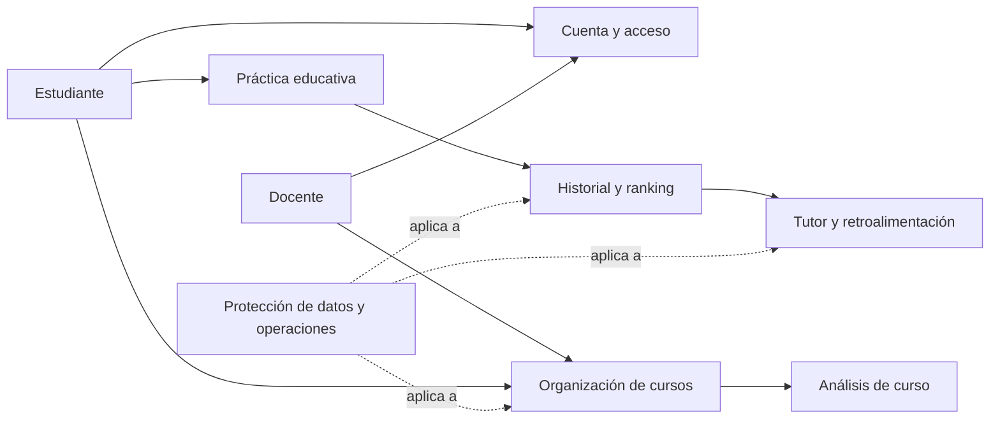

# Requisitos del sistema

Este documento organiza los requisitos educativos de CyberSim y enlaza su catálogo de historias de usuario. El **14 de octubre de 2026** se acordó con el usuario crear una serie nueva desde **HU001**. Los IDs se establecen aquí para el trabajo futuro; no se atribuyen retrospectivamente a los commits existentes.

Las historias se reconstruyen de las funciones y reglas revisadas en `cc0c9cb`. Sus criterios definen resultados verificables; el soporte observado se registra por separado. Esta documentación no certifica aceptación funcional ni corrige las brechas del sistema.

## Requisitos funcionales como HUs

El catálogo canónico, con actor, beneficio, criterios y evidencia, está en [historias de usuario](historias-de-usuario.md).

| Área | Historias | Resultado para el usuario |
|---|---|---|
| Cuenta y acceso | HU001–HU005 | Registro de estudiantes/docentes, confirmación, sesión y recuperación |
| Organización de cursos | HU006–HU009 | Gestión de grupos, invitaciones, matrícula y retiro |
| Práctica educativa | HU010–HU017 | Selección, oficina 3D, fases, dispositivos, activos, consola, redes y VPN |
| Seguimiento | HU018–HU019 | Historial de intentos y ranking del grupo |
| Asistencia y generación | HU020–HU024 | Tutor, audio, feedback, análisis de curso y desafíos dinámicos |
| Protección de actividad | HU025 | Acceso a datos y operaciones según identidad, rol y relación con el recurso |



El diagrama organiza necesidades del producto; la implementación y sus conexiones están en [el resumen de arquitectura](../architecture/resumen.md).

## Requisitos no funcionales

Son objetivos propuestos para evaluar calidad, no garantías ya alcanzadas ni compromisos institucionales aprobados. No se fijan cifras de rendimiento/disponibilidad sin medición y acuerdo.

| ID | Requisito | Criterio observable propuesto | Estado de la revisión |
|---|---|---|---|
| RNF001 | Protección de acceso | Identidad verificada y control de rol/propiedad en operaciones educativas; vinculado a HU025 | Parcial: protección localizada en dos rutas de auth |
| RNF002 | Integridad de actividad | Matrícula consistente ante concurrencia y guardado de intentos con confirmación y datos legibles | Pendientes de atomicidad, serialización y errores de guardado |
| RNF003 | Claridad ante fallos | El usuario reconoce fallo de guardado o integración y puede actuar sin duplicar actividad silenciosamente | Manejo desigual; no hay idempotencia general |
| RNF004 | Uso controlado de IA | Generación vinculada a cuenta y límites verificables; las salidas se validan antes de persistir/usarse | Sin cuotas por cuenta ni validación completa |
| RNF005 | Usabilidad y acceso a la práctica | Tutorial comprensible, navegación clara y carga adecuada en dispositivos del público objetivo | Recorridos UI probados con mocks; falta evaluación con audiencia real |
| RNF006 | Mantenibilidad documental | Arquitectura visual, procedimientos reproducibles, HUs/ADRs estables y enlaces al código | Base documental creada; debe actualizarse con cambios |
| RNF007 | Operación y recuperación | Configuración coherente, comprobación real de dependencias y restauración de datos ensayada | Procedimientos documentados; servicios/restauración reales no verificados |

El análisis detallado está en [riesgos de proyecto](riesgos-y-pendientes.md) y [revisión técnica](../architecture/revision-del-sistema.md). La política de privacidad, retención y responsables requiere definición del proyecto; no se declara cumplimiento legal a partir de estos objetivos.

## Trazabilidad y commits

Mantener el ID de una HU aunque cambie su título o se refine su criterio. No reutilizar IDs retirados ni renumerar historias porque cambie su prioridad. Agregar nuevas historias después de HU025.

Las [reglas funcionales](reglas-funcionales.md) describen el comportamiento actual con IDs RF; las HUs expresan necesidades y criterios. Cada historia vincula sus reglas para no duplicar especificaciones. Un ADR registra una decisión significativa que puede afectar varias HUs.

Para cambios futuros, elegir la HU realmente asociada al trabajo y respetar la skill `commit-message` del repositorio. Ejemplos de formato, no commits realizados:

```text
feat(front): HU010 improve scenario selection
fix(back): HU008 prevent concurrent duplicate enrollment
docs: document requirements and architecture
```

El scope, cuando corresponde, es `front`, `back` o `db`. Los cambios transversales pueden omitirlo. Los commits exclusivamente documentales usan `docs:` sin asociar artificialmente todo el catálogo a HU001. Referenciar una historia no declara que todos sus criterios estén completados; no incluir números/sufijos de tareas.

Los cinco commits disponibles al crear este catálogo no contienen IDs HU. No se reescribe Git ni se propone una correspondencia histórica por semejanza de títulos. Convenciones: [skill de mensajes](../../.agents/skills/commit-message/SKILL.md).
